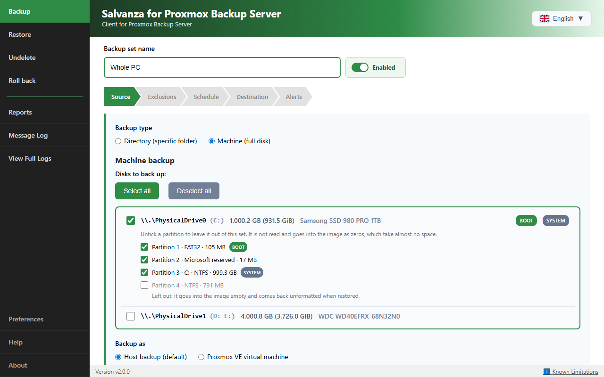
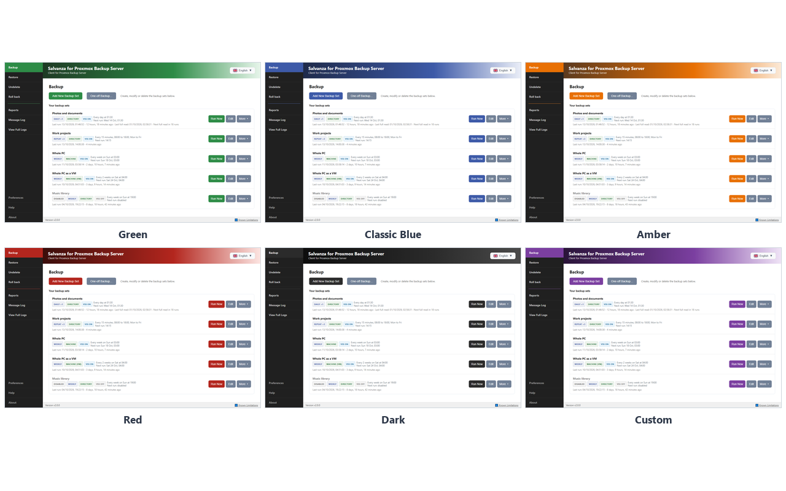
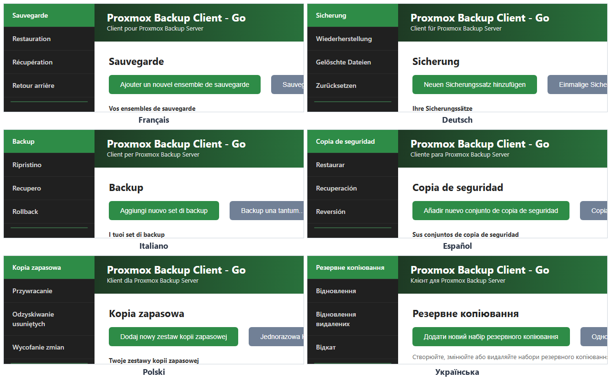

# Proxmox Backup Client: Windows- und Linux-Client für Proxmox Backup Server

[🇬🇧 English](README.md) · [🇫🇷 Français](README.fr.md) · [🇮🇹 Italiano](README.it.md) · [🇩🇪 Deutsch](README.de.md) · [🇪🇸 Español](README.es.md) · [🇷🇺 Русский](README.ru.md) · [🇨🇳 中文](README.zh.md) · [🇯🇵 日本語](README.ja.md) · [🇬🇷 Ελληνικά](README.el.md) · [🇷🇴 Română](README.ro.md) · [🇸🇪 Svenska](README.sv.md) · [🇸🇦 العربية](README.ar.md) · [🇮🇷 فارسی](README.fa.md)

> ℹ️ Dies ist eine Übersetzung der [englischen README](README.md). Wo sich beide unterscheiden, ist die englische Fassung aktuell.

> ⚠️ **Hinweis zu Marken und Zugehörigkeit.** Dies ist ein **unabhängiges Community-Projekt** und kein offizielles Proxmox-Produkt: Es ist **weder mit Proxmox Server Solutions GmbH verbunden noch von ihr unterstützt oder gesponsert**. **Proxmox®** ist eine eingetragene Marke der Proxmox Server Solutions GmbH in der EU, den USA und anderen Ländern und wird hier **ausschließlich** zur Beschreibung der Kompatibilität verwendet. Gemäß den Markenrichtlinien von Proxmox (eingetragene Marken dürfen nicht in Produkt- oder App-Namen verwendet werden, also zum Beispiel „XY App for Proxmox Virtual Environment“ statt „Proxmox XY App“) **wird der Client ohne Branding umbenannt**: Das Produkt, das derzeit *Proxmox Backup Client* heißt, erhält einen Namen, der die Marke Proxmox nicht enthält. Die genauen Regeln stehen im [Proxmox Media Kit](https://www.proxmox.com/en/about/company-details/media-kit).

[](LICENSE)
[](https://github.com/tizbac/proxmoxbackupclient_go/releases)
[](docs/manual/README.md)

**Proxmox Backup Client ist ein Open-Source-Sicherungsclient (GPL-3.0) für Proxmox Backup Server (PBS), für Windows und Linux.** Er sichert Ordner als durchsuchbare Dateiarchive und ganze Maschinen als bootfähige Datenträgerabbilder, nach Zeitplan oder bei Bedarf. Er stellt alles wieder her, von einer einzelnen Datei bis zur ganzen Maschine: auf demselben Computer, auf einem Ersatzgerät oder in einer virtuellen Maschine unter Proxmox VE.

Es handelt sich um eine **Sammlung von Werkzeugen**:

- **Proxmox Backup Client GUI** (ursprünglich von RDEM Systems als Nimbus Backup GUI entwickelt, von mjb-is überarbeitet und erweitert): die App für Windows und Linux. Sicherungssätze mit jeweils mehreren Zeitplänen, Ordner- und Datenträgersicherungen mit konsistenten Snapshots (VSS unter Windows, elastio-snap/dattobd unter Linux), Wiederherstellung von Dateien aus Ordner- und Maschinensicherungen, „Gelöschte Dateien wiederherstellen“ und „Zurücksetzen“, mehrere PBS-Server, clientseitige Verschlüsselung und ein Hintergrunddienst, damit Zeitpläne auch ohne angemeldeten Benutzer laufen.
- **`proxmoxbackup-directory`**: Ordnersicherungen (pxar) auf der Kommandozeile, mit Deduplizierung und Änderungserkennung.
- **`proxmoxbackup-machine`**: Live-Sicherungen ganzer Datenträger (fidx) von Windows- und Linux-Maschinen auf der Kommandozeile. Das Abbild ist nach einer Wiederherstellung bootfähig.
- **`proxmoxbackup-nbd`**: bindet eine Datenträgersicherung als NBD-Blockgerät ein (Linux).
- **Ein ISO für die Bare-Metal-Wiederherstellung** auf Basis von Clonezilla Live, mit einer geführten Wiederherstellung vom Einschalten bis zum Neustart.

> Schlüsselwörter: proxmox backup client windows · PBS-Client · Windows-VSS-Sicherung · unveränderliche Offsite-Sicherungen · physisch zu virtuell (P2V) · Bare-Metal-Wiederherstellung · Oberfläche für Proxmox Backup Server.

<a id="-new-in-20"></a>
## 🆕 Neu in 2.0

Version 2.0 übernimmt umfangreiche Arbeiten an der GUI, am Hintergrunddienst und an der Sicherungs-Engine in das Projekt (siehe [CHANGELOG](CHANGELOG.md)). Im Vergleich zu 1.2:

- **Die App verbindet sich mit Administratorrechten mit dem Hintergrunddienst.** Ist der Dienst installiert, gehören die PBS-Server und Sicherungssätze des Computers dem Dienst, und nur der Dienst liest seinen Einstellungsordner. Die App fragt einmal nach Administratorrechten, um sich zu verbinden (UAC unter Windows, pkexec unter Linux; bei einem Standardkonto Name und Kennwort eines Administrators). Nur ein kleines Hilfsprogramm läuft mit erhöhten Rechten, und die App hält das Token des Dienstes nur im Arbeitsspeicher. Wer die Abfrage nicht beantworten kann, wählt **Eigene Einstellungen verwenden** und behält seine eigenen Server und Sicherungssätze, die laufen, solange die App geöffnet ist; **Verbinden** bietet später an, sie in die des Computers zu kopieren. Die App selbst läuft ohne Administratorrechte und bietet **Als Administrator neu starten** an, wo ein Vorgang dies erfordert. Siehe Abschnitt 15 des [GUI-Handbuchs](docs/manual/GUI.md#connecting-to-the-background-service).
- **Die App prüft, ob sie wirklich mit dem Dienst spricht.** Bevor sie etwas an die lokale API des Dienstes sendet, prüft die App, wer antwortet: unter Windows der Prozess des Dienstes selbst, unter Linux ein Socket, der root gehört. Ein Programm, das den Port belegt, während der Dienst gestoppt ist, erhält nichts.
- **Sicherungssätze mit jeweils mehreren Zeitplänen**, von alle paar Minuten bis einmal jährlich (der letzte Tag des Monats, der 2. Dienstag), jeweils in Klartext beschrieben mit den nächsten 3 Ausführungen.
- **Inkrementelle Ordnersicherungen** mit der Änderungserkennung des offiziellen Clients (Modi Daten und Metadaten): Unveränderte Dateien werden nicht erneut gelesen.
- **Schnellere Maschinensicherungen**, die freien Speicher, die Auslagerungsdatei und die Ruhezustandsdatei überspringen und unlesbare Sektoren als Nullen schreiben, statt abzubrechen.
- **Mehrere Sicherungen gleichzeitig** (**Maximale Anzahl gleichzeitiger Sicherungen**, 1 bis 8, Standard 3), auch im Hintergrunddienst, jede mit eigenem Snapshot, eigenem Protokoll, Pause und Stoppen.
- **Geschwindigkeitsbegrenzungen** für das Hochladen zu PBS, das Herunterladen von PBS und das Lesen von Datenträgern, jeweils ein gemeinsames Budget für alles, was gleichzeitig läuft.
- **„Gelöschte Dateien wiederherstellen“ und „Zurücksetzen“** für Ordner- und Maschinen-Sicherungssätze, in der GUI und auf der Kommandozeile.
- **Dateien aus Maschinensicherungen**: NTFS-, FAT-, exFAT-, ext2/3/4- und XFS-Volumes in einem Datenträgerabbild durchsuchen und einzelne Dateien wiederherstellen.
- **Verschlüsselungsschlüssel, die Sie aufbewahren können**: eine Kopie speichern, einen Papierschlüssel mit QR-Code drucken und einen Schlüssel aus einer Datei, über die Kamera, aus einem Foto oder als eingetippten Text importieren.
- **Maschinen-Sicherungssätze erkennen ihre Datenträger an deren Identität**, sodass ein Datenträger, der nach einer Hardwareänderung eine neue Nummer erhält, weiterhin derjenige ist, der gesichert wird, und ein fehlender Datenträger die Ausführung scheitern lässt, statt dass ein anderer Datenträger gesichert wird.
- **Partitionen können von einer Maschinensicherung ausgenommen werden**: Haken Sie unter jedem Datenträger die zu sichernden Partitionen an. Eine ausgenommene Partition wird weder gelesen noch in den Snapshot aufgenommen und landet als Nullen im Abbild, sodass eine Wiederherstellung sie an ihrer Stelle und in ihrer Größe zurückgibt, leer und unformatiert. Die Datenträgerauswahl kennzeichnet die Partitionen, die ein wiederhergestellter Datenträger zum Starten braucht.
- **Linux-Maschinensicherungen mit elastio-snap oder dattobd.** Ein Linux-Maschinen-Sicherungssatz kann Snapshots abschalten und Datenträger live lesen, aber nur, wenn sein Besitzer ankreuzt, dass er eine möglicherweise inkonsistente Sicherung akzeptiert.
- **Jeder Benutzer kann sein eigenes Farbschema wählen**, in der App ohne Branding. Eine App mit Branding behält die Farben ihrer Marke.
- **Einen Sicherungssatz aktivieren und deaktivieren**, im Editor ebenso wie im Menü, und eine Warnung beim Speichern, wenn ein Satz so, wie er gespeichert ist, nicht laufen würde (deaktiviert, kein Zeitplan eingeschaltet, ein Snapshot-Problem, ein fehlender Datenträger).
- **Linux-Pakete** (`.deb`, `.rpm` und Arch), Paket- und Dienstname `proxmoxbackupclient`, mit dem Hintergrunddienst.
- **Ein geführtes ISO für die Bare-Metal-Wiederherstellung**, das auch in eine leere virtuelle Maschine wiederherstellt (P2V). Eine Maschine, die als virtuelle Maschine von Proxmox VE gesichert wurde, lässt sich in Proxmox VE auch direkt aus PBS wiederherstellen, wie jede VM, die Proxmox VE selbst gesichert hat.
- **Builds mit Branding**: Dieselben Binärdateien werden als Installer für Proxmox Backup Client, Nimbus Backup, Acme Backup und Etitech Backup ausgeliefert.
- **18 Sprachen für die Oberfläche.**

## ⭐ Was er leistet, mit gemessenen Ergebnissen

| | Ergebnis |
|---|---|
| **Inkrementelle Ordnersicherungen** | Eine Dateifreigabe mit 480,9 GB in 761.866 Dateien: erster Lauf 4 h 17 min, jeder weitere Lauf 10 bis 15 Minuten. Unveränderte Dateien werden nicht einmal geöffnet (Änderungserkennung Metadaten, wie beim offiziellen Client). |
| **Schnelle Maschinensicherungen** | Freier Speicher, die Auslagerungsdatei und die Ruhezustandsdatei werden nicht gelesen, und leerer Speicherplatz wird nicht gehasht. Die 1-TB-Festplatte eines Laptops mit 373 GB Belegung brauchte vorher 1 h 23 min bis 1 h 44 min, jetzt nur noch 38 Minuten. |
| **Langsame und volumenbegrenzte Verbindungen** | Nur neue Daten werden gesendet, komprimiert, und die App zeigt, was tatsächlich über das Netzwerk ging. Ein kleiner Linux-PC an einem entfernten Standort mit 4G-Verbindung (4,8 Mbit/s im Upload): sein gesamtes 128-GB-Datenträgerabbild plus sein Home-Ordner in 11 Minuten, bei etwa 172 MiB Übertragung. |
| **Dateien aus Maschinensicherungen** | Das 127-GB-Laufwerk C: eines Laptops mit 430.000 Dateien wird in 4 bis 15 Sekunden aufgelistet. Vorher wird nichts eingebunden oder heruntergeladen. |
| **Bare-Metal-Wiederherstellung** | ISO booten (USB-Stick, CD oder Netzwerk), PBS-Daten eingeben, Sicherung auswählen: Eine Windows-Maschine mit 32 GB war 8 Minuten nach dem Einschalten wieder am Anmeldebildschirm. |
| **Gelöschte Dateien wiederherstellen** | Nachdem 39 GB aus einer Freigabe mit 761.000 Dateien gelöscht worden waren, fand eine Suche mit „Gelöschte Dateien wiederherstellen“ über die Sicherungen der letzten 7 Tage genau diese Dateien in etwa einer Minute und stellte sie zurück. |
| **Wiederherstellungstreue** | NTFS-Berechtigungen, Attribute, alternative Datenströme, erweiterte Attribute, Erstellungszeiten und Ordnerzeiten unter Windows; Modi, Besitzer, ACLs, erweiterte Attribute und symbolische Links unter Linux. |

## 📖 Benutzerhandbücher

| Handbuch | Inhalt |
|---|---|
| **[GUI-Handbuch](docs/manual/GUI.md)** | Installation, PBS-Server, Sicherungssätze und Zeitpläne, inkrementelle Sicherungen, Fortschritt, Wiederherstellung, Gelöschte Dateien wiederherstellen, Zurücksetzen, Berichte, Protokolle, Einstellungen, der Hintergrunddienst, Fehlerbehebung |
| **[Kommandozeilen-Handbuch](docs/manual/CLI.md)** | `proxmoxbackup-directory`, `proxmoxbackup-machine`, `proxmoxbackup-nbd`: alle Optionen, Konfigurationsdateien, Exit-Codes, Zeitplanung; Gelöschte Dateien wiederherstellen und Zurücksetzen auf der Kommandozeile |
| **[Handbuch zur Bare-Metal-Wiederherstellung](docs/manual/BMR.md)** | Das Wiederherstellungs-ISO Schritt für Schritt; `vm`-Sicherungen in Proxmox VE; physisch zu virtuell; abweichende Hardware |
| [Wiederherstellungsszenarien](docs/RESTORE_GUIDE.md) | Welche Wiederherstellung wann |
| [Handbuchübersicht](docs/manual/README.md) | Ein Überblick über die Handbücher |

Dieselben Handbücher sind in die App eingebaut (**Hilfe**, F1), funktionieren also offline und passen zur installierten Version.

<a id="-download"></a>
## 📦 Download

👉 **[Neueste Version herunterladen](https://github.com/tizbac/proxmoxbackupclient_go/releases)**

| Sie haben | Verwenden Sie |
|---|---|
| Windows | Den **MSI-Installer**, `ProxmoxBackupClient-<version>.msi`. Er installiert die App und den Hintergrunddienst unter Program Files, startet den Dienst und fügt einen Eintrag im Startmenü hinzu. Die Installer mit Branding (`NimbusBackup-<version>.msi`, `AcmeBackup-<version>.msi`, `EtitechBackup-<version>.msi`) sind derselbe Build unter einer anderen Marke |
| Debian, Ubuntu, Mint | `sudo apt install ./proxmoxbackupclient_<version>_amd64.deb` |
| Fedora | `sudo dnf install ./proxmoxbackupclient-<version>-*.rpm` |
| Arch | Das aus [packaging/arch/PKGBUILD](packaging/arch/PKGBUILD) gebaute Paket (`make pkgarch`) |
| Nur die Kommandozeile | Die Archive je Plattform (`proxmoxbackup-cli-*` und `proxmoxbackupclient_go_*`) |
| Eine Maschine zum Wiederherstellen | Das ISO für die Bare-Metal-Wiederherstellung ([Handbuch zur Bare-Metal-Wiederherstellung](docs/manual/BMR.md#3-get-the-iso-and-make-the-boot-media)), oder bauen Sie es selbst ([siehe unten](#-bare-metal-restore-iso)) |

Enthält eine Version kein Linux-Paket, bauen Sie es mit `make deb`, `make pkgfedora` oder `make pkgarch` ([BUILD.md](BUILD.md), [packaging/debian/README.md](packaging/debian/README.md)).

Die Linux-Pakete installieren einen einzigen Menüeintrag, **Proxmox Backup Client**, der die App unter Ihrem Benutzer startet. Eine Neuinstallation schaltet den Hintergrunddienst (`proxmoxbackupclient.service`) ein; ein Upgrade behält Ihre bisherige Wahl bei. Die Pakete benötigen polkit (pkexec), das die App für die Verbindung zum Dienst verwendet.

> ⚠️ **Windows meldet „Virus erkannt“ (z. B. `Trojan:Win32/Sabsik.FL.A!ml`) oder zeigt eine SmartScreen-Warnung?**
> Das ist ein **bekannter Fehlalarm** bei Go/Wails-Anwendungen: Es ist *kein* Virus. Die Endung `!ml` steht für eine Erkennung durch ein Machine-Learning-Modell, das *unsignierte und seltene* ausführbare Dateien markiert. Prüfen Sie den Download wie unten beschrieben.

### 🔎 Einen Download prüfen

Jede Version liefert SHA-256-Prüfsummen (`SHA256SUMS.txt`, auch auf der Release-Seite angegeben) und eine **signierte Herkunftsbescheinigung** (Provenance Attestation): den kryptografischen Nachweis, dass die Datei von der CI dieses Repositorys aus einem bestimmten Commit erzeugt wurde.

```powershell
Get-FileHash .\ProxmoxBackupClient-<version>.msi -Algorithm SHA256   # compare with SHA256SUMS.txt
gh attestation verify .\ProxmoxBackupClient-<version>.msi --repo tizbac/proxmoxbackupclient_go
```

Unter Linux: `sha256sum -c SHA256SUMS.txt --ignore-missing`.

Wenn die Installer einer Version bei VirusTotal ohne Befund bleiben, verlinkt die Release-Seite die Berichte.

> ℹ️ **Codesignatur:** Die Windows-Binärdateien sind **noch nicht mit Authenticode signiert** (ein OSS-Zertifikat über die [SignPath Foundation](https://signpath.org) ist beantragt). Bis dahin wird die Herkunft über die Bescheinigung und die Prüfsummen oben nachgewiesen.

## 🚀 Schnellstart (GUI)

1. Installieren Sie ihn: das MSI unter Windows, das `.deb`-, `.rpm`- oder Arch-Paket unter Linux ([Download](#-download)).
2. Starten Sie **Proxmox Backup Client**. Die Installer richten den Hintergrunddienst ein, daher fragt die App einmal nach Administratorrechten, um sich mit ihm zu verbinden (UAC unter Windows, Ihr Kennwort über pkexec unter Linux). Wenn Sie diese nicht erteilen können, wählen Sie **Eigene Einstellungen verwenden**.
3. Fügen Sie Ihren PBS-Server unter **Einstellungen > Kontoinformationen** hinzu und prüfen Sie ihn mit **Testen**.
4. Legen Sie einen Sicherungssatz an (oder eine einmalige Sicherung) und wählen Sie die zu sichernden Ordner oder Datenträger aus.
5. Führen Sie ihn aus. Mit dem Hintergrunddienst laufen seine Zeitpläne, ob jemand angemeldet ist oder nicht.

Das [GUI-Handbuch](docs/manual/GUI.md) erklärt jeden Schritt.

### 🪟 Unbeaufsichtigte / stille Installation (MSI)

Das MSI unterstützt den üblichen Schalter für die stille Installation von Windows Installer sowie öffentliche Eigenschaften für jede Voreinstellung:

```powershell
# Silent install with the defaults (service: Automatic + started)
msiexec /i ProxmoxBackupClient-<version>.msi /quiet

# Silent install that installs the service but does NOT enable/autostart it
# (created as Manual and left stopped)
msiexec /i ProxmoxBackupClient-<version>.msi /quiet SERVICEAUTOSTART=0

# Silent install that also applies a settings file exported from another computer
msiexec /i ProxmoxBackupClient-<version>.msi /quiet CONFIGFILE="C:\Deploy\settings.json"

# Custom directory + verbose install log
msiexec /i ProxmoxBackupClient-<version>.msi /quiet INSTALLFOLDER="D:\Apps\ProxmoxBackupClient" /L*v "C:\Temp\install.log"

# Silent uninstall (KEEP_CONFIG=0 also purges %ProgramData%\<name>)
msiexec /x ProxmoxBackupClient-<version>.msi /quiet KEEP_CONFIG=0
```

| Eigenschaft | Standard | Bedeutung |
| --- | --- | --- |
| `SERVICEAUTOSTART` | `1` | `0` = Dienst mit Starttyp **Manuell** installiert und **beendet** gelassen: installiert, aber nie aktiviert oder automatisch gestartet |
| `AUTOSTART` | `1` | `0` = die App bei der Anmeldung eines Benutzers nicht im Infobereich starten |
| `DESKTOPSHORTCUTS` | `1` | `0` = keine Desktopverknüpfung (der Eintrag im Startmenü wird immer angelegt) |
| `CONFIGFILE` | | Vollständiger Pfad einer mit **Einstellungen > Einstellungen exportieren...** gespeicherten Datei: Ihre PBS-Server und Sicherungssätze werden vor dem Start des Dienstes übernommen. Sicherungs-IDs, die aus dem Namen des exportierenden Computers gebildet wurden, werden aus dem Namen des jeweiligen Computers gebildet. Siehe [installer/DEPLOYMENT.md](installer/DEPLOYMENT.md) |
| `KEEP_CONFIG` | `1` | Nur bei der Deinstallation: `0` = auch das Statusverzeichnis `%ProgramData%\<name>` löschen |
| `INSTALLFOLDER` | `Program Files` | Installationsverzeichnis (auch in der Oberfläche änderbar) |

Mit erhöhten Rechten (Administrator) ausführen; Exit-Code `0` = Erfolg, `3010` = Erfolg + Neustart erforderlich. Die MSIs mit Branding nehmen genau dieselben Schalter an.

## ✨ Funktionen

### GUI
Die wichtigsten Funktionen stehen unter [Neu in 2.0](#-new-in-20). Außerdem:
- 18 Sprachen für die Oberfläche: Französisch, Englisch, Italienisch, Deutsch, Polnisch, Spanisch, Bulgarisch, Tschechisch, Griechisch, Ungarisch, Lettisch, Litauisch, Niederländisch, Portugiesisch, Rumänisch, Slowakisch, Türkisch und Ukrainisch
- **Einmalige Sicherungen** von Ordnern oder ganzen Datenträgern, und Maschinensicherungen, die als `host` oder als `vm`-Sicherung von Proxmox VE gespeichert werden, mit der Option **Forensische Kopie**, die auch freien Speicher liest
- **Wiederherstellung** mit Dateisuche (Platzhalter, reguläre Ausdrücke, vollständige Pfade), selektiver Wiederherstellung, NTFS-/POSIX-ACLs, alternativen Datenströmen, Windows-Erstellungszeiten und einem optionalen Prüfdurchlauf
- **Pause, Fortsetzen und Stoppen** einer laufenden Sicherung, auch über den Infobereich unter Windows und für Läufe des Hintergrunddienstes
- Live-Fortschrittsanzeige (voraussichtliches Ende, erledigte Dateien, Upload-Geschwindigkeit, übertragene Daten, Kompressionsrate), **Berichte**, ein **Meldungsprotokoll** und **Vollständige Protokolle anzeigen**
- E-Mail-Benachrichtigungen, Aktionen nach der Sicherung, Klonen von Sicherungssätzen, Export und Import der Einstellungen
- Mehrere PBS-Server, mit Pinning des Zertifikats-Fingerprints (Vertrauen bei erster Verwendung), Anmeldung per API-Token oder mit Benutzer und Kennwort
- Fünf Farbschemata und eine eigene Farbe, von jedem Benutzer selbst gewählt (in der App ohne Branding; eine App mit Branding behält die Farben ihrer Marke)

### Kommandozeilenwerkzeuge
- `proxmoxbackup-directory`: Ordnersicherungen (pxar) mit Deduplizierung und `-change-detection-mode legacy|data|metadata`
- `proxmoxbackup-machine`: Live-Sicherungen ganzer Datenträger von Windows- (VSS) und Linux-Maschinen (elastio-snap/dattobd) (fidx, inkrementell, freier Speicher wird übersprungen, außer mit `-readfreespace`, `-type vm` für eine Proxmox VE-Sicherung, `-skippartition <disk>:<number>`, um eine Partition auszunehmen)
- `proxmoxbackup-nbd`: NBD-Server zum Wiederherstellen von Datenträgersicherungen (Linux)
- `ProxmoxBackupClientSVC` (Windows) und `proxmoxbackupclient` (Linux-Pakete): `-list-sets`, `-undelete` und `-rollback` für in der GUI definierte Sicherungssätze

Die ersten drei nehmen `-keyfile` und `-keyfile-passphrase` für verschlüsselte Snapshots an. Vollständige Referenz: [Kommandozeilen-Handbuch](docs/manual/CLI.md).

### 📸 Bildschirmfotos

<table>
<tr>
<td width="33%">

[](docs/screenshots/gui-backup-sets.png)
**Sicherungssätze**: benannte Aufträge mit Zeitplan- und Typ-Kennzeichen, „Jetzt ausführen“ bei jedem

</td>
<td width="33%">

[](docs/screenshots/gui-backup-progress.png)
**Sicherungsfortschritt**: Durchsatz, voraussichtliches Ende, neue und wiederverwendete Chunks

</td>
<td width="33%">

[](docs/screenshots/gui-restore.png)
**Wiederherstellung**: PBS-Server und Sicherungs-ID wählen, Snapshots auflisten oder nach Dateinamen durchsuchen

</td>
</tr>
<tr>
<td width="33%">

[](docs/screenshots/gui-schedule-tab.png)
**Zeitpläne**: mehrere pro Satz, mit den nächsten 3 Ausführungen

</td>
<td width="33%">

[](docs/screenshots/backup-set-as-vm.png)
**Sicherung als Proxmox VE-VM**: Die PBS-Sicherungs-ID wird schon beim Tippen angezeigt

</td>
<td width="33%">

[](docs/screenshots/gui-reports.png)
**Berichte**: vollständiger Verlauf der Läufe mit einem Detailbereich

</td>
</tr>
<tr>
<td width="33%">

[](docs/screenshots/gui-machine-partitions.png)
**Maschinen-Sicherungssätze**: die zu sichernden Partitionen unter jedem Datenträger anhaken

</td>
<td width="33%">

[](docs/screenshots/gui-themes.png)
**Farbschemata**: sechs Farbschemata, von jedem Benutzer selbst gewählt

</td>
<td width="33%">

[](docs/screenshots/gui-languages.png)
**Sprachen**: 18, hier Französisch, Deutsch, Italienisch, Spanisch, Polnisch und Ukrainisch

</td>
</tr>
</table>

### Intelligente Systemausschlüsse (Ordnersicherungen)
Ordnersicherungen lassen Folgendes von selbst aus:

**Systemordner:** `System Volume Information` (VSS-Speicher, kann über 100 GB erreichen) und `$RECYCLE.BIN`, wo immer sie liegen; `Recovery` nur im Stammverzeichnis eines Laufwerks; `.pbs-rollback` (der Sicherheitsordner von „Zurücksetzen“).
**Systemdateien:** `pagefile.sys`, `hiberfil.sys`, `swapfile.sys` und `DumpStack.log.tmp`.

**Warum das wichtig ist:** Ein Laufwerk kann 1,03 TB belegt anzeigen, während die echten Dateien ~141 GB groß sind. Ohne Ausschlüsse würde die Sicherung die VSS-Snapshots enthalten (verschwendeter Platz und verschwendete Zeit); mit ihnen entspricht die Größe den tatsächlichen Daten.

**Empfehlung:** Verwenden Sie eine **Ordnersicherung** für Sicherungen auf Dateiebene; verwenden Sie eine **Maschinensicherung** in einem eigenen Sicherungssatz für Bare-Metal-Wiederherstellung und P2V (ein Abbild des ganzen Datenträgers, in dem freier Speicher sowie Auslagerungs- und Ruhezustandsdatei als Nullen landen).

### Sicherheit und Qualität
- Der Einstellungsordner des Dienstes ist nur für SYSTEM und Administratoren (Windows) bzw. nur für root (Linux) zugänglich; seine lokale API lauscht auf 127.0.0.1 und verlangt ein Token, das bei jedem Start und alle 24 Stunden ersetzt wird
- Die App sendet nichts an diese API, bevor sie geprüft hat, dass der Dienst selbst antwortet (unter Windows der Prozess des Dienstes, unter Linux ein Socket, der root gehört)
- Unter Windows werden PBS-Tokens und -Kennwörter in `config.json` für den Computer verschlüsselt (DPAPI)
- Eingabevalidierung, Bereinigung von Zugangsdaten, Schutz vor Path Traversal, Wiederholungen mit exponentiellem Backoff
- Unit-Tests in jedem Modul, dazu optionale Live-Tests und End-to-End-Tests gegen einen echten PBS

## 🔐 Clientseitige Verschlüsselung

Snapshots können verschlüsselt werden, bevor sie die Maschine verlassen, mit einer Schlüsseldatei von Proxmox Backup Server (dem Format, das `proxmox-backup-client key create` schreibt, sodass Schlüssel mit dem offiziellen Client austauschbar sind). Jeder Chunk wird mit AES-256-GCM verschlüsselt und das Manifest wird signiert. Der PBS-Server sieht den Schlüssel nie.

**GUI:** Öffnen Sie **Einstellungen > Kontoinformationen**, bearbeiten Sie einen Server und verwenden Sie dessen Registerkarte **Verschlüsselung**. Mit **Importieren...** übernehmen Sie einen vorhandenen Schlüssel (eine Kopie der Schlüsseldatei oder einen Papierschlüssel, gelesen mit der Kamera, aus einem Scan oder Foto, oder eingetippt), mit **Generieren...** erzeugen Sie einen neuen. Die Registerkarte zeigt den Fingerprint des Schlüssels. Mit **Kopie speichern…** und **Papierschlüssel drucken…** (mit QR-Code) bewahren Sie eine Kopie getrennt vom Computer auf. Die Berichte zeigen, ob jede Sicherung verschlüsselt war. **Ohne die Schlüsseldatei lässt sich ein Snapshot nicht wiederherstellen: Bewahren Sie eine Kopie an einem sicheren Ort auf, getrennt von dieser Maschine.**

**Schlüssel mit Passphrase (scrypt oder PBKDF2):** **Nachfragen** hält die Passphrase für eine Sitzung der App im Arbeitsspeicher; **Auf diesem Computer merken** speichert sie wie das PBS-Token und ist die richtige Wahl für Zeitpläne und den Hintergrunddienst.

**Kommandozeile:**
```shell
proxmoxbackup-directory.exe -baseurl ... -backupdir "C:\data" -datastore store -keyfile "C:\keys\pbs-key.json" -keyfile-passphrase "..."
```
`-keyfile-passphrase` (oder `PBS_ENCRYPTION_PASSWORD`) wird nur für einen geschützten Schlüssel benötigt; fehlt die Angabe, wird die Passphrase abgefragt. `proxmoxbackup-machine` und `proxmoxbackup-nbd` nehmen dieselben Optionen an. `proxmoxbackup-nbd` prüft den Schlüssel gegen den Snapshot, bevor es das NBD-Gerät anfasst, sodass ein falscher Schlüssel sofort scheitert.

**Bare-Metal-Wiederherstellung:** Das Wiederherstellungs-ISO fragt nach dem Schlüssel (keiner, eine Schlüsseldatei auf einem USB-Stick oder ein eingetippter Pfad) und nach der Passphrase eines geschützten Schlüssels. Der Schlüssel wird nie auf das ISO geschrieben.

Zum Wiederherstellen eines verschlüsselten Snapshots ist dieselbe Schlüsseldatei nötig; geht sie verloren, gibt es keine Rettung.

## Schnellere Ordnersicherungen: Änderungserkennung

Im Standardmodus Klassisch liest jede Ordnersicherung jede Datei, sodass ein Lauf so lange dauert wie das Lesen des ganzen Ordners, auch wenn sich nichts geändert hat. Sicherungssätze und `proxmoxbackup-directory` können stattdessen die Modi der Änderungserkennung des offiziellen `proxmox-backup-client` verwenden:

| Modus | Liest | Gespeichert als |
|---|---|---|
| **Klassisch** (Legacy, Standard) | jede Datei | ein `<name>.pxar.didx` pro Ordner |
| **Daten** (Data) | jede Datei | ein geteiltes Archiv: `<name>.mpxar.didx` (Metadaten) + `<name>.ppxar.didx` (Dateiinhalte) |
| **Metadaten** (Metadata) | nur neue und geänderte Dateien | dasselbe geteilte Archiv; Dateien, deren Größe, Änderungszeit (auf die Nanosekunde), Modus und Besitzer mit der vorherigen Sicherung übereinstimmen, werden ungelesen aus ihr übernommen |

Im Modus **Metadaten** liest der erste Lauf alles; spätere Läufe lesen nur, was sich geändert hat. Eine Datei, die so geändert wurde, dass Größe und Änderungszeit gleich bleiben, wird nicht bemerkt; deshalb kann ein Satz auch **alle N Läufe alle Dateien neu lesen**. Geben Sie jedem Sicherungssatz seine eigene Sicherungs-ID: Der Modus Metadaten vergleicht mit dem neuesten Snapshot der Sicherungsgruppe. Auf der Kommandozeile verwenden Sie `-change-detection-mode`.

**Bevor Sie einen Satz auf Daten oder Metadaten umstellen,** aktualisieren Sie jede Maschine, auf der Sie wiederherstellen, auf 2.0: Frühere Versionen zeigen die Ordner eines geteilten Archivs ohne ihre Dateien. Siehe [Abschnitt 7 des GUI-Handbuchs](docs/manual/GUI.md#7-incremental-folder-backups-change-detection).

<a id="-physical-machines-into-virtual-machines-p2v"></a>
## 🔄 Physische Maschinen in virtuelle Maschinen (P2V)

Die Maschinensicherung eines physischen PCs oder Servers kann auf zwei Wegen zu einer virtuellen Maschine unter Proxmox VE werden:

1. **In Proxmox VE wiederherstellen.** Stellen Sie den Sicherungssatz (oder die einmalige Sicherung) auf **Sichern als: Virtuelle Maschine von Proxmox VE**. Die Sicherung wird als `vm/<number>` gespeichert, sodass Proxmox VE sie bei seinen anderen VM-Sicherungen auflistet und als VM wiederherstellt (ein SATA-Datenträger; fügen Sie vor dem Start eine Netzwerkkarte hinzu).
2. **Mit dem Wiederherstellungs-ISO in eine leere VM wiederherstellen**, mit derselben Firmware wie die ursprüngliche Maschine, einem mindestens ebenso großen SATA-Datenträger und einer Intel-E1000-Netzwerkkarte. Das funktioniert für `host`- und `vm`-Sicherungen gleichermaßen, und dieselbe Sicherung lässt sich weiterhin auch auf Bare Metal wiederherstellen.

Zu den getesteten Wegen gehören Windows 10 und Windows Server (UEFI/GPT), Linux-Desktops (UEFI/GPT und BIOS/MBR) und eine verschlüsselte Linux-Sicherung mit dem Schlüssel auf einem USB-Stick. Das [Handbuch zur Bare-Metal-Wiederherstellung](docs/manual/BMR.md#7-restoring-onto-different-hardware-p2v-and-replacement-machines) enthält die vollständige Tabelle, die Firmware-Optionen, Treiber und Schritt-für-Schritt-Anleitungen.

## 🤝 Kompatibel mit dem offiziellen Proxmox-Client, in beide Richtungen

Geprüft mit `proxmox-backup-client` 3.4.9 und PBS 4.2:

- **Snapshots in den Modi Klassisch, Daten und Metadaten, die mit diesem Client erstellt wurden, lassen sich mit dem offiziellen Client bytegenau wiederherstellen**, ob sie über die GUI oder die Kommandozeile, unter Windows oder Linux erstellt wurden, und der Dateibrowser von PBS 4.2 öffnet sie.
- **Snapshots in den Modi Klassisch, Daten und Metadaten, die mit dem offiziellen Client erstellt wurden, lassen sich mit diesem Client bytegenau wiederherstellen**, vollständig oder selektiv.
- Dasselbe geteilte Archivformat (pxar Version 2), dieselben Modi der Änderungserkennung, dasselbe Format der Schlüsseldatei, dieselben Umgebungsvariablen im Stil von `PBS_REPOSITORY`.

Ihre Sicherungen sind nie an diesen Client gebunden. Das einzige Extra ist eine kleine Datei im Stammverzeichnis eines Ordner-Snapshots, `.proxmox_backup_client_meta.json` (der ursprüngliche Pfad), die der offizielle Client als gewöhnliche Datei wiederherstellt.

## Live-Sicherung der ganzen Maschine

`proxmoxbackup-machine` (und die Maschinensicherungen der GUI) sichern ein vollständiges Windows 10/11 oder Windows Server oder eine Linux-Maschine ohne jede Ausfallzeit.

Die Befehlssyntax ist weitgehend dieselbe wie bei Ordnersicherungen, nur wird `-backupdir` durch `-backupdev` ersetzt (für mehrere Datenträger wiederholen). Zum Beispiel:

`proxmoxbackup-machine.exe -authid yourapikey -backupdev \\.\PhysicalDrive0 -baseurl https://yourpbs:8007 -certfingerprint xx:xx:xx... -datastore zfs -secret L4m3r -backup-id testfull1`

Der obige Befehl betrachtet Datenträger 0, erkennt alle eingebundenen Partitionen, erstellt einen VSS-Snapshot davon und legt dann ein bootfähiges Sicherungsabbild des ganzen Datenträgers als fidx an. Freier Speicher sowie Auslagerungs- und Ruhezustandsdatei landen ungelesen als Nullen im Abbild (unter Linux auch der freie Speicher von ext2/3/4 und XFS); `-readfreespace` liest stattdessen alles, für eine forensische Kopie. Ein Sektor, der sich nicht lesen lässt, landet als Nullen im Abbild, und der Lauf meldet, wo. Fügen Sie `-type vm` (mit einer numerischen `-backup-id`) hinzu, um die Sicherung als VM-Sicherung von Proxmox VE zu speichern ([P2V](#-physical-machines-into-virtual-machines-p2v)).

Die nächste Sicherung ist inkrementell. Das Hashing ist parallelisiert, sodass Geschwindigkeiten von 1 GB/s erreicht werden können.

Um eine Partition auszunehmen, etwa eine Spielebibliothek oder eine Datenpartition, die bereits durch eine Ordnersicherung abgedeckt ist, fügen Sie `-skippartition <disk>:<number>` hinzu (für mehrere wiederholen), etwa `-skippartition \\.\PhysicalDrive0:4` oder `-skippartition /dev/sda:3`. Die Partition wird weder gelesen noch in den Snapshot aufgenommen und landet als Nullen im Abbild: Die Partitionstabelle bleibt erhalten, sodass eine Wiederherstellung die Partition an ihrer Stelle und in ihrer Größe zurückgibt, leer und unformatiert. In der GUI entfernen Sie im Sicherungssatz den Haken bei der Partition unter ihrem Datenträger.

### Voraussetzungen für Linux-Maschinensicherungen (VSS-Entsprechung)

Die Maschinensicherung unter Windows nutzt VSS. Linux hat kein VSS, daher braucht die Maschinensicherung eines laufenden Linux-Hosts das Kernelmodul `elastio-snap` (ein Fork von `dattobd`), um einen zeitpunktgenauen Snapshot des Blockgeräts zu erstellen, während darauf geschrieben wird. `dattobd` selbst funktioniert ebenfalls, wenn es bereits geladen ist.

Das ursprüngliche Repository `elastio/elastio-snap` ist archiviert und lässt sich auf aktuellen Kerneln nicht mehr bauen. Verwenden Sie den gepflegten Fork [`Axcient/elastio-snap`](https://github.com/Axcient/elastio-snap) (Branch `develop`). Version 0.12.11 dieses Forks ließ sich unter Debian 13 mit Kernel 6.12 bauen und lief dort. Das `.deb` schlägt das Paket `elastio-snap-dkms` vor.

Zwei Dinge sind erforderlich, sonst verweigert eine Linux-Maschinensicherung den Start:

1. **Das Kernelmodul muss installiert und geladen sein.** Bau aus dem Quellcode:
   ```bash
   sudo apt-get install linux-headers-$(uname -r) build-essential   # Debian/Ubuntu
   git clone --depth 1 https://github.com/Axcient/elastio-snap.git
   cd elastio-snap
   sudo make
   sudo make install
   sudo depmod -a      # `make install` does not run depmod, and modprobe fails without it
   sudo modprobe elastio-snap
   lsmod | grep elastio_snap
   ```
   Damit wird es nur für den aktuellen Systemstart geladen. Legen Sie einen Eintrag in `/etc/modules-load.d/` an, um es bei jedem Start zu laden. Die eigene [INSTALL.md](https://github.com/Axcient/elastio-snap/blob/develop/INSTALL.md) des Projekts beschreibt die Installation aus Paketen.

2. **Die Sicherung muss als root laufen.** Die Steuerschnittstelle des Moduls ist nur für root zugänglich, und für einen normalen Benutzer wird der Snapshot verweigert. Der Hintergrunddienst läuft als root; ohne ihn verwenden Sie **Als Administrator neu starten** in der App oder führen `proxmoxbackup-machine` mit `sudo` aus. Eine einfache Ordnersicherung braucht kein root.

In der GUI kann ein Linux-Maschinen-Sicherungssatz **Snapshots verwenden** abwählen und seine Datenträger live lesen, aber nur, wenn das zweite Kästchen angekreuzt ist („Ohne Snapshot ausführen: Ich akzeptiere, dass die Sicherung inkonsistent sein kann“). Ohne dieses hält jeder Lauf an und nennt den Grund. Nicht eingebundene Partitionen werden direkt gelesen.

### Dateien aus einer Datenträgersicherung wiederherstellen

Die Seite Wiederherstellung der GUI öffnet eine Maschinensicherung wie eine Ordnersicherung: Jedes Volume im Abbild (NTFS, FAT, exFAT, ext2/3/4 oder XFS) ist ein Ordner, den Sie durchsuchen und aus dem Sie wiederherstellen können. Es wird nichts eingebunden.

Unter Linux können Sie eine Datenträgersicherung mit dem nbd-Werkzeug auch als Blockgerät einbinden. Führen Sie zuerst `modprobe nbd max_part=0` aus: Mit `max_part != 0` kann der Kernel beim Abtasten der Partitionen in eine Endlosschleife geraten.

Das NBD-Werkzeug verbindet jede Sicherung eines festen Datenträgers, ob VM- oder Host-Sicherung (es funktioniert also auch für Sicherungen von Proxmox VE). Zum Beispiel:

`./proxmoxbackup-nbd -authid 'apikey' -baseurl https://yourpbs:8007 -secret 'yoursecret' -certfingerprint 'aa:...:xx' -datastore test -namespace test1 -path "vm/107/2025-08-02T23:13:01Z/drive-virtio0.img.fidx"`

Wenn Sie `-path` weglassen, können Sie die fidx-Datei in einer Textoberfläche auswählen; `-list` gibt stattdessen alle Abbilder aus.

> Verwenden Sie dies nicht auf einer Maschine, auf der etwas Wichtiges läuft: Ein beschädigtes Dateisystem kann das Betriebssystem zum Absturz bringen, weshalb Proxmox VE dafür eine QEMU-Instanz verwendet.

Hängen Sie alles auf dem nbd-Datenträger aus, bevor Sie `proxmoxbackup-nbd` beenden, sonst bleibt die Partition wahrscheinlich belegt. Erhalten Sie den Fehler `Device or resource busy`, erzwingen Sie die Trennung mit `nbd-client -d /dev/nbd0` oder starten Sie neu.

### Wiederherstellung auf eine physische Maschine oder eine VM

Verwenden Sie das [ISO für die Bare-Metal-Wiederherstellung](#-bare-metal-restore-iso), auf Bare Metal oder in eine leere virtuelle Maschine. Das [Handbuch zur Bare-Metal-Wiederherstellung](docs/manual/BMR.md) beschreibt es Schritt für Schritt.

## Verwendung: Verzeichnissicherung

Die vollständige Referenz mit Beispielen für Windows und Linux, Exit-Codes und Zeitplanung steht im **[Kommandozeilen-Handbuch](docs/manual/CLI.md)**. Ein typischer Befehl:

```shell
proxmoxbackup-directory.exe -baseurl "https://yourpbshost:8007" -certfingerprint pbsfingerprint -authid "user@realm!apiid" -secret "apisecret" -backupdir "C:\path\to\backup" -datastore "datastorename"
```

```
proxmoxbackup-directory
  -baseurl string            PBS URL, example: https://192.168.1.10:8007
  -certfingerprint string    Certificate fingerprint (asked for interactively when omitted)
  -authid string             API token ID (user@realm!token)
  -secret string             API token secret
  -pbsusername string        PBS user for ticket login (with -pbspassword; overrides -authid/-secret)
  -pbspassword string        Password for -pbsusername (asked for when omitted)
  -datastore string          Datastore name
  -namespace string          Namespace (optional)
  -backup-id string          Backup ID (default: the hostname)
  -backupdir string          Source directory, must not be a symlink; repeat for several
  -change-detection-mode     legacy (default), data or metadata
  -novss                     Do not snapshot the source (VSS on Windows, elastio-snap/dattobd on Linux)
  -keyfile string            PBS encryption key file
  -keyfile-passphrase string Passphrase for a protected key (asked for when omitted)
  -no-mtime                  Record 1970-01-01 as every file and folder time (see below)
  -backupstream string       Back up standard input as <name>.didx instead of a directory
  -pxarout string            Also write the archive to a local file (debugging)
  -mail-host, -mail-port, -mail-username, -mail-password, -mail-insecure,
  -mail-from, -mail-to, -mail-subject-template, -mail-body-template
                             Email report (optional)
  -config string             JSON config file; flags given on the command line override it
```

Die Umgebungsvariablen `PBS_REPOSITORY`, `PBS_SERVER`, `PBS_PORT`, `PBS_DATASTORE`, `PBS_AUTH_ID`, `PBS_PASSWORD` und `PBS_FINGERPRINT` des offiziellen Clients werden ebenfalls gelesen.

Zur JSON-Konfiguration siehe [config.json.example](config.json.example); füllen Sie nur die Felder aus, die Sie brauchen.

### Mehrere Verzeichnisse in einem Lauf

Wiederholen Sie `-backupdir`, um mehr als ein Verzeichnis mit einem einzigen Befehl zu sichern:

```shell
proxmoxbackup-directory.exe -baseurl "https://yourpbshost:8007" -certfingerprint pbsfingerprint -authid "user@realm!apiid" -secret "apisecret" -datastore "datastorename" -backupdir "C:\Data" -backupdir "D:\Photos"
```

Jedes Verzeichnis wird als eigene Sicherungsgruppe gesichert, mit der Sicherungs-ID `<backup-id>_<path>` (`-backup-id` ist standardmäßig der Hostname). Aufbewahrung, Pruning und Wiederherstellung behandeln daher jedes Verzeichnis als unabhängige Reihe. Ein fehlschlagendes Verzeichnis hält die anderen nicht auf, und der Exit-Code meldet den Fehler. `-pxarout` lässt sich nicht mit mehreren Verzeichnissen kombinieren, und zwei Verzeichnisse, die dieselbe Sicherungs-ID erhalten würden, werden abgelehnt, bevor irgendetwas hochgeladen wird.

In einer JSON-Konfigurationsdatei verwenden Sie `"backupdirs": ["C:\\Data", "D:\\Photos"]`. Das einzelne Feld `"backupdir"` funktioniert weiterhin und lässt sich mit `"backupdirs"` kombinieren. Die Verschlüsselung funktioniert wie bei einem einzelnen Verzeichnis: Der Schlüssel wird einmal gelesen, und die Sicherungsgruppe jedes Verzeichnisses wird damit verschlüsselt.

### Zeiten aus dem Archiv weglassen

Die Änderungszeit jeder Datei und jedes Ordners ist Teil des Archivs, sodass eine geänderte Zeit die Bytes des Archivs ändert und die Chunks rund um diesen Eintrag erneut hochgeladen werden, obwohl sich in ihnen nichts geändert hat. Für die meisten Daten ist das der richtige Kompromiss. Manche Verzeichnisbäume berühren jedoch ständig ihre Ordner, während die Dateien gleich bleiben: Ein Speicher, der seine Daten in nach Hashes benannten Ordnern ablegt (`aa/bb/<rest of the hash>`), kann allein deshalb bei jedem Lauf einen großen Teil des Archivs erneut hochladen.

`-no-mtime` (`"no-mtime": true` in einer JSON-Konfigurationsdatei) speichert stattdessen 1970-01-01 als Zeit jeder Datei und jedes Ordners, sodass nur echte Inhaltsänderungen neue Chunks kosten. Die echten Zeiten werden nirgends aufbewahrt: Eine Wiederherstellung datiert jedes Element auf den 1970-01-01. Mit `-change-detection-mode metadata` wird jede Datei gelesen, wie im Modus `data`. Die Option ist standardmäßig ausgeschaltet; verwenden Sie sie für eine Quelle, bei der die Zeiten keine Rolle spielen.

### E-Mail-Vorlagen

Ein Relay ohne Anmeldung (oft auf Port 25) funktioniert: Lassen Sie Benutzername und Kennwort weg. Der Absender darf einen Namen enthalten (`Backups <backup@example.com>`).

Für Betreff und Text der E-Mails wird die [Template-Engine von Go](https://pkg.go.dev/text/template) verwendet; die Syntax finden Sie in deren Dokumentation. Diese Variablen stehen zur Verfügung:

- `.NewChunks`: Anzahl der neu erzeugten Chunks
- `.ReusedChunks`: Anzahl der wiederverwendeten Chunks
- `.Datastore`: Name des Datastores
- `.Error`: der Fehler, falls vorhanden (`.ErrorStr` liefert ihn als Text, leer, wenn es keinen gibt)
- `.ReadErrors`: die Dateien oder Ordner, die nicht gelesen werden konnten; `.ReadErrorCount` gibt ihre Anzahl an
- `.Hostname`: Hostname der Maschine
- `.StartTime`: Startzeit der Sicherung
- `.EndTime`: Endzeit der Sicherung
- `.Duration`: Dauer der Sicherung
- `.FromattedDuration`: formatierte Dauer der Sicherung (der Name ist im Code so geschrieben)
- `.Success`: wahr, wenn die Sicherung ohne Fehler und ohne Unlesbares beendet wurde
- `.Partial`: wahr, wenn ein Snapshot gespeichert wurde, einige Dateien aber nicht gelesen werden konnten
- `.Status`: `Success`, `Partial` oder `Failed`

## Stream-Sicherung

Hiermit wird ein Datenstrom statt eines pxar-Archivs gesichert. Zum Beispiel:

```
mysqldump yourdatabase | ./proxmoxbackup-directory -backupstream yourdatabase.sql [other options]
```

Dabei wird buzhash-Chunking verwendet, um den Datenstrom selbst zu deduplizieren, zum Beispiel ein tar-Archiv oder einen SQL-Dump.

## Bekannte Probleme

Ein aktiver Malware-Schutz von Windows Defender kann eine Sicherung auf etwa 25 % der erreichbaren Geschwindigkeit verlangsamen.

Unter Windows setzen die Kommandozeilenwerkzeuge eine Prozesssperre: Eine zweite Sicherung, die gestartet wird, während eine läuft, gibt „Another backup job is running“ aus und endet mit Code 2. Unter Linux gibt es diese Sperre nicht, planen Sie also keine zwei Kommandozeilenläufe zur selben Zeit. (Die GUI und der Hintergrunddienst führen mehrere Sicherungen sicher gleichzeitig aus, siehe [Mehrere Sicherungen gleichzeitig](docs/manual/GUI.md#67-several-backups-at-once).)

## 📋 Voraussetzungen

- Windows 10/11 oder Windows Server (64 Bit); Administratorrechte für die Installation und um die App mit dem Hintergrunddienst zu verbinden
- oder Linux: Die Pakete sind für Debian, Ubuntu, Mint, Fedora und Arch; die GUI benötigt die WebKitGTK-Laufzeit und polkit; konsistente Maschinensicherungen benötigen das Kernelmodul elastio-snap oder dattobd und root
- Netzwerkzugriff auf einen Proxmox Backup Server
- Für P2V: Proxmox VE mit dem als Speicher eingebundenen PBS-Datastore, oder ein beliebiger Hypervisor, der das Wiederherstellungs-ISO booten kann

## 🔨 Aus dem Quellcode bauen

**[BUILD.md](BUILD.md)** enthält die vollständige Anleitung: die GUI und den Hintergrunddienst, die Kommandozeilenwerkzeuge, das MSI und die Linux-Pakete. Kurz gesagt, mit Go 1.25 oder neuer und der Wails-CLI v2.13:

```bash
cd gui
wails build                                                       # the app, in gui/build/bin
go build -tags service -o build/bin/ProxmoxBackupClientSVC.exe    # the background service
```

```bash
make deb          # .deb
make pkgfedora    # .rpm (in Docker)
make pkgarch      # Arch package (on Arch)
make msi          # Windows MSIs on Linux (Docker + Wine + WiX), one per brand
make clonezilla   # the bare-metal restore ISO
```

Das gebaute Frontend (`gui/frontend/dist`) ist eingecheckt, daher wird Node.js nur gebraucht, um das Frontend zu ändern (`npm install` und `npm run build` in `gui/frontend`, oder `wails dev` für Hot Reload). Tests: `make test`.

## 🔧 Fortgeschrittene Nutzung und Anleitungen

### Multi-PBS (mehrere PBS-Server)

Richten Sie mehrere PBS-Server ein und wählen Sie das Ziel pro Sicherungssatz oder einmaliger Sicherung (z. B. `C:\Users` täglich auf einen schnellen SSD-PBS, `D:\` wöchentlich auf einen PBS für große Datenmengen, dazu ein Server für die Notfallwiederherstellung).

- **[Benutzeranleitung](MULTI_PBS_USER_GUIDE.md)**: Server hinzufügen und testen, der Standardserver, einen Server pro Sicherung wählen, FAQ und Fehlerbehebung.
- **[Implementierungsanleitung](MULTI_PBS_GUIDE.md)**: Datenmodell, automatische Migration aus einer Konfiguration mit einem einzelnen PBS, Backend-Methoden.

Eine alte Konfiguration mit einem einzelnen PBS wird beim ersten Laden automatisch auf einen Server `default` migriert.

<a id="-bare-metal-restore-iso"></a>
### 💿 ISO für die Bare-Metal-Wiederherstellung

Das Wiederherstellungs-ISO ist ein unverändertes Clonezilla-Live-ISO, ergänzt um die Binärdateien `pbsnbd` / `machinebackup` und zwei Menüeinträge. Es bootet von CD, von einem USB-Stick (mit `dd` geschrieben oder von einem Ventoy-Stick) und auf UEFI- oder BIOS-Maschinen:

- **`ocs-pbs-bare-metal-restore`**: der erste und voreingestellte Eintrag im Bootmenü, **PBS Bare Metal Restore**. Er überspringt die Sprach- und Tastaturabfragen von Clonezilla und führt direkt von den PBS-Zugangsdaten zu einer abgeschlossenen Wiederherstellung: zuerst DHCP (eine Abfrage für eine statische IP nur, wenn das scheitert), ein Verschlüsselungsschlüssel von einem USB-Stick, wenn die Sicherung verschlüsselt ist, und eine Erkennung des Zieldatenträgers, die nie den Stick anbietet, von dem gebootet wurde. Er stellt Windows- und Linux-Sicherungen gleichermaßen wieder her (die Wiederherstellung erfolgt auf Blockebene), auf Bare Metal oder in eine leere VM.
- **`ocs-pbs-nbd`**: ein Eintrag **pbs-nbd** im Modusauswahlmenü von Clonezilla selbst. Er fragt nach Ihren PBS-Verbindungsdaten und dem Snapshot, bindet ihn an `/dev/nbd0` und übergibt dann an den normalen Datenträger-Wiederherstellungsassistenten von Clonezilla, den Sie selbst bedienen.

```bash
./patch-clonezilla.sh \
  -o clonezilla-live-patched.iso \
  clonezilla-live-3.3.3-37-amd64.iso \
  ./build/pbsnbd ./build/machinebackup \
  ./clonezilla-patch/ocs-pbs-nbd ./clonezilla-patch/ocs-pbs-bare-metal-restore
```

`make clonezilla` lädt das unveränderte ISO herunter und tut dasselbe. Alle Einzelheiten (warum ein vollständiger Neubau des ISO statt eines Austauschs an Ort und Stelle, Voraussetzungen, Menüablauf, Überprüfung) stehen in **[PATCH-CLONEZILLA.md](PATCH-CLONEZILLA.md)**; die Verwendung im **[Handbuch zur Bare-Metal-Wiederherstellung](docs/manual/BMR.md)**.

### Die Windows-GUI bauen

**Nativ unter Windows**: Siehe **[BUILD.md](BUILD.md)** für die Toolchain (Go und MinGW aus Chocolatey, Wails) und die Befehle für die App, den Dienst und das MSI.

**Docker (beim Bauen unter Linux).** `./build_gui_windows_docker.sh` baut die Windows-App als `ProxmoxBackupClientGO.exe`, mit voller WebView2-Unterstützung, in einem Wegwerf-Container `golang`. Den Hintergrunddienst und das MSI baut es nicht.

### Changelog und interne Dokumentation

- **[CHANGELOG.md](CHANGELOG.md)**: Änderungsverlauf pro Version.
- **[TODO.md](TODO.md)**: offene Roadmap und Ideen.
- **[RELEASE_NOTES.md](RELEASE_NOTES.md)**: stabiler Produktstand und verfügbare Builds.
- **[installer/DEPLOYMENT.md](installer/DEPLOYMENT.md)**: das MSI auf viele Computer verteilen.
- **[MSI_UNINSTALL_TEST.md](MSI_UNINSTALL_TEST.md)**: Deinstallationsdialog des MSI (Konfiguration behalten oder löschen) und sein Testplan.
- **[AGENTS.md](AGENTS.md)**: Aufbau des Repositorys und Konventionen, für Mitwirkende und Coding-Agenten.

## 🌐 Technischer Support in Italien

Vorausgeschickt, dass das Projekt und **ALLE** Beiträge dazu für immer öffentlich und unter der GPLv3-Lizenz bleiben: Der Hauptsponsor dieses Projekts und auch der neuesten Funktionen für Maschinensicherungen, E.T.I. Srl ( https://etitech.net ), kann allen, die es brauchen, Support für Proxmox-Installationen im Allgemeinen und für Sicherungswerkzeuge für Windows im Besonderen anbieten.

Es wird nie getrennte Ausgaben „Community“ und „Enterprise“ geben; nur der technische Support wird ein eigenständiger Dienst sein.
Jede Anpassung, die Sie anfragen, wird, auch wenn die Entwicklung kostenpflichtig sein kann, wie das gesamte Projekt unter der GPLv3 veröffentlicht.

## 🖥️ Herkunft der GUI

Die **Proxmox Backup Client GUI** wurde ursprünglich von **[RDEM Systems](https://www.rdem-systems.com/)** als **[Nimbus Backup GUI](https://nimbus.rdem-systems.com)** entwickelt: RDEM Systems hat die ursprüngliche App entworfen und gebaut und bietet kommerziellen Support rund um Nimbus Backup, die Version mit eigenem Branding. **[mjb-is](https://github.com/mjb-is)** hat sie anschließend überarbeitet und erweitert, angelehnt an Arbeitsweise und Bedienung anderer Sicherungssysteme, und diese Arbeit wurde in dieses Repository zurückgeführt. Der gesamte Code, einschließlich der GUI und all ihrer Funktionen, bleibt Open Source unter der GPLv3-Lizenz.

## ⚠️ Warnung

Diese Software wird „wie besehen“ bereitgestellt. Obwohl wir Zuverlässigkeit anstreben, lehnen wir jede Verantwortung für Verlust oder Beschädigung von Daten ab. Testen Sie Ihre Sicherungen immer und prüfen Sie die Wiederherstellung, bevor Sie sich im Produktivbetrieb darauf verlassen. Keine Sicherung ist erwiesen, bevor Sie aus ihr wiederhergestellt haben; testen Sie also Ihre eigenen Wiederherstellungen, auch eine Bare-Metal-Wiederherstellung.

Die Software hat noch Alpha-Qualität, und wir übernehmen keine Verantwortung für Schäden oder Datenverluste jeglicher Art, auch nicht an Quelldateien.

Fehlerberichte sind willkommen: Eröffnen Sie ein [Issue](https://github.com/tizbac/proxmoxbackupclient_go/issues) mit dem, was Sie getan haben, was passiert ist, und dem Protokoll (dem Meldungsprotokoll oder **Vollständige Protokolle anzeigen**).

## 📄 Lizenz

GPLv3: siehe die Datei [LICENSE](LICENSE).

## 🏷️ Branding

Jeder Mitwirkende, der **mindestens 5 Commits** beigetragen hat, die Funktionen oder Fehlerbehebungen hinzufügen, hat das Recht, seine Branding-Daten für die kommerzielle Nutzung hinzufügen zu lassen.

Die einzigen Bedingungen sind, dass das Unternehmen, auf das das Branding verweist, **keines** der folgenden Dinge betreibt:

- Malware-Kampagnen
- Geschäfte, die Krieg fördern (das gilt für jedes Land, auch für westliche)
- Betrug
- Datendiebstahl
- Kinderhandel
- Gewalt
- Diskriminierung
- Drogen
- Jede allgemein als illegal anerkannte Tätigkeit

Erreicht einen der Mitwirkenden eine Beschwerde, versuchen wir, Kontakt aufzunehmen; wird keine stichhaltige Erklärung gegeben, **beenden wir diesen Vorteil sofort**.

Die **GPLv3-Lizenz bleibt in Kraft**, und es steht Ihnen weiterhin frei, das Projekt zu forken und Ihre eigenen ausführbaren Dateien zu bauen.

## 🤝 Mitwirken

Beiträge sind willkommen, besonders:

1. Übersetzungen der READMEs und der Benutzerhandbücher für Version 2.0
2. Asynchrones / mehrkerniges Hochladen der Chunks (mehrkernige Kompression ist für die Maschinensicherung bereits umgesetzt)
3. Ein Patch auf Proxmox-Seite, der dem pxar-Format eine weitere Art von Eintrag mit Windows-Sicherheitsdeskriptoren hinzufügt
4. Unterstützung für symbolische Links und Junctions unter Windows (sie werden derzeit übersprungen)
5. Tests auf mehr Hardware, Linux-Distributionen und Kerneln, besonders Bare-Metal-Wiederherstellungen
6. Alles Interessante, das Ihnen einfällt :)

## Über die Mitwirkenden an Proxmox Backup Client GO

Die Mitwirkenden an Proxmox Backup Client GO entwickeln und pflegen dieses Projekt. Die Software stützt sich auf die NTP/NTS-Infrastruktur und die [11 öffentlichen NTS-Server](https://github.com/jauderho/nts-servers), die in der Community-Referenz aufgeführt sind.

---

**© 2024-2026 Proxmox Backup Client GO Contributors und RDEM Systems.**
