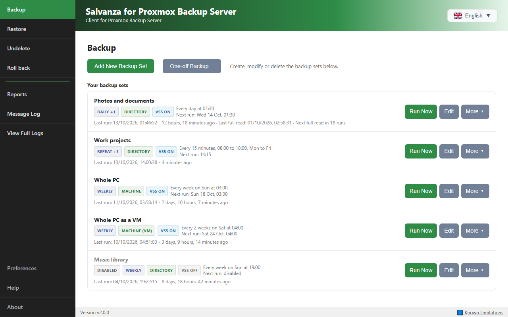
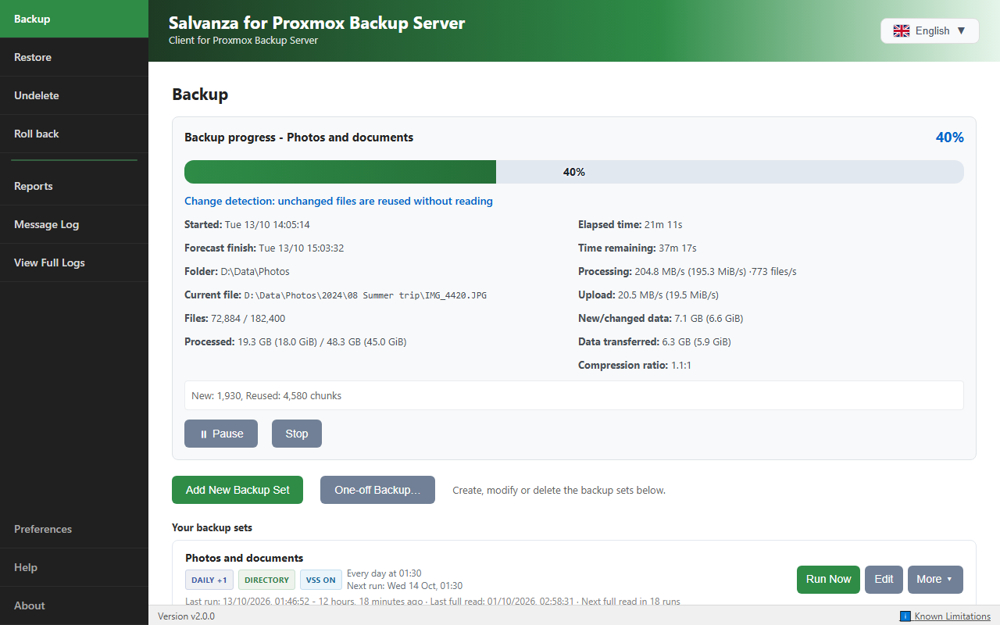
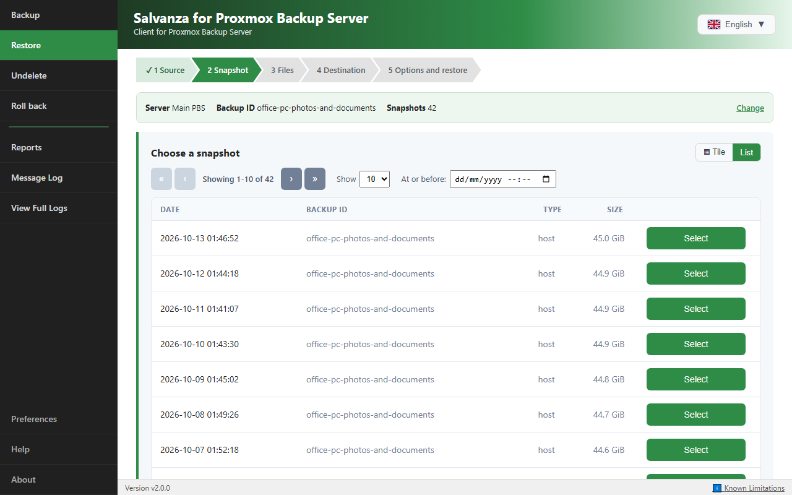
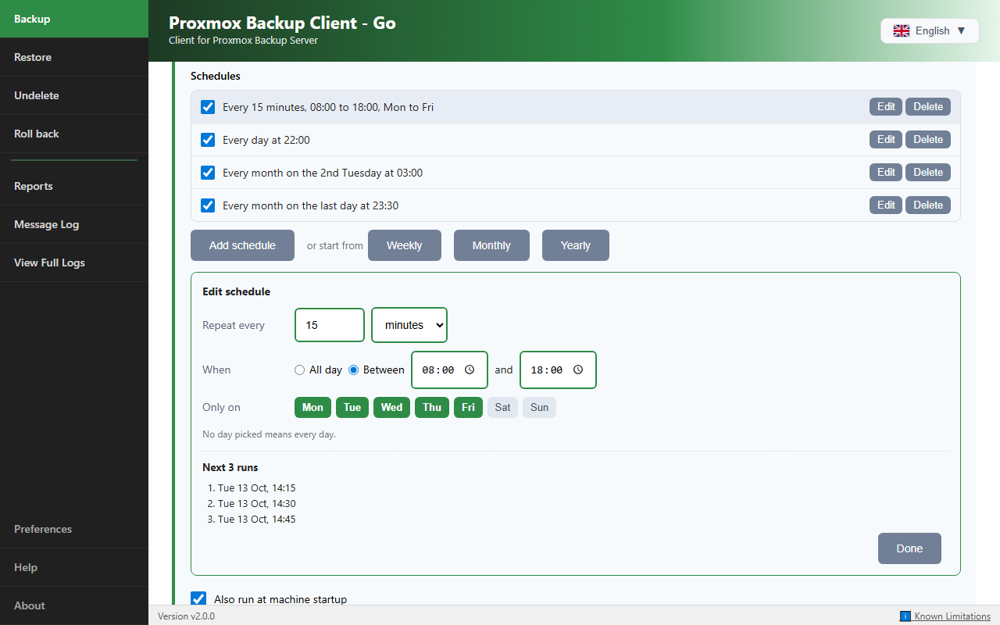
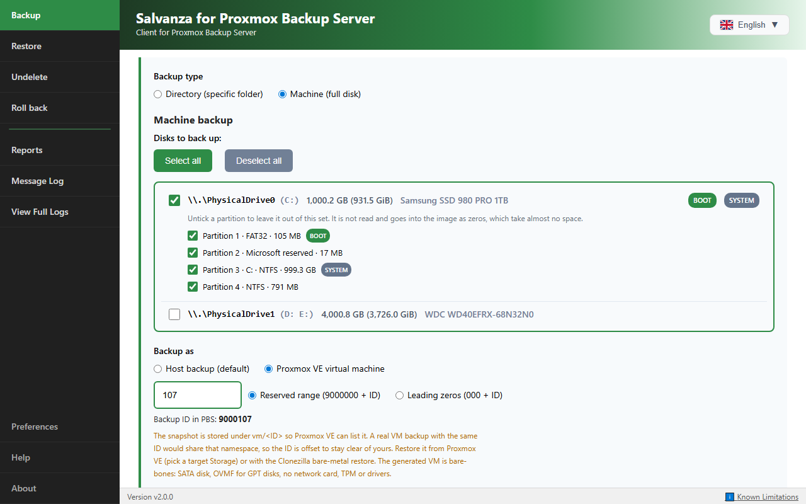
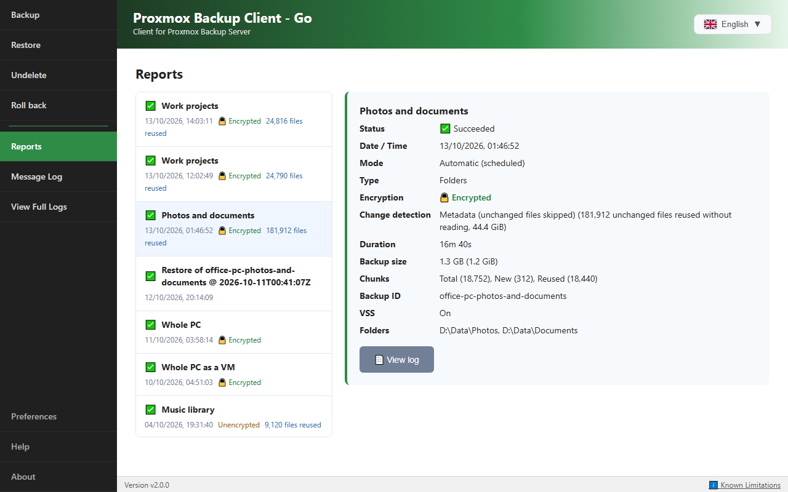

# Proxmox Backup Client: πρόγραμμα-πελάτης για Windows και Linux για το Proxmox Backup Server

[🇬🇧 English](README.md) · [🇫🇷 Français](README.fr.md) · [🇮🇹 Italiano](README.it.md) · [🇩🇪 Deutsch](README.de.md) · [🇪🇸 Español](README.es.md) · [🇷🇺 Русский](README.ru.md) · [🇨🇳 中文](README.zh.md) · [🇯🇵 日本語](README.ja.md) · [🇬🇷 Ελληνικά](README.el.md) · [🇷🇴 Română](README.ro.md) · [🇸🇪 Svenska](README.sv.md) · [🇸🇦 العربية](README.ar.md) · [🇮🇷 فارسی](README.fa.md)

> ℹ️ Αυτό το κείμενο είναι μετάφραση του [αγγλικού README](README.md). Όπου διαφέρουν, ισχύει το αγγλικό, που είναι πάντα ενημερωμένο.

> ⚠️ **Σημείωση για τα εμπορικά σήματα και τη σχέση με την Proxmox.** Αυτό είναι ένα **ανεξάρτητο κοινοτικό έργο** και όχι επίσημο προϊόν της Proxmox: **δεν συνδέεται με την Proxmox Server Solutions GmbH, ούτε εγκρίνεται ή χρηματοδοτείται από αυτήν**. Το **Proxmox®** είναι σήμα κατατεθέν της Proxmox Server Solutions GmbH στην ΕΕ, στις ΗΠΑ και σε άλλες χώρες, και χρησιμοποιείται εδώ **μόνο** για να περιγράψει τη συμβατότητα. Σύμφωνα με τις οδηγίες της ίδιας της Proxmox για τα εμπορικά σήματα (τα κατατεθέντα σήματα δεν πρέπει να χρησιμοποιούνται σε ονόματα προϊόντων ή εφαρμογών, για παράδειγμα «XY App for Proxmox Virtual Environment» αντί για «Proxmox XY App»), **η μετονομασία του προγράμματος-πελάτη χωρίς επωνυμία βρίσκεται σε εξέλιξη**: το προϊόν που σήμερα ονομάζεται *Proxmox Backup Client* αποκτά όνομα που δεν περιέχει το σήμα Proxmox. Οι ακριβείς κανόνες βρίσκονται στο [media kit της Proxmox](https://www.proxmox.com/en/about/company-details/media-kit).

[](LICENSE)
[](https://github.com/tizbac/proxmoxbackupclient_go/releases)
[](docs/manual/README.md)

**Το Proxmox Backup Client είναι ένα πρόγραμμα-πελάτης αντιγράφων ασφαλείας ανοιχτού κώδικα (GPL-3.0) για το Proxmox Backup Server (PBS), για Windows και Linux.** Δημιουργεί αντίγραφα ασφαλείας φακέλων ως αρχειοθήκες στις οποίες μπορείτε να περιηγηθείτε, και ολόκληρων μηχανημάτων ως εκκινήσιμα είδωλα δίσκου, με χρονοδιάγραμμα ή κατ' απαίτηση. Επαναφέρει οτιδήποτε, από ένα μεμονωμένο αρχείο έως ολόκληρο μηχάνημα: στον ίδιο υπολογιστή, σε έναν υπολογιστή αντικατάστασης ή σε μια εικονική μηχανή Proxmox VE.

Είναι ένα **σύνολο εργαλείων**:

- **Proxmox Backup Client GUI** (δημιουργήθηκε από την RDEM Systems ως Nimbus Backup GUI, αναδομήθηκε και επεκτάθηκε από τον mjb-is): η εφαρμογή για Windows και Linux. Σύνολα αντιγράφων ασφαλείας με πολλά χρονοδιαγράμματα το καθένα, αντίγραφα φακέλων και ολόκληρων δίσκων με συνεπή στιγμιότυπα (VSS στα Windows, elastio-snap/dattobd στο Linux), επαναφορά αρχείων από αντίγραφα φακέλων και μηχανημάτων, Ανάκτηση διαγραμμένων και Επαναφορά κατάστασης, πολλοί διακομιστές PBS, κρυπτογράφηση στην πλευρά του πελάτη, και μια υπηρεσία παρασκηνίου ώστε τα χρονοδιαγράμματα να εκτελούνται χωρίς να είναι συνδεδεμένος κανείς.
- **`proxmoxbackup-directory`**: αντίγραφα ασφαλείας φακέλων (pxar) από τη γραμμή εντολών, με αφαίρεση διπλοτύπων και εντοπισμό αλλαγών.
- **`proxmoxbackup-machine`**: ζωντανά αντίγραφα ασφαλείας ολόκληρων δίσκων (fidx) από τη γραμμή εντολών, για μηχανήματα Windows και Linux. Το είδωλο είναι εκκινήσιμο μετά την επαναφορά.
- **`proxmoxbackup-nbd`**: συνδέει ένα αντίγραφο δίσκου ως συσκευή μπλοκ NBD (Linux).
- **Ένα ISO επαναφοράς bare-metal** βασισμένο στο Clonezilla Live, με καθοδηγούμενη επαναφορά από την ενεργοποίηση έως την επανεκκίνηση.

> Λέξεις-κλειδιά: proxmox backup client windows · πρόγραμμα-πελάτης PBS · αντίγραφα ασφαλείας Windows με VSS · αμετάβλητα αντίγραφα εκτός εγκατάστασης · από φυσικό σε εικονικό (P2V) · επαναφορά bare-metal · διεπαφή για Proxmox Backup Server.

## 🆕 Νέα στην έκδοση 2.0

Η έκδοση 2.0 ενσωματώνει στο έργο ένα μεγάλο σύνολο εργασιών στο γραφικό περιβάλλον, στην υπηρεσία παρασκηνίου και στη μηχανή αντιγράφων ασφαλείας (δείτε το [CHANGELOG](CHANGELOG.md)). Σε σύγκριση με την 1.2:

- **Η εφαρμογή συνδέεται στην υπηρεσία παρασκηνίου με δικαιώματα διαχειριστή.** Όταν η υπηρεσία είναι εγκατεστημένη, οι διακομιστές PBS και τα σύνολα αντιγράφων ασφαλείας του υπολογιστή ανήκουν στην υπηρεσία, και μόνο η υπηρεσία διαβάζει τον φάκελο ρυθμίσεών της. Η εφαρμογή ζητά μία φορά δικαιώματα διαχειριστή για να συνδεθεί (UAC στα Windows, pkexec στο Linux· σε τυπικό λογαριασμό, όνομα και κωδικό ενός διαχειριστή). Μόνο ένα μικρό βοηθητικό πρόγραμμα εκτελείται με αυξημένα δικαιώματα, και η εφαρμογή κρατά το διακριτικό της υπηρεσίας μόνο στη μνήμη. Ένας χρήστης που δεν μπορεί να απαντήσει στο αίτημα μπορεί να επιλέξει **Χρήση των δικών μου ρυθμίσεων** και να κρατήσει τους δικούς του διακομιστές και σύνολα αντιγράφων ασφαλείας, που εκτελούνται όσο η εφαρμογή είναι ανοιχτή· η **Σύνδεση** αργότερα προσφέρει την αντιγραφή τους σε εκείνα του υπολογιστή. Η ίδια η εφαρμογή εκτελείται χωρίς δικαιώματα διαχειριστή και προσφέρει **Επανεκκίνηση ως διαχειριστής** όπου μια λειτουργία το χρειάζεται. Δείτε την ενότητα 15 του [εγχειριδίου του γραφικού περιβάλλοντος](docs/manual/GUI.md#connecting-to-the-background-service).
- **Η εφαρμογή ελέγχει ότι μιλά με την υπηρεσία.** Πριν στείλει οτιδήποτε στο τοπικό API της υπηρεσίας, η εφαρμογή ελέγχει ποιος απαντά: η ίδια η διεργασία της υπηρεσίας στα Windows, ένα socket που ανήκει στον root στο Linux. Ένα πρόγραμμα που καταλαμβάνει τη θύρα όσο η υπηρεσία είναι σταματημένη δεν παίρνει τίποτα.
- **Σύνολα αντιγράφων ασφαλείας με πολλά χρονοδιαγράμματα το καθένα**, από κάθε λίγα λεπτά έως μία φορά τον χρόνο (την τελευταία ημέρα του μήνα, τη 2η Τρίτη), το καθένα διατυπωμένο σε απλά λόγια με τις επόμενες 3 εκτελέσεις του.
- **Σταδιακά (incremental) αντίγραφα φακέλων** με τον εντοπισμό αλλαγών του επίσημου προγράμματος-πελάτη (λειτουργίες **Δεδομένα** και **Μεταδεδομένα**): τα αμετάβλητα αρχεία δεν διαβάζονται ξανά.
- **Ταχύτερα αντίγραφα μηχανήματος** που παραλείπουν τον ελεύθερο χώρο, το αρχείο σελιδοποίησης και το αρχείο αδρανοποίησης, και γράφουν τους μη αναγνώσιμους τομείς ως μηδενικά αντί να αποτυγχάνουν.
- **Πολλά αντίγραφα ασφαλείας ταυτόχρονα** (**Μέγιστος αριθμός ταυτόχρονων αντιγράφων ασφαλείας**, 1 έως 8, προεπιλογή 3), και στην υπηρεσία παρασκηνίου, το καθένα με το δικό του στιγμιότυπο, αρχείο καταγραφής, **Παύση** και **Διακοπή**.
- **Όρια ταχύτητας** για την αποστολή στο PBS, τη λήψη από το PBS και την ανάγνωση δίσκου, το καθένα ένας προϋπολογισμός που μοιράζονται όλες οι εργασίες που εκτελούνται ταυτόχρονα.
- **Ανάκτηση διαγραμμένων και Επαναφορά κατάστασης** για σύνολα αντιγράφων φακέλων και μηχανημάτων, στο γραφικό περιβάλλον και από τη γραμμή εντολών.
- **Αρχεία από αντίγραφα μηχανημάτων**: περιήγηση σε τόμους NTFS, FAT, exFAT, ext2/3/4 και XFS μέσα σε ένα είδωλο δίσκου και επαναφορά μεμονωμένων αρχείων.
- **Κλειδιά κρυπτογράφησης που μπορείτε να φυλάξετε**: αποθήκευση αντιγράφου, εκτύπωση κλειδιού σε χαρτί με κωδικό QR, και εισαγωγή κλειδιού από αρχείο, κάμερα, φωτογραφία ή πληκτρολογημένο κείμενο.
- **Τα σύνολα αντιγράφων μηχανήματος αναγνωρίζουν τους δίσκους τους από την ταυτότητά τους**, έτσι ένας δίσκος που παίρνει νέο αριθμό μετά από αλλαγή υλικού εξακολουθεί να είναι αυτός που αντιγράφεται, και ένας δίσκος που λείπει κάνει την εκτέλεση να αποτύχει αντί να αντιγραφεί άλλος δίσκος.
- **Διαμερίσματα μπορούν να εξαιρεθούν από ένα αντίγραφο μηχανήματος**: επιλέξτε τα διαμερίσματα που θα αντιγραφούν κάτω από κάθε δίσκο. Ένα διαμέρισμα που εξαιρείται δεν διαβάζεται ούτε λαμβάνεται στιγμιότυπό του, και μπαίνει στο είδωλο ως μηδενικά, οπότε η επαναφορά το επιστρέφει στη θέση του και στο μέγεθός του, κενό και μη διαμορφωμένο. Η επιλογή δίσκων σημειώνει τα διαμερίσματα που χρειάζεται ένας δίσκος που επαναφέρθηκε για να ξεκινήσει.
- **Αντίγραφα μηχανημάτων Linux με elastio-snap ή dattobd.** Ένα σύνολο μηχανήματος Linux μπορεί να απενεργοποιήσει τα στιγμιότυπα και να διαβάζει τους δίσκους ζωντανά, αλλά μόνο όταν ο κάτοχός του επιλέξει ότι αποδέχεται πως το αντίγραφο μπορεί να είναι ασυνεπές.
- **Κάθε χρήστης μπορεί να επιλέξει το δικό του χρωματικό θέμα** στην εφαρμογή χωρίς επωνυμία. Μια εφαρμογή με επωνυμία κρατά τα χρώματα της επωνυμίας της.
- **Ενεργοποίηση και απενεργοποίηση ενός συνόλου αντιγράφων ασφαλείας** από τον επεξεργαστή του καθώς και από το μενού του, και προειδοποίηση κατά την αποθήκευση όταν ένα σύνολο δεν θα εκτελεστεί όπως αποθηκεύτηκε (απενεργοποιημένο, κανένα ενεργό χρονοδιάγραμμα, πρόβλημα στιγμιότυπου, δίσκος που λείπει).
- **Πακέτα Linux** (`.deb`, `.rpm` και Arch), με όνομα πακέτου και υπηρεσίας `proxmoxbackupclient`, μαζί με την υπηρεσία παρασκηνίου.
- **Ένα καθοδηγούμενο ISO επαναφοράς bare-metal**, που επαναφέρει και σε κενή εικονική μηχανή (P2V). Ένα μηχάνημα που αντιγράφηκε ως εικονική μηχανή Proxmox VE μπορεί επίσης να επαναφερθεί απευθείας από το PBS μέσα στο Proxmox VE, όπως κάθε VM που αντέγραψε το ίδιο το Proxmox VE.
- **Εκδόσεις με επωνυμία**: τα ίδια εκτελέσιμα διανέμονται ως προγράμματα εγκατάστασης Proxmox Backup Client, Nimbus Backup, Acme Backup και Etitech Backup.
- **18 γλώσσες διεπαφής.**

## ⭐ Τι κάνει, με μετρημένα αποτελέσματα

| | Αποτέλεσμα |
|---|---|
| **Σταδιακά αντίγραφα φακέλων** | Ένας κοινόχρηστος φάκελος 480.9 GB με 761,866 αρχεία: πρώτη εκτέλεση 4 ώρες 17 λεπτά, κάθε επόμενη 10 έως 15 λεπτά. Τα αμετάβλητα αρχεία δεν ανοίγονται καν (εντοπισμός αλλαγών **Μεταδεδομένα**, όπως στο επίσημο πρόγραμμα-πελάτη). |
| **Γρήγορα αντίγραφα μηχανήματος** | Ο ελεύθερος χώρος, το αρχείο σελιδοποίησης και το αρχείο αδρανοποίησης δεν διαβάζονται, και ο κενός χώρος του δίσκου δεν κατακερματίζεται. Ένας δίσκος φορητού 1 TB με 373 GB σε χρήση χρειαζόταν πριν από 1 ώρα 23 λεπτά έως 1 ώρα 44 λεπτά και τώρα 38 λεπτά. |
| **Αργές συνδέσεις και συνδέσεις με χρέωση δεδομένων** | Αποστέλλονται μόνο τα νέα δεδομένα, συμπιεσμένα, και η εφαρμογή δείχνει τι πέρασε πραγματικά από το δίκτυο. Ένας μικρός υπολογιστής Linux σε απομακρυσμένη τοποθεσία με σύνδεση 4G (4.8 Mbit/s αποστολή): ολόκληρο το είδωλο του δίσκου των 128 GB μαζί με τον προσωπικό του φάκελο σε 11 λεπτά, με περίπου 172 MiB μεταφοράς. |
| **Αρχεία από αντίγραφα μηχανημάτων** | Ο δίσκος C: 127 GB ενός φορητού με 430,000 αρχεία εμφανίζεται σε 4 έως 15 δευτερόλεπτα. Τίποτα δεν προσαρτάται ούτε κατεβαίνει πρώτα. |
| **Επαναφορά bare-metal** | Εκκινήστε το ISO (στικάκι USB, CD ή δίκτυο), εισαγάγετε τα στοιχεία του PBS, επιλέξτε το αντίγραφο: ένα μηχάνημα Windows 32 GB επέστρεψε στην οθόνη σύνδεσης 8 λεπτά μετά την ενεργοποίηση. |
| **Ανάκτηση διαγραμμένων** | Αφού διαγράφηκαν 39 GB από έναν κοινόχρηστο φάκελο 761,000 αρχείων, μια αναζήτηση **Ανάκτησης διαγραμμένων** στα αντίγραφα των τελευταίων 7 ημερών βρήκε ακριβώς αυτά τα αρχεία σε περίπου ένα λεπτό, και τα επανέφερε. |
| **Πιστότητα επαναφοράς** | Δικαιώματα NTFS, χαρακτηριστικά, εναλλακτικές ροές δεδομένων, εκτεταμένα χαρακτηριστικά, χρόνοι δημιουργίας και χρόνοι φακέλων στα Windows· δικαιώματα (modes), κάτοχοι, ACL, εκτεταμένα χαρακτηριστικά και συμβολικοί σύνδεσμοι στο Linux. |

## 📖 Εγχειρίδια χρήσης

| Εγχειρίδιο | Περιεχόμενο |
|---|---|
| **[Εγχειρίδιο γραφικού περιβάλλοντος](docs/manual/GUI.md)** | Εγκατάσταση, διακομιστές PBS, σύνολα αντιγράφων ασφαλείας και χρονοδιαγράμματα, σταδιακά αντίγραφα, πρόοδος, επαναφορά, Ανάκτηση διαγραμμένων, Επαναφορά κατάστασης, Αναφορές, αρχεία καταγραφής, Προτιμήσεις, η υπηρεσία παρασκηνίου, αντιμετώπιση προβλημάτων |
| **[Εγχειρίδιο γραμμής εντολών](docs/manual/CLI.md)** | `proxmoxbackup-directory`, `proxmoxbackup-machine`, `proxmoxbackup-nbd`: κάθε σημαία, αρχεία ρυθμίσεων, κωδικοί εξόδου, χρονοπρογραμματισμός· Ανάκτηση διαγραμμένων και Επαναφορά κατάστασης από τη γραμμή εντολών |
| **[Εγχειρίδιο επαναφοράς bare-metal](docs/manual/BMR.md)** | Το ISO επαναφοράς, βήμα προς βήμα· αντίγραφα `vm` στο Proxmox VE· από φυσικό σε εικονικό· διαφορετικό υλικό |
| [Σενάρια επαναφοράς](docs/RESTORE_GUIDE.md) | Ποια επαναφορά να χρησιμοποιήσετε και πότε |
| [Ευρετήριο εγχειριδίων](docs/manual/README.md) | Επισκόπηση των εγχειριδίων |

Τα ίδια εγχειρίδια είναι ενσωματωμένα στην εφαρμογή (**Βοήθεια**, F1), οπότε λειτουργούν χωρίς σύνδεση και αντιστοιχούν στην εγκατεστημένη έκδοση.

## 📦 Λήψη

👉 **[Λήψη της τελευταίας έκδοσης](https://github.com/tizbac/proxmoxbackupclient_go/releases)**

| Έχετε | Χρησιμοποιήστε |
|---|---|
| Windows | Το **πρόγραμμα εγκατάστασης MSI**, `ProxmoxBackupClient-<version>.msi`. Εγκαθιστά την εφαρμογή και την υπηρεσία παρασκηνίου στο Program Files, ξεκινά την υπηρεσία και προσθέτει μια καταχώριση στο μενού Έναρξη. Τα προγράμματα εγκατάστασης με επωνυμία (`NimbusBackup-<version>.msi`, `AcmeBackup-<version>.msi`, `EtitechBackup-<version>.msi`) είναι η ίδια έκδοση με άλλη επωνυμία |
| Debian, Ubuntu, Mint | `sudo apt install ./proxmoxbackupclient_<version>_amd64.deb` |
| Fedora | `sudo dnf install ./proxmoxbackupclient-<version>-*.rpm` |
| Arch | Το πακέτο που δημιουργείται από το [packaging/arch/PKGBUILD](packaging/arch/PKGBUILD) (`make pkgarch`) |
| Μόνο γραμμή εντολών | Τα αρχεία ανά πλατφόρμα (`proxmoxbackup-cli-*` και `proxmoxbackupclient_go_*`) |
| Ένα μηχάνημα για επαναφορά | Το ISO επαναφοράς bare-metal ([εγχειρίδιο επαναφοράς bare-metal](docs/manual/BMR.md#3-get-the-iso-and-make-the-boot-media)), ή δημιουργήστε το μόνοι σας ([παρακάτω](#-bare-metal-restore-iso)) |

Όταν μια έκδοση δεν περιλαμβάνει πακέτο Linux, δημιουργήστε το με `make deb`, `make pkgfedora` ή `make pkgarch` ([BUILD.md](BUILD.md), [packaging/debian/README.md](packaging/debian/README.md)).

Τα πακέτα Linux εγκαθιστούν μία καταχώριση μενού, **Proxmox Backup Client**, που ξεκινά την εφαρμογή με τον δικό σας λογαριασμό. Μια νέα εγκατάσταση ενεργοποιεί την υπηρεσία παρασκηνίου (`proxmoxbackupclient.service`)· μια αναβάθμιση διατηρεί την επιλογή που κάνατε. Τα πακέτα χρειάζονται το polkit (pkexec), που χρησιμοποιεί η εφαρμογή για να συνδεθεί στην υπηρεσία.

> ⚠️ **Τα Windows αναφέρουν «εντοπίστηκε ιός» (π.χ. `Trojan:Win32/Sabsik.FL.A!ml`) ή εμφανίζουν προειδοποίηση SmartScreen;**
> Πρόκειται για **γνωστό ψευδώς θετικό αποτέλεσμα** για εφαρμογές Go/Wails: *δεν* είναι ιός. Η κατάληξη `!ml` δείχνει εντοπισμό από μοντέλο μηχανικής μάθησης, που επισημαίνει *μη υπογεγραμμένα και ασυνήθιστα* εκτελέσιμα. Επαληθεύστε τη λήψη όπως φαίνεται παρακάτω.

### 🔎 Επαλήθευση κάθε λήψης

Κάθε έκδοση παρέχει αθροίσματα ελέγχου SHA-256 (`SHA256SUMS.txt`, που εμφανίζονται και στη σελίδα της έκδοσης) και μια **υπογεγραμμένη βεβαίωση προέλευσης**: κρυπτογραφική απόδειξη ότι το αρχείο παράχθηκε από το CI αυτού του αποθετηρίου, από συγκεκριμένο commit.

```powershell
Get-FileHash .\ProxmoxBackupClient-<version>.msi -Algorithm SHA256   # compare with SHA256SUMS.txt
gh attestation verify .\ProxmoxBackupClient-<version>.msi --repo tizbac/proxmoxbackupclient_go
```

Στο Linux: `sha256sum -c SHA256SUMS.txt --ignore-missing`.

Όταν τα προγράμματα εγκατάστασης μιας έκδοσης περνούν καθαρά τον έλεγχο του VirusTotal, η σελίδα της έκδοσης παραπέμπει στις αναφορές.

> ℹ️ **Υπογραφή κώδικα:** τα εκτελέσιμα των Windows **δεν έχουν ακόμη υπογραφή Authenticode** (ένα πιστοποιητικό OSS μέσω του [SignPath Foundation](https://signpath.org) εκκρεμεί). Μέχρι τότε, η προέλευση τεκμηριώνεται με τη βεβαίωση και τα αθροίσματα ελέγχου που αναφέρονται παραπάνω.

## 🚀 Γρήγορη έναρξη (γραφικό περιβάλλον)

1. Εγκαταστήστε το: το MSI στα Windows, το πακέτο `.deb`, `.rpm` ή Arch στο Linux ([Λήψη](#-download)).
2. Ξεκινήστε το **Proxmox Backup Client**. Τα προγράμματα εγκατάστασης εγκαθιστούν την υπηρεσία παρασκηνίου, οπότε η εφαρμογή ζητά μία φορά δικαιώματα διαχειριστή για να συνδεθεί σε αυτήν (UAC στα Windows, τον κωδικό σας μέσω pkexec στο Linux). Αν δεν μπορείτε να τα δώσετε, επιλέξτε **Χρήση των δικών μου ρυθμίσεων**.
3. Προσθέστε τον διακομιστή PBS σας στις **Προτιμήσεις > Πληροφορίες λογαριασμού** και πατήστε **Δοκιμή**.
4. Δημιουργήστε ένα σύνολο αντιγράφων ασφαλείας (ή ένα εφάπαξ αντίγραφο ασφαλείας) και επιλέξτε τους φακέλους ή τους δίσκους που θα αντιγραφούν.
5. Εκτελέστε το. Με την υπηρεσία παρασκηνίου, τα χρονοδιαγράμματά του εκτελούνται είτε είναι συνδεδεμένος κάποιος είτε όχι.

Το [εγχειρίδιο του γραφικού περιβάλλοντος](docs/manual/GUI.md) περιγράφει κάθε βήμα αναλυτικά.

### 🪟 Αυτόματη / σιωπηλή εγκατάσταση (MSI)

Το MSI δέχεται τον τυπικό διακόπτη σιωπηλής εγκατάστασης του Windows Installer, καθώς και δημόσιες ιδιότητες για κάθε προεπιλογή:

```powershell
# Silent install with the defaults (service: Automatic + started)
msiexec /i ProxmoxBackupClient-<version>.msi /quiet

# Silent install that installs the service but does NOT enable/autostart it
# (created as Manual and left stopped)
msiexec /i ProxmoxBackupClient-<version>.msi /quiet SERVICEAUTOSTART=0

# Silent install that also applies a settings file exported from another computer
msiexec /i ProxmoxBackupClient-<version>.msi /quiet CONFIGFILE="C:\Deploy\settings.json"

# Custom directory + verbose install log
msiexec /i ProxmoxBackupClient-<version>.msi /quiet INSTALLFOLDER="D:\Apps\ProxmoxBackupClient" /L*v "C:\Temp\install.log"

# Silent uninstall (KEEP_CONFIG=0 also purges %ProgramData%\<name>)
msiexec /x ProxmoxBackupClient-<version>.msi /quiet KEEP_CONFIG=0
```

| Ιδιότητα | Προεπιλογή | Σημασία |
| --- | --- | --- |
| `SERVICEAUTOSTART` | `1` | `0` = η υπηρεσία εγκαθίσταται ως **Manual** (χειροκίνητη) και μένει **σταματημένη**: εγκατεστημένη, αλλά ποτέ ενεργοποιημένη ή με αυτόματη εκκίνηση |
| `AUTOSTART` | `1` | `0` = η εφαρμογή δεν ξεκινά στην περιοχή ειδοποιήσεων σε κάθε σύνδεση χρήστη |
| `DESKTOPSHORTCUTS` | `1` | `0` = καμία συντόμευση στην επιφάνεια εργασίας (η καταχώριση στο μενού Έναρξη προστίθεται πάντα) |
| `CONFIGFILE` | | Πλήρης διαδρομή ενός αρχείου που αποθηκεύτηκε με **Προτιμήσεις > Εξαγωγή ρυθμίσεων...**: οι διακομιστές PBS και τα σύνολα αντιγράφων ασφαλείας του συγχωνεύονται πριν ξεκινήσει η υπηρεσία. Τα ID αντιγράφων ασφαλείας που σχηματίστηκαν από το όνομα του υπολογιστή που έκανε την εξαγωγή σχηματίζονται από το όνομα κάθε υπολογιστή. Δείτε το [installer/DEPLOYMENT.md](installer/DEPLOYMENT.md) |
| `KEEP_CONFIG` | `1` | Μόνο κατά την απεγκατάσταση: `0` = διαγράφεται και ο κατάλογος κατάστασης `%ProgramData%\<name>` |
| `INSTALLFOLDER` | `Program Files` | Κατάλογος εγκατάστασης (μπορεί να αλλάξει και από το περιβάλλον εγκατάστασης) |

Εκτελέστε με αυξημένα δικαιώματα (διαχειριστής)· κωδικός εξόδου `0` = επιτυχία, `3010` = επιτυχία + απαιτείται επανεκκίνηση. Τα MSI με επωνυμία δέχονται ακριβώς τους ίδιους διακόπτες.

## ✨ Δυνατότητες

### Γραφικό περιβάλλον
Οι κύριες δυνατότητες αναφέρονται στα [Νέα στην έκδοση 2.0](#-new-in-20). Επίσης:
- 18 γλώσσες διεπαφής: γαλλικά, αγγλικά, ιταλικά, γερμανικά, πολωνικά, ισπανικά, βουλγαρικά, τσεχικά, ελληνικά, ουγγρικά, λετονικά, λιθουανικά, ολλανδικά, πορτογαλικά, ρουμανικά, σλοβακικά, τουρκικά και ουκρανικά
- **Εφάπαξ αντίγραφα ασφαλείας** φακέλων ή ολόκληρων δίσκων, και αντίγραφα μηχανημάτων αποθηκευμένα ως `host` ή ως αντίγραφο `vm` του Proxmox VE, με την επιλογή **Εγκληματολογικό αντίγραφο** που διαβάζει και τον ελεύθερο χώρο
- **Επαναφορά** με αναζήτηση αρχείων (μπαλαντέρ, κανονικές εκφράσεις, πλήρεις διαδρομές), επιλεκτική επαναφορά, ACL NTFS/POSIX, εναλλακτικές ροές δεδομένων, χρόνους δημιουργίας των Windows και προαιρετικό πέρασμα επαλήθευσης
- **Παύση, Συνέχεια και Διακοπή** ενός αντιγράφου ασφαλείας σε εξέλιξη, και από την περιοχή ειδοποιήσεων στα Windows και για εκτελέσεις της υπηρεσίας παρασκηνίου
- Κάρτα προόδου σε πραγματικό χρόνο (εκτιμώμενη ολοκλήρωση, αρχεία που ολοκληρώθηκαν, ταχύτητα αποστολής, δεδομένα που μεταφέρθηκαν, λόγος συμπίεσης), **Αναφορές**, **Αρχείο καταγραφής μηνυμάτων** και **Προβολή πλήρων αρχείων καταγραφής**
- Ειδοποιήσεις μέσω email, ενέργειες μετά το αντίγραφο ασφαλείας, κλωνοποίηση συνόλων αντιγράφων ασφαλείας, εξαγωγή και εισαγωγή ρυθμίσεων
- Πολλοί διακομιστές PBS, με καρφίτσωμα του αποτυπώματος πιστοποιητικού (εμπιστοσύνη στην πρώτη χρήση), σύνδεση με διακριτικό API ή με χρήστη/κωδικό
- Πέντε χρωματικά θέματα και ένα προσαρμοσμένο χρώμα, που επιλέγει κάθε χρήστης (στην εφαρμογή χωρίς επωνυμία· μια εφαρμογή με επωνυμία κρατά τα χρώματα της επωνυμίας της)

### Εργαλεία γραμμής εντολών
- `proxmoxbackup-directory`: αντίγραφα φακέλων (pxar) με αφαίρεση διπλοτύπων και `-change-detection-mode legacy|data|metadata`
- `proxmoxbackup-machine`: ζωντανά αντίγραφα ολόκληρων δίσκων μηχανημάτων Windows (VSS) και Linux (elastio-snap/dattobd) (fidx, σταδιακά, ο ελεύθερος χώρος παραλείπεται εκτός αν δοθεί `-readfreespace`, `-type vm` για αντίγραφο Proxmox VE, `-skippartition <disk>:<number>` για εξαίρεση ενός διαμερίσματος)
- `proxmoxbackup-nbd`: διακομιστής NBD για την επαναφορά αντιγράφων δίσκων (Linux)
- `ProxmoxBackupClientSVC` (Windows) και `proxmoxbackupclient` (πακέτα Linux): `-list-sets`, `-undelete` και `-rollback` για σύνολα αντιγράφων ασφαλείας που ορίστηκαν στο γραφικό περιβάλλον

Τα τρία πρώτα δέχονται `-keyfile` και `-keyfile-passphrase` για κρυπτογραφημένα στιγμιότυπα. Πλήρης αναφορά: [εγχειρίδιο γραμμής εντολών](docs/manual/CLI.md).

### 📸 Στιγμιότυπα οθόνης

<table>
<tr>
<td width="33%">

[](docs/screenshots/gui-backup-sets.png)
**Σύνολα αντιγράφων ασφαλείας**: εργασίες με όνομα, με ενδείξεις χρονοδιαγράμματος και τύπου, και **Εκτέλεση τώρα** στην καθεμία

</td>
<td width="33%">

[](docs/screenshots/gui-backup-progress.png)
**Πρόοδος αντιγράφου ασφαλείας**: ρυθμός μεταφοράς, εκτιμώμενη ολοκλήρωση, νέα και επαναχρησιμοποιημένα τμήματα

</td>
<td width="33%">

[](docs/screenshots/gui-restore.png)
**Επαναφορά**: επιλέξτε διακομιστή PBS και ID αντιγράφου ασφαλείας, εμφανίστε τα στιγμιότυπα ή αναζητήστε τα με όνομα αρχείου

</td>
</tr>
<tr>
<td width="33%">

[](docs/screenshots/gui-schedule-tab.png)
**Προγράμματα**: πολλά ανά σύνολο, με τις επόμενες 3 εκτελέσεις

</td>
<td width="33%">

[](docs/screenshots/backup-set-as-vm.png)
**Αντίγραφο ασφαλείας ως εικονική μηχανή Proxmox VE**: το ID αντιγράφου ασφαλείας στο PBS εμφανίζεται καθώς πληκτρολογείτε

</td>
<td width="33%">

[](docs/screenshots/gui-reports.png)
**Αναφορές**: πλήρες ιστορικό εκτελέσεων με πλαίσιο λεπτομερειών

</td>
</tr>
</table>

### Έξυπνες εξαιρέσεις συστήματος (αντίγραφα φακέλων)
Τα αντίγραφα φακέλων παραλείπουν αυτόματα τα εξής:

**Φάκελοι συστήματος:** `System Volume Information` (χώρος αποθήκευσης VSS, μπορεί να ξεπεράσει τα 100 GB) και `$RECYCLE.BIN` όπου κι αν βρίσκονται· `Recovery` μόνο στη ρίζα μιας μονάδας δίσκου· `.pbs-rollback` (ο φάκελος ασφαλείας της Επαναφοράς κατάστασης).
**Αρχεία συστήματος:** `pagefile.sys`, `hiberfil.sys`, `swapfile.sys` και `DumpStack.log.tmp`.

**Γιατί έχει σημασία:** μια μονάδα δίσκου μπορεί να δείχνει 1.03 TB σε χρήση ενώ τα πραγματικά αρχεία είναι ~141 GB. Χωρίς εξαιρέσεις, το αντίγραφο θα περιλάμβανε τα στιγμιότυπα VSS (σπατάλη χώρου και χρόνου)· με αυτές, το μέγεθος αντιστοιχεί στα πραγματικά δεδομένα.

**Σύσταση:** χρησιμοποιήστε αντίγραφο **φακέλων** για αντίγραφα σε επίπεδο αρχείων· χρησιμοποιήστε αντίγραφο **μηχανήματος** σε ξεχωριστό σύνολο αντιγράφων ασφαλείας για επαναφορά bare-metal και P2V (ένα είδωλο ολόκληρου δίσκου, στο οποίο ο ελεύθερος χώρος και τα αρχεία σελιδοποίησης και αδρανοποίησης μπαίνουν ως μηδενικά).

### Ασφάλεια και ποιότητα
- Ο φάκελος ρυθμίσεων της υπηρεσίας είναι προσβάσιμος μόνο στους SYSTEM και Administrators (Windows) ή μόνο στον root (Linux)· το τοπικό API της ακούει στο 127.0.0.1 και απαιτεί διακριτικό, που αντικαθίσταται σε κάθε εκκίνηση και κάθε 24 ώρες
- Η εφαρμογή δεν στέλνει τίποτα σε αυτό το API μέχρι να ελέγξει ότι απαντά η ίδια η υπηρεσία (η διεργασία της υπηρεσίας στα Windows, ένα socket που ανήκει στον root στο Linux)
- Στα Windows, τα διακριτικά και οι κωδικοί PBS στο `config.json` είναι κρυπτογραφημένα για τον συγκεκριμένο υπολογιστή (DPAPI)
- Επικύρωση εισόδου, απολύμανση διαπιστευτηρίων, αποτροπή διάσχισης διαδρομών (path traversal), επαναλήψεις με εκθετική καθυστέρηση
- Δοκιμές μονάδας σε κάθε λειτουργική μονάδα, καθώς και προαιρετικές δοκιμές σε πραγματικό περιβάλλον και δοκιμές από άκρο σε άκρο με πραγματικό PBS

## 🔐 Κρυπτογράφηση στην πλευρά του πελάτη

Τα στιγμιότυπα μπορούν να κρυπτογραφηθούν πριν φύγουν από το μηχάνημα, με ένα αρχείο κλειδιού του Proxmox Backup Server (τη μορφή που γράφει το `proxmox-backup-client key create`, άρα τα κλειδιά είναι εναλλάξιμα με το επίσημο πρόγραμμα-πελάτη). Κάθε τμήμα κρυπτογραφείται με AES-256-GCM και το μανιφέστο υπογράφεται. Ο διακομιστής PBS δεν βλέπει ποτέ το κλειδί.

**Γραφικό περιβάλλον:** ανοίξτε τις **Προτιμήσεις > Πληροφορίες λογαριασμού**, επεξεργαστείτε έναν διακομιστή και χρησιμοποιήστε την καρτέλα του **Κρυπτογράφηση**. Με **Εισαγωγή...** φέρνετε ένα κλειδί που ήδη έχετε (αντίγραφο του αρχείου κλειδιού, ή κλειδί σε χαρτί που διαβάζεται με την κάμερα, από σάρωση ή φωτογραφία, ή πληκτρολογείται), ή με **Δημιουργία...** φτιάχνετε νέο. Η καρτέλα δείχνει το αποτύπωμα του κλειδιού. Η **Αποθήκευση αντιγράφου…** και η **Εκτύπωση κλειδιού σε χαρτί…** (με κωδικό QR) κρατούν ένα αντίγραφο μακριά από τον υπολογιστή. Οι αναφορές δείχνουν αν κάθε αντίγραφο ασφαλείας ήταν κρυπτογραφημένο. **Χωρίς το αρχείο κλειδιού ένα στιγμιότυπο δεν μπορεί να επαναφερθεί: κρατήστε ένα αντίγραφο σε ασφαλές μέρος, μακριά από αυτό το μηχάνημα.**

**Κλειδιά προστατευμένα με φράση πρόσβασης (scrypt ή PBKDF2):** το **Να με ρωτά** κρατά τη φράση πρόσβασης στη μνήμη για μία συνεδρία της εφαρμογής· η **Απομνημόνευση σε αυτόν τον υπολογιστή** την αποθηκεύει όπως το διακριτικό PBS, και είναι η επιλογή για τα χρονοδιαγράμματα και την υπηρεσία παρασκηνίου.

**Γραμμή εντολών:**
```shell
proxmoxbackup-directory.exe -baseurl ... -backupdir "C:\data" -datastore store -keyfile "C:\keys\pbs-key.json" -keyfile-passphrase "..."
```
Το `-keyfile-passphrase` (ή το `PBS_ENCRYPTION_PASSWORD`) χρειάζεται μόνο για προστατευμένο κλειδί, και ζητείται όταν παραλείπεται. Τα `proxmoxbackup-machine` και `proxmoxbackup-nbd` δέχονται τις ίδιες σημαίες. Το `proxmoxbackup-nbd` ελέγχει το κλειδί με το στιγμιότυπο πριν αγγίξει τη συσκευή NBD, ώστε ένα λάθος κλειδί να αποτυγχάνει αμέσως.

**Επαναφορά bare-metal:** το ISO επαναφοράς ζητά το κλειδί (κανένα, αρχείο κλειδιού σε στικάκι USB ή πληκτρολογημένη διαδρομή) και τη φράση πρόσβασης ενός προστατευμένου κλειδιού. Το κλειδί δεν γράφεται ποτέ στο ISO.

Η επαναφορά ενός κρυπτογραφημένου στιγμιότυπου χρειάζεται το ίδιο αρχείο κλειδιού· δεν υπάρχει τρόπος ανάκτησης αν χαθεί.

## Ταχύτερα αντίγραφα φακέλων: εντοπισμός αλλαγών

Στην προεπιλεγμένη λειτουργία **Κλασικό** (Legacy) κάθε αντίγραφο φακέλων διαβάζει κάθε αρχείο, οπότε μια εκτέλεση διαρκεί όσο η ανάγνωση ολόκληρου του φακέλου ακόμη κι αν δεν άλλαξε τίποτα. Τα σύνολα αντιγράφων ασφαλείας και το `proxmoxbackup-directory` μπορούν αντί γι' αυτό να χρησιμοποιούν τις λειτουργίες εντοπισμού αλλαγών του επίσημου `proxmox-backup-client`:

| Λειτουργία | Διαβάζει | Αποθηκεύεται ως |
|---|---|---|
| **Κλασικό** (Legacy, προεπιλογή) | κάθε αρχείο | ένα `<name>.pxar.didx` ανά φάκελο |
| **Δεδομένα** (Data) | κάθε αρχείο | ένα διαιρεμένο αρχείο: `<name>.mpxar.didx` (μεταδεδομένα) + `<name>.ppxar.didx` (περιεχόμενο αρχείων) |
| **Μεταδεδομένα** (Metadata) | μόνο τα νέα και τα αλλαγμένα αρχεία | το ίδιο διαιρεμένο αρχείο· τα αρχεία των οποίων το μέγεθος, ο χρόνος τροποποίησης (στο νανοδευτερόλεπτο), τα δικαιώματα (mode) και ο κάτοχος ταιριάζουν με το προηγούμενο αντίγραφο λαμβάνονται από εκείνο χωρίς να διαβαστούν |

Στη λειτουργία **Μεταδεδομένα** η πρώτη εκτέλεση διαβάζει τα πάντα· οι επόμενες διαβάζουν μόνο ό,τι άλλαξε. Ένα αρχείο που άλλαξε με τρόπο που διατηρεί το μέγεθος και τον χρόνο τροποποίησής του δεν γίνεται αντιληπτό, γι' αυτό ένα σύνολο μπορεί επίσης να κάνει **Ανάγνωση όλων των αρχείων κάθε** N εκτελέσεις. Δώστε σε κάθε σύνολο αντιγράφων ασφαλείας το δικό του ID αντιγράφου ασφαλείας: η λειτουργία **Μεταδεδομένα** συγκρίνει με το νεότερο στιγμιότυπο της ομάδας αντιγράφων. Στη γραμμή εντολών χρησιμοποιήστε το `-change-detection-mode`.

**Πριν αλλάξετε ένα σύνολο σε Δεδομένα ή Μεταδεδομένα,** αναβαθμίστε στην 2.0 κάθε μηχάνημα από το οποίο κάνετε επαναφορά: οι παλαιότερες εκδόσεις δείχνουν τους φακέλους ενός διαιρεμένου αρχείου χωρίς τα αρχεία τους. Δείτε την [ενότητα 7 του εγχειριδίου του γραφικού περιβάλλοντος](docs/manual/GUI.md#7-incremental-folder-backups-change-detection).

## 🔄 Φυσικά μηχανήματα σε εικονικές μηχανές (P2V)

Ένα αντίγραφο μηχανήματος ενός φυσικού υπολογιστή ή διακομιστή μπορεί να γίνει εικονική μηχανή Proxmox VE, με δύο τρόπους:

1. **Επαναφορά μέσα στο Proxmox VE.** Ρυθμίστε το σύνολο αντιγράφων ασφαλείας (ή το εφάπαξ αντίγραφο) σε **Αντίγραφο ασφαλείας ως: Εικονική μηχανή Proxmox VE**. Το αντίγραφο αποθηκεύεται ως `vm/<number>`, οπότε το Proxmox VE το εμφανίζει μαζί με τα άλλα αντίγραφα VM και το επαναφέρει ως VM (ένας δίσκος SATA· προσθέστε κάρτα δικτύου πριν την ξεκινήσετε).
2. **Επαναφορά με το ISO επαναφοράς σε κενή VM** με το ίδιο υλικολογισμικό (firmware) με το αρχικό μηχάνημα, δίσκο SATA τουλάχιστον ίδιου μεγέθους και κάρτα δικτύου Intel E1000. Αυτό λειτουργεί εξίσου για αντίγραφα `host` και `vm`, και το ίδιο αντίγραφο εξακολουθεί να επαναφέρεται σε γυμνό υλικό (bare metal).

Οι διαδρομές που έχουν δοκιμαστεί περιλαμβάνουν Windows 10 και Windows Server (UEFI/GPT), επιτραπέζια συστήματα Linux (UEFI/GPT και BIOS/MBR) και ένα κρυπτογραφημένο αντίγραφο Linux με το κλειδί του σε στικάκι USB. Το [εγχειρίδιο επαναφοράς bare-metal](docs/manual/BMR.md#7-restoring-onto-different-hardware-p2v-and-replacement-machines) έχει τον πλήρη πίνακα, τις επιλογές υλικολογισμικού, τα προγράμματα οδήγησης και οδηγίες βήμα προς βήμα.

## 🤝 Συμβατό με το επίσημο πρόγραμμα-πελάτη της Proxmox, και προς τις δύο κατευθύνσεις

Επαληθευμένο με το `proxmox-backup-client` 3.4.9 και το PBS 4.2:

- **Τα στιγμιότυπα Legacy, Data και Metadata που δημιουργεί αυτό το πρόγραμμα-πελάτης επαναφέρονται με το επίσημο πρόγραμμα-πελάτη πανομοιότυπα σε επίπεδο byte**, τόσο από το γραφικό περιβάλλον όσο και από τη γραμμή εντολών, σε Windows ή Linux, και ο περιηγητής αρχείων του PBS 4.2 τα ανοίγει.
- **Τα στιγμιότυπα Legacy, Data και Metadata που δημιουργεί το επίσημο πρόγραμμα-πελάτης επαναφέρονται με αυτό το πρόγραμμα-πελάτη πανομοιότυπα σε επίπεδο byte**, πλήρως ή επιλεκτικά.
- Ίδια μορφή διαιρεμένου αρχείου (pxar έκδοση 2), ίδιες λειτουργίες εντοπισμού αλλαγών, ίδια μορφή αρχείου κλειδιού κρυπτογράφησης, ίδιες μεταβλητές περιβάλλοντος τύπου `PBS_REPOSITORY`.

Τα αντίγραφά σας δεν δένονται ποτέ με αυτό το πρόγραμμα-πελάτη. Το μόνο επιπλέον είναι ένα μικρό αρχείο στη ρίζα ενός στιγμιότυπου φακέλου, το `.proxmox_backup_client_meta.json` (η αρχική διαδρομή), που το επίσημο πρόγραμμα-πελάτης επαναφέρει ως συνηθισμένο αρχείο.

## Ζωντανό αντίγραφο ολόκληρου μηχανήματος

Το `proxmoxbackup-machine` (και τα αντίγραφα μηχανήματος του γραφικού περιβάλλοντος) αντιγράφει ένα πλήρες σύστημα Windows 10/11 ή Windows Server, ή ένα μηχάνημα Linux, χωρίς καμία διακοπή λειτουργίας.

Η σύνταξη της εντολής είναι σε μεγάλο βαθμό ίδια με εκείνη των αντιγράφων φακέλων, με τη διαφορά ότι το `-backupdir` αντικαθίσταται από το `-backupdev` (επαναλάβετέ το για περισσότερους δίσκους). Για παράδειγμα:

`proxmoxbackup-machine.exe -authid yourapikey -backupdev \\.\PhysicalDrive0 -baseurl https://yourpbs:8007 -certfingerprint xx:xx:xx... -datastore zfs -secret L4m3r -backup-id testfull1`

Η παραπάνω εντολή εξετάζει τον Δίσκο 0, εντοπίζει όλα τα προσαρτημένα διαμερίσματα, παίρνει στιγμιότυπο VSS τους, και στη συνέχεια δημιουργεί ένα εκκινήσιμο είδωλο ολόκληρου του δίσκου ως fidx. Ο ελεύθερος χώρος και τα αρχεία σελιδοποίησης και αδρανοποίησης μπαίνουν στο είδωλο ως μηδενικά χωρίς να διαβαστούν (στο Linux και ο ελεύθερος χώρος ext2/3/4 και XFS)· το `-readfreespace` διαβάζει τα πάντα, για εγκληματολογικό αντίγραφο. Ένας τομέας που δεν διαβάζεται μπαίνει στο είδωλο ως μηδενικά, και η εκτέλεση αναφέρει πού. Προσθέστε `-type vm` (με αριθμητικό `-backup-id`) για να αποθηκευτεί το αντίγραφο ως αντίγραφο VM του Proxmox VE ([P2V](#-physical-machines-into-virtual-machines-p2v)).

Το επόμενο αντίγραφο είναι σταδιακό. Ο κατακερματισμός γίνεται παράλληλα, οπότε μπορούν να επιτευχθούν ταχύτητες 1 GB/s.

Για να εξαιρέσετε ένα διαμέρισμα, για παράδειγμα μια βιβλιοθήκη παιχνιδιών ή ένα διαμέρισμα δεδομένων που ήδη καλύπτεται από αντίγραφο φακέλων, προσθέστε `-skippartition <disk>:<number>` (επαναλάβετέ το για περισσότερα), όπως `-skippartition \\.\PhysicalDrive0:4` ή `-skippartition /dev/sda:3`. Το διαμέρισμα δεν διαβάζεται ούτε λαμβάνεται στιγμιότυπό του, και μπαίνει στο είδωλο ως μηδενικά: ο πίνακας διαμερισμάτων διατηρείται, οπότε η επαναφορά επιστρέφει το διαμέρισμα στη θέση του και στο μέγεθός του, κενό και μη διαμορφωμένο. Στο γραφικό περιβάλλον, αποεπιλέξτε το διαμέρισμα κάτω από τον δίσκο του στο σύνολο αντιγράφων ασφαλείας.

### Προαπαιτούμενα για αντίγραφα μηχανημάτων Linux (αντίστοιχο του VSS)

Το αντίγραφο μηχανήματος στα Windows χρησιμοποιεί το VSS. Το Linux δεν έχει VSS, οπότε ένα αντίγραφο μηχανήματος ενός Linux σε λειτουργία χρειάζεται τη λειτουργική μονάδα πυρήνα `elastio-snap` (fork του `dattobd`) για να πάρει στιγμιότυπο της συσκευής μπλοκ σε ένα σημείο του χρόνου ενώ γράφονται δεδομένα σε αυτήν. Το ίδιο το `dattobd` λειτουργεί επίσης, αν είναι ήδη φορτωμένο.

Το αρχικό αποθετήριο `elastio/elastio-snap` είναι αρχειοθετημένο και δεν μεταγλωττίζεται πλέον σε τρέχοντες πυρήνες. Χρησιμοποιήστε το fork που συντηρείται, [`Axcient/elastio-snap`](https://github.com/Axcient/elastio-snap) (κλάδος `develop`). Η έκδοση 0.12.11 αυτού του fork μεταγλωττίστηκε και λειτούργησε σε Debian 13 με πυρήνα 6.12. Το `.deb` προτείνει το πακέτο `elastio-snap-dkms`.

Χρειάζονται δύο πράγματα, αλλιώς ένα αντίγραφο μηχανήματος Linux αρνείται να εκτελεστεί:

1. **Η λειτουργική μονάδα πυρήνα πρέπει να είναι εγκατεστημένη και φορτωμένη.** Μεταγλώττιση από τον πηγαίο κώδικα:
   ```bash
   sudo apt-get install linux-headers-$(uname -r) build-essential   # Debian/Ubuntu
   git clone --depth 1 https://github.com/Axcient/elastio-snap.git
   cd elastio-snap
   sudo make
   sudo make install
   sudo depmod -a      # `make install` does not run depmod, and modprobe fails without it
   sudo modprobe elastio-snap
   lsmod | grep elastio_snap
   ```
   Έτσι φορτώνεται μόνο για την τρέχουσα εκκίνηση. Προσθέστε μια καταχώριση στο `/etc/modules-load.d/` για να φορτώνεται σε κάθε εκκίνηση. Το δικό του [INSTALL.md](https://github.com/Axcient/elastio-snap/blob/develop/INSTALL.md) καλύπτει τις εγκαταστάσεις από πακέτα.

2. **Το αντίγραφο πρέπει να εκτελείται ως root.** Η διεπαφή ελέγχου της μονάδας είναι μόνο για τον root, και το στιγμιότυπο απορρίπτεται για απλό χρήστη. Η υπηρεσία παρασκηνίου εκτελείται ως root· χωρίς αυτήν, χρησιμοποιήστε **Επανεκκίνηση ως διαχειριστής** στην εφαρμογή, ή εκτελέστε το `proxmoxbackup-machine` με `sudo`. Ένα απλό αντίγραφο φακέλων δεν χρειάζεται root.

Στο γραφικό περιβάλλον, ένα σύνολο αντιγράφων μηχανήματος Linux μπορεί να αποεπιλέξει τη **Χρήση στιγμιότυπων** και να διαβάζει τους δίσκους του ζωντανά, αλλά μόνο με επιλεγμένο το δεύτερο πλαίσιο («Εκτέλεση χωρίς στιγμιότυπο: αποδέχομαι ότι το αντίγραφο ασφαλείας μπορεί να είναι ασυνεπές»). Χωρίς αυτό, κάθε εκτέλεση σταματά και εξηγεί τον λόγο. Τα διαμερίσματα που δεν είναι προσαρτημένα διαβάζονται απευθείας.

### Επαναφορά αρχείων από αντίγραφο δίσκου

Η σελίδα **Επαναφορά** του γραφικού περιβάλλοντος ανοίγει ένα αντίγραφο μηχανήματος όπως ένα αντίγραφο φακέλων: κάθε τόμος του ειδώλου (NTFS, FAT, exFAT, ext2/3/4 ή XFS) είναι ένας φάκελος στον οποίο μπορείτε να περιηγηθείτε και από τον οποίο μπορείτε να επαναφέρετε. Τίποτα δεν προσαρτάται.

Στο Linux μπορείτε επίσης να συνδέσετε ένα αντίγραφο δίσκου ως συσκευή μπλοκ με το εργαλείο nbd. Εκτελέστε πρώτα `modprobe nbd max_part=0`: με `max_part != 0` ο πυρήνας μπορεί να μπει σε ατέρμονο βρόχο ανιχνεύοντας διαμερίσματα.

Το εργαλείο NBD συνδέει οποιοδήποτε αντίγραφο σταθερού δίσκου, είτε πρόκειται για αντίγραφο VM είτε host (άρα λειτουργεί και για αντίγραφα του Proxmox VE). Για παράδειγμα:

`./proxmoxbackup-nbd -authid 'apikey' -baseurl https://yourpbs:8007 -secret 'yoursecret' -certfingerprint 'aa:...:xx' -datastore test -namespace test1 -path "vm/107/2025-08-02T23:13:01Z/drive-virtio0.img.fidx"`

Αν παραλείψετε το `-path`, ένα περιβάλλον τερματικού σάς αφήνει να επιλέξετε το αρχείο fidx· το `-list` εμφανίζει αντί γι' αυτό όλα τα είδωλα.

> Μην το χρησιμοποιείτε σε μηχάνημα που εκτελεί κάτι σημαντικό: ένα κατεστραμμένο σύστημα αρχείων μπορεί να ρίξει το λειτουργικό σύστημα, και γι' αυτό το Proxmox VE χρησιμοποιεί μια παρουσία QEMU για αυτόν τον σκοπό.

Αποπροσαρτήστε τα πάντα στον δίσκο nbd πριν σταματήσετε το `proxmoxbackup-nbd`, αλλιώς το διαμέρισμα πιθανότατα θα παραμείνει απασχολημένο. Αν πάρετε σφάλμα `Device or resource busy`, εξαναγκάστε την αποσύνδεση με `nbd-client -d /dev/nbd0`, ή κάντε επανεκκίνηση.

### Επαναφορά σε φυσικό μηχάνημα ή σε VM

Χρησιμοποιήστε το [ISO επαναφοράς bare-metal](#-bare-metal-restore-iso), σε γυμνό υλικό ή σε κενή εικονική μηχανή. Το [εγχειρίδιο επαναφοράς bare-metal](docs/manual/BMR.md) το περιγράφει βήμα προς βήμα.

## Χρήση: αντίγραφο ασφαλείας καταλόγου

Η πλήρης αναφορά, με παραδείγματα για Windows και Linux, κωδικούς εξόδου και χρονοπρογραμματισμό, βρίσκεται στο **[εγχειρίδιο γραμμής εντολών](docs/manual/CLI.md)**. Μια τυπική εντολή:

```shell
proxmoxbackup-directory.exe -baseurl "https://yourpbshost:8007" -certfingerprint pbsfingerprint -authid "user@realm!apiid" -secret "apisecret" -backupdir "C:\path\to\backup" -datastore "datastorename"
```

```
proxmoxbackup-directory
  -baseurl string            PBS URL, example: https://192.168.1.10:8007
  -certfingerprint string    Certificate fingerprint (asked for interactively when omitted)
  -authid string             API token ID (user@realm!token)
  -secret string             API token secret
  -pbsusername string        PBS user for ticket login (with -pbspassword; overrides -authid/-secret)
  -pbspassword string        Password for -pbsusername (asked for when omitted)
  -datastore string          Datastore name
  -namespace string          Namespace (optional)
  -backup-id string          Backup ID (default: the hostname)
  -backupdir string          Source directory, must not be a symlink; repeat for several
  -change-detection-mode     legacy (default), data or metadata
  -novss                     Do not snapshot the source (VSS on Windows, elastio-snap/dattobd on Linux)
  -keyfile string            PBS encryption key file
  -keyfile-passphrase string Passphrase for a protected key (asked for when omitted)
  -no-mtime                  Record 1970-01-01 as every file and folder time (see below)
  -backupstream string       Back up standard input as <name>.didx instead of a directory
  -pxarout string            Also write the archive to a local file (debugging)
  -mail-host, -mail-port, -mail-username, -mail-password, -mail-insecure,
  -mail-from, -mail-to, -mail-subject-template, -mail-body-template
                             Email report (optional)
  -config string             JSON config file; flags given on the command line override it
```

Διαβάζονται επίσης οι μεταβλητές περιβάλλοντος `PBS_REPOSITORY`, `PBS_SERVER`, `PBS_PORT`, `PBS_DATASTORE`, `PBS_AUTH_ID`, `PBS_PASSWORD` και `PBS_FINGERPRINT` του επίσημου προγράμματος-πελάτη.

Για ρύθμιση μέσω JSON δείτε το [config.json.example](config.json.example)· συμπληρώστε μόνο τα πεδία που χρειάζεστε.

### Πολλοί κατάλογοι σε μία εκτέλεση

Επαναλάβετε το `-backupdir` για να αντιγράψετε περισσότερους από έναν καταλόγους με μία μόνο εντολή:

```shell
proxmoxbackup-directory.exe -baseurl "https://yourpbshost:8007" -certfingerprint pbsfingerprint -authid "user@realm!apiid" -secret "apisecret" -datastore "datastorename" -backupdir "C:\Data" -backupdir "D:\Photos"
```

Κάθε κατάλογος αντιγράφεται ως ξεχωριστή ομάδα αντιγράφων, με ID αντιγράφου ασφαλείας `<backup-id>_<path>` (το `-backup-id` έχει ως προεπιλογή το όνομα του υπολογιστή). Η διατήρηση, το κλάδεμα (pruning) και η επαναφορά αντιμετωπίζουν επομένως κάθε κατάλογο ως ανεξάρτητη σειρά. Ένας κατάλογος που αποτυγχάνει δεν σταματά τους άλλους, και ο κωδικός εξόδου αναφέρει την αποτυχία. Το `-pxarout` δεν συνδυάζεται με πολλούς καταλόγους, και δύο κατάλογοι που θα κατέληγαν με το ίδιο ID αντιγράφου ασφαλείας απορρίπτονται πριν σταλεί οτιδήποτε.

Σε αρχείο ρυθμίσεων JSON χρησιμοποιήστε `"backupdirs": ["C:\\Data", "D:\\Photos"]`. Το μεμονωμένο πεδίο `"backupdir"` εξακολουθεί να λειτουργεί και μπορεί να συνδυαστεί με το `"backupdirs"`. Η κρυπτογράφηση λειτουργεί όπως για έναν κατάλογο: το κλειδί διαβάζεται μία φορά, και η ομάδα αντιγράφων κάθε καταλόγου κρυπτογραφείται με αυτό.

### Εξαίρεση των χρόνων από την αρχειοθήκη

Ο χρόνος τροποποίησης κάθε αρχείου και φακέλου είναι μέρος της αρχειοθήκης, οπότε ένας χρόνος που αλλάζει αλλάζει τα byte της αρχειοθήκης, και τα τμήματα γύρω από εκείνη την καταχώριση αποστέλλονται ξανά, παρόλο που τίποτα σε αυτά δεν άλλαξε. Για τα περισσότερα δεδομένα αυτό είναι το σωστό αντάλλαγμα. Ορισμένα δέντρα όμως αγγίζουν συνεχώς τους φακέλους τους ενώ τα αρχεία μένουν ίδια: ένας χώρος αποθήκευσης που τοποθετεί τα δεδομένα του σε φακέλους με ονόματα κατακερματισμού (`aa/bb/<rest of the hash>`) μπορεί να καταλήγει να στέλνει ξανά μεγάλο μέρος της αρχειοθήκης σε κάθε εκτέλεση μόνο γι' αυτόν τον λόγο.

Το `-no-mtime` (`"no-mtime": true` σε αρχείο ρυθμίσεων JSON) καταγράφει αντί γι' αυτό την 1970-01-01 ως χρόνο κάθε αρχείου και φακέλου, οπότε μόνο οι πραγματικές αλλαγές περιεχομένου κοστίζουν νέα τμήματα. Οι πραγματικοί χρόνοι δεν διατηρούνται πουθενά: μια επαναφορά δίνει σε κάθε στοιχείο την ημερομηνία 1970-01-01. Με `-change-detection-mode metadata` διαβάζεται κάθε αρχείο, όπως στη λειτουργία `data`. Η επιλογή είναι απενεργοποιημένη από προεπιλογή· χρησιμοποιήστε την για μια πηγή όπου οι χρόνοι δεν έχουν σημασία.

### Πρότυπα email

Ένας αναμεταδότης που δεν απαιτεί σύνδεση (συχνά στη θύρα 25) λειτουργεί: παραλείψτε το όνομα χρήστη και τον κωδικό. Ο αποστολέας μπορεί να περιλαμβάνει όνομα (`Backups <backup@example.com>`).

Για τα θέματα και το σώμα των email χρησιμοποιείται η [μηχανή προτύπων της Go](https://pkg.go.dev/text/template)· δείτε την τεκμηρίωσή της για τη σύνταξη. Είναι διαθέσιμες οι εξής μεταβλητές:

- `.NewChunks`: πλήθος νέων τμημάτων που δημιουργήθηκαν
- `.ReusedChunks`: πλήθος τμημάτων που επαναχρησιμοποιήθηκαν
- `.Datastore`: όνομα του datastore
- `.Error`: το σφάλμα, αν υπάρχει (το `.ErrorStr` το δίνει ως κείμενο, κενό όταν δεν υπάρχει)
- `.ReadErrors`: τα αρχεία ή οι φάκελοι που δεν μπόρεσαν να διαβαστούν· το `.ReadErrorCount` είναι το πλήθος τους
- `.Hostname`: όνομα του μηχανήματος
- `.StartTime`: ώρα έναρξης του αντιγράφου ασφαλείας
- `.EndTime`: ώρα λήξης του αντιγράφου ασφαλείας
- `.Duration`: διάρκεια του αντιγράφου ασφαλείας
- `.FromattedDuration`: μορφοποιημένη διάρκεια του αντιγράφου ασφαλείας (το όνομα γράφεται έτσι στον κώδικα)
- `.Success`: true όταν το αντίγραφο ολοκληρώθηκε χωρίς σφάλματα και χωρίς τίποτα μη αναγνώσιμο
- `.Partial`: true όταν αποθηκεύτηκε στιγμιότυπο αλλά κάποια αρχεία δεν μπόρεσαν να διαβαστούν
- `.Status`: `Success`, `Partial` ή `Failed`

## Αντίγραφο ασφαλείας ροής

Αυτό αντιγράφει μια ροή αντί για αρχειοθήκη pxar. Για παράδειγμα:

```
mysqldump yourdatabase | ./proxmoxbackup-directory -backupstream yourdatabase.sql [other options]
```

Χρησιμοποιείται τεμαχισμός buzhash για την αφαίρεση διπλοτύπων μέσα στην ίδια τη ροή, για παράδειγμα σε μια αρχειοθήκη tar ή σε ένα SQL dump.

## Γνωστά ζητήματα

Όταν το πρόγραμμα προστασίας από κακόβουλο λογισμικό Windows Defender είναι ενεργό, μπορεί να επιβραδύνει ένα αντίγραφο ασφαλείας σε περίπου 25% της εφικτής ταχύτητας.

Στα Windows τα εργαλεία γραμμής εντολών παίρνουν κλείδωμα διεργασίας: ένα δεύτερο αντίγραφο που ξεκινά ενώ εκτελείται ήδη ένα εμφανίζει «Another backup job is running» και τερματίζει με κωδικό 2. Στο Linux δεν υπάρχει τέτοιο κλείδωμα, οπότε μην προγραμματίζετε δύο εκτελέσεις γραμμής εντολών την ίδια ώρα. (Το γραφικό περιβάλλον και η υπηρεσία παρασκηνίου εκτελούν με ασφάλεια πολλά αντίγραφα ταυτόχρονα, δείτε [Πολλά αντίγραφα ασφαλείας ταυτόχρονα](docs/manual/GUI.md#67-several-backups-at-once).)

## 📋 Προαπαιτούμενα

- Windows 10/11 ή Windows Server (64-bit)· δικαιώματα διαχειριστή για την εγκατάσταση και για τη σύνδεση της εφαρμογής στην υπηρεσία παρασκηνίου
- ή Linux: τα πακέτα είναι για Debian, Ubuntu, Mint, Fedora και Arch· το γραφικό περιβάλλον χρειάζεται το runtime WebKitGTK και το polkit· τα συνεπή αντίγραφα μηχανήματος χρειάζονται τη λειτουργική μονάδα πυρήνα elastio-snap ή dattobd και root
- Πρόσβαση δικτύου σε έναν Proxmox Backup Server
- Για P2V: Proxmox VE με το datastore του PBS προστεθειμένο ως χώρο αποθήκευσης, ή οποιονδήποτε hypervisor μπορεί να εκκινήσει το ISO επαναφοράς

## 🔨 Δημιουργία από τον πηγαίο κώδικα

Το **[BUILD.md](BUILD.md)** έχει τις πλήρεις οδηγίες: το γραφικό περιβάλλον και η υπηρεσία παρασκηνίου, τα εργαλεία γραμμής εντολών, το MSI και τα πακέτα Linux. Συνοπτικά, με Go 1.25 ή νεότερη και Wails CLI v2.13:

```bash
cd gui
wails build                                                       # the app, in gui/build/bin
go build -tags service -o build/bin/ProxmoxBackupClientSVC.exe    # the background service
```

```bash
make deb          # .deb
make pkgfedora    # .rpm (in Docker)
make pkgarch      # Arch package (on Arch)
make msi          # Windows MSIs on Linux (Docker + Wine + WiX), one per brand
make clonezilla   # the bare-metal restore ISO
```

Το μεταγλωττισμένο frontend (`gui/frontend/dist`) περιλαμβάνεται στο αποθετήριο, οπότε το Node.js χρειάζεται μόνο για αλλαγές στο frontend (`npm install` και `npm run build` στο `gui/frontend`, ή `wails dev` για άμεση επαναφόρτωση). Δοκιμές: `make test`.

## 🔧 Προχωρημένη χρήση και οδηγοί

### Multi-PBS (πολλοί διακομιστές PBS)

Ρυθμίστε πολλούς διακομιστές PBS και επιλέξτε τον προορισμό ανά σύνολο αντιγράφων ασφαλείας ή εφάπαξ αντίγραφο (π.χ. `C:\Users` καθημερινά σε ένα γρήγορο PBS με SSD, `D:\` εβδομαδιαία σε ένα PBS για μεγάλα δεδομένα, και έναν διακομιστή ανάκαμψης από καταστροφή).

- **[Οδηγός χρήσης](MULTI_PBS_USER_GUIDE.md)**: προσθήκη και δοκιμή διακομιστών, ο προεπιλεγμένος διακομιστής, επιλογή διακομιστή ανά αντίγραφο, συχνές ερωτήσεις και αντιμετώπιση προβλημάτων.
- **[Οδηγός υλοποίησης](MULTI_PBS_GUIDE.md)**: μοντέλο δεδομένων, αυτόματη μετάβαση από ρύθμιση με ένα PBS, μέθοδοι του backend.

Μια παλαιά ρύθμιση με ένα μόνο PBS μεταφέρεται αυτόματα σε διακομιστή `default` στην πρώτη φόρτωση.

### 💿 ISO επαναφοράς bare-metal

Το ISO επαναφοράς είναι ένα τυπικό ISO του Clonezilla Live, τροποποιημένο με τα εκτελέσιμα `pbsnbd` / `machinebackup` και δύο καταχωρίσεις μενού. Εκκινεί από CD, από στικάκι USB (γραμμένο με `dd`, ή από στικάκι Ventoy), και σε μηχανήματα UEFI ή BIOS:

- **`ocs-pbs-bare-metal-restore`**: η πρώτη, προεπιλεγμένη καταχώριση του μενού εκκίνησης, **PBS Bare Metal Restore**. Παραλείπει τις ερωτήσεις γλώσσας και πληκτρολογίου του Clonezilla και πηγαίνει κατευθείαν από τα διαπιστευτήρια PBS σε μια ολοκληρωμένη επαναφορά: πρώτα DHCP (ερώτηση για στατική IP μόνο αν αυτό αποτύχει), κλειδί κρυπτογράφησης από στικάκι USB αν το αντίγραφο είναι κρυπτογραφημένο, και εντοπισμός δίσκου προορισμού που δεν προσφέρει ποτέ το στικάκι από το οποίο έγινε η εκκίνηση. Επαναφέρει εξίσου αντίγραφα Windows και Linux (η επαναφορά γίνεται σε επίπεδο μπλοκ), σε γυμνό υλικό ή σε κενή VM.
- **`ocs-pbs-nbd`**: μια καταχώριση **pbs-nbd** στο μενού επιλογής λειτουργίας του ίδιου του Clonezilla. Ζητά τα στοιχεία σύνδεσης PBS και το στιγμιότυπο, το συνδέει στο `/dev/nbd0`, και στη συνέχεια παραδίδει τον έλεγχο στον κανονικό οδηγό επαναφοράς δίσκου του Clonezilla, για να τον χειριστείτε εσείς.

```bash
./patch-clonezilla.sh \
  -o clonezilla-live-patched.iso \
  clonezilla-live-3.3.3-37-amd64.iso \
  ./build/pbsnbd ./build/machinebackup \
  ./clonezilla-patch/ocs-pbs-nbd ./clonezilla-patch/ocs-pbs-bare-metal-restore
```

Το `make clonezilla` κατεβάζει το τυπικό ISO και κάνει το ίδιο. Όλες οι λεπτομέρειες (γιατί πλήρης αναδημιουργία του ISO αντί για αντικατάσταση επί τόπου, προαπαιτούμενα, ροή μενού, επαλήθευση) βρίσκονται στο **[PATCH-CLONEZILLA.md](PATCH-CLONEZILLA.md)**· η χρήση του, στο **[εγχειρίδιο επαναφοράς bare-metal](docs/manual/BMR.md)**.

### Δημιουργία του γραφικού περιβάλλοντος για Windows

**Εγγενώς στα Windows**: δείτε το **[BUILD.md](BUILD.md)** για την εργαλειοθήκη (Go και MinGW από το Chocolatey, Wails) και τις εντολές για την εφαρμογή, την υπηρεσία και το MSI.

**Docker (όταν η δημιουργία γίνεται σε Linux).** Το `./build_gui_windows_docker.sh` δημιουργεί την εφαρμογή Windows ως `ProxmoxBackupClientGO.exe`, με σωστή υποστήριξη WebView2, σε ένα αναλώσιμο container `golang`. Δεν δημιουργεί την υπηρεσία παρασκηνίου ούτε το MSI.

### Ιστορικό αλλαγών και εσωτερική τεκμηρίωση

- **[CHANGELOG.md](CHANGELOG.md)**: ιστορικό αλλαγών ανά έκδοση.
- **[TODO.md](TODO.md)**: ανοιχτός σχεδιασμός και ιδέες.
- **[RELEASE_NOTES.md](RELEASE_NOTES.md)**: σταθερή κατάσταση του προϊόντος και διαθέσιμες εκδόσεις.
- **[installer/DEPLOYMENT.md](installer/DEPLOYMENT.md)**: ανάπτυξη του MSI σε πολλούς υπολογιστές.
- **[MSI_UNINSTALL_TEST.md](MSI_UNINSTALL_TEST.md)**: διάλογος απεγκατάστασης του MSI (διατήρηση/διαγραφή ρυθμίσεων) και το σχέδιο δοκιμών του.
- **[AGENTS.md](AGENTS.md)**: δομή και συμβάσεις του αποθετηρίου, για συνεισφέροντες και πράκτορες κώδικα.

## 🌐 Τεχνική υποστήριξη στην Ιταλία

Με την επιφύλαξη ότι το έργο και **ΟΛΕΣ** οι συνεισφορές του θα παραμείνουν για πάντα δημόσιες και υπό την άδεια GPLv3, ο κύριος χορηγός αυτού του έργου, καθώς και των πιο πρόσφατων δυνατοτήτων αντιγράφων μηχανήματος, η E.T.I. Srl ( https://etitech.net ), μπορεί να παρέχει, σε όποιον τη χρειάζεται, υποστήριξη για εγκαταστάσεις Proxmox γενικά και ειδικότερα για εργαλεία αντιγράφων ασφαλείας Windows.

Δεν θα υπάρξει ποτέ ξεχωριστή έκδοση «community» και «enterprise»· μόνο η τεχνική υποστήριξη θα είναι ανεξάρτητη υπηρεσία.
Κάθε προσαρμογή που θα ζητήσετε, ακόμη κι αν η ανάπτυξη πληρωθεί, θα δημοσιευτεί υπό GPLv3, όπως ολόκληρο το έργο.

## 🖥️ Προέλευση του γραφικού περιβάλλοντος

Το **Proxmox Backup Client GUI** δημιουργήθηκε από την **[RDEM Systems](https://www.rdem-systems.com/)** ως **[Nimbus Backup GUI](https://nimbus.rdem-systems.com)**: σχεδίασαν και κατασκεύασαν την αρχική εφαρμογή, και παρέχουν εμπορική υποστήριξη γύρω από το Nimbus Backup, την έκδοσή της με επωνυμία. Ο **[mjb-is](https://github.com/mjb-is)** στη συνέχεια την αναδόμησε και την επέκτεινε, αντλώντας από τη ροή εργασίας και την αίσθηση άλλων συστημάτων αντιγράφων ασφαλείας, και αυτή η εργασία ενσωματώθηκε ξανά σε αυτό το αποθετήριο. Ολόκληρος ο κώδικας, μαζί με το γραφικό περιβάλλον και όλες τις δυνατότητές του, παραμένει ανοιχτού κώδικα υπό την άδεια GPLv3.

## ⚠️ Προειδοποίηση

Το λογισμικό παρέχεται «ως έχει». Αν και στοχεύουμε στην αξιοπιστία, δεν αναλαμβάνουμε καμία ευθύνη για απώλεια ή ζημία δεδομένων. Δοκιμάζετε πάντα τα αντίγραφα ασφαλείας σας και επαληθεύετε την επαναφορά πριν βασιστείτε σε αυτά σε παραγωγικό περιβάλλον. Κανένα αντίγραφο ασφαλείας δεν έχει αποδειχθεί μέχρι να κάνετε επαναφορά από αυτό, οπότε δοκιμάστε τις δικές σας επαναφορές, μαζί και μια επαναφορά bare-metal.

Το λογισμικό είναι ακόμη ποιότητας alpha και δεν αναλαμβάνουμε καμία ευθύνη για οποιοδήποτε είδος ζημίας ή απώλειας δεδομένων, ακόμη και των αρχείων προέλευσης.

Οι αναφορές σφαλμάτων είναι ευπρόσδεκτες: ανοίξτε ένα [issue](https://github.com/tizbac/proxmoxbackupclient_go/issues) με το τι κάνατε, τι συνέβη και το αρχείο καταγραφής (το **Αρχείο καταγραφής μηνυμάτων**, ή **Προβολή πλήρων αρχείων καταγραφής**).

## 📄 Άδεια

GPLv3: δείτε το αρχείο [LICENSE](LICENSE).

## 🏷️ Επωνυμία

Κάθε συνεισφέρων που έχει συνεισφέρει **τουλάχιστον 5 commits** που προσθέτουν λειτουργικότητα ή διορθώσεις έχει δικαίωμα να προστεθούν τα στοιχεία της επωνυμίας του για εμπορική χρήση.

Οι μόνες προϋποθέσεις είναι η εταιρεία στην οποία παραπέμπει η επωνυμία να **μην** ασκεί καμία από τις εξής δραστηριότητες:

- Εκστρατείες κακόβουλου λογισμικού
- Επιχειρήσεις που προωθούν τον πόλεμο (ισχύει για οποιαδήποτε χώρα, και για τις δυτικές)
- Απάτες
- Κλοπή δεδομένων
- Εμπορία παιδιών
- Βία
- Διακρίσεις
- Ναρκωτικά
- Οποιαδήποτε δραστηριότητα αναγνωρίζεται γενικά ως παράνομη

Αν φτάσει οποιαδήποτε καταγγελία σε κάποιον από τους συνεισφέροντες, θα προσπαθήσουμε να έρθουμε σε επαφή· αν δεν δοθεί έγκυρη εξήγηση, θα **τερματίσουμε αμέσως** αυτό το προνόμιο.

Η **άδεια GPLv3 παραμένει σε ισχύ**, και θα εξακολουθείτε να είστε ελεύθεροι να κάνετε fork του έργου και να δημιουργείτε τα δικά σας εκτελέσιμα.

## 🤝 Συνεισφορά

Οι συνεισφορές είναι ευπρόσδεκτες, ιδίως:

1. Μεταφράσεις των README και των εγχειριδίων χρήσης για την έκδοση 2.0
2. Ασύγχρονη / πολυπύρηνη αποστολή τμημάτων (η πολυπύρηνη συμπίεση έχει ήδη υλοποιηθεί για τα αντίγραφα μηχανήματος)
3. Τροποποίηση στην πλευρά της Proxmox για την προσθήκη ενός ακόμη τύπου καταχώρισης στη μορφή pxar, με περιγραφείς ασφαλείας των Windows
4. Υποστήριξη για συμβολικούς συνδέσμους και junctions των Windows (σήμερα παραλείπονται)
5. Δοκιμές σε περισσότερο υλικό, διανομές Linux και πυρήνες, ιδίως επαναφορές bare-metal
6. Οτιδήποτε ενδιαφέρον σας έρθει στο μυαλό :)

## Σχετικά με τους συνεισφέροντες του Proxmox Backup Client GO

Οι συνεισφέροντες του Proxmox Backup Client GO αναπτύσσουν και συντηρούν αυτό το έργο. Το λογισμικό βασίζεται στην υποδομή NTP/NTS και στους [11 δημόσιους διακομιστές NTS](https://github.com/jauderho/nts-servers) που αναφέρονται στην κοινοτική λίστα αναφοράς.

---

**© 2024-2026 Proxmox Backup Client GO Contributors and RDEM Systems.**
