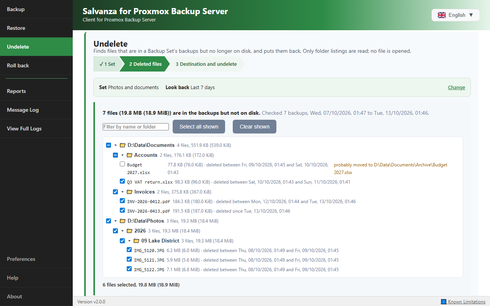
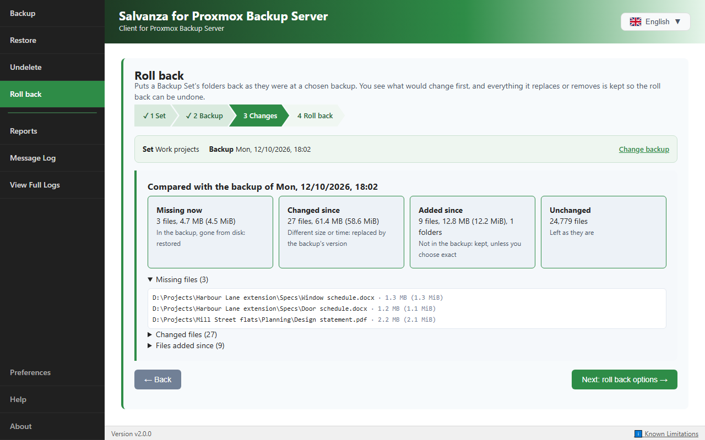
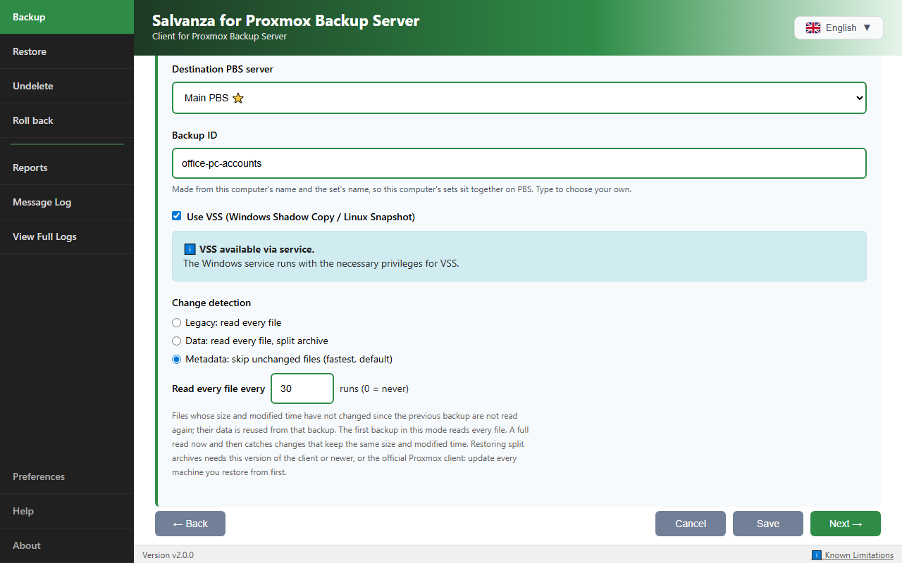

# Salvanza for Proxmox Backup Server : client Windows et Linux pour Proxmox Backup Server

[🇬🇧 English](README.md) · [🇫🇷 Français](README.fr.md) · [🇮🇹 Italiano](README.it.md) · [🇩🇪 Deutsch](README.de.md) · [🇪🇸 Español](README.es.md) · [🇷🇺 Русский](README.ru.md) · [🇨🇳 中文](README.zh.md) · [🇯🇵 日本語](README.ja.md) · [🇬🇷 Ελληνικά](README.el.md) · [🇷🇴 Română](README.ro.md) · [🇸🇪 Svenska](README.sv.md) · [🇸🇦 العربية](README.ar.md) · [🇮🇷 فارسی](README.fa.md)

> ℹ️ Ce document est une traduction du [README anglais](README.md). En cas de différence, c'est la version anglaise qui est à jour.

> ⚠️ **Avis sur les marques et l'affiliation.** Ceci est un **projet communautaire indépendant**, et non un produit officiel Proxmox : il n'est **ni affilié à Proxmox Server Solutions GmbH, ni approuvé ou parrainé par elle**. **Proxmox®** est une marque déposée de Proxmox Server Solutions GmbH dans l'UE, aux États-Unis et dans d'autres pays ; elle est utilisée ici **uniquement** pour indiquer la compatibilité. Conformément aux recommandations de Proxmox sur l'usage de ses marques (une marque déposée ne doit pas figurer dans le nom d'un produit ou d'une application : par exemple « XY App for Proxmox Virtual Environment » et non « Proxmox XY App »), **le client sans marque a été renommé** : le produit appelé auparavant *Proxmox Backup Client* s'appelle désormais **Salvanza for Proxmox Backup Server** (Salvanza en abrégé), un nom qui ne contient pas la marque Proxmox. Les règles exactes figurent dans le [kit média de Proxmox](https://www.proxmox.com/en/about/company-details/media-kit).

[](LICENSE)
[](https://github.com/salvanza/salvanza_client/releases)
[](docs/manual/README.md)

**Salvanza for Proxmox Backup Server (anciennement Proxmox Backup Client) est un client de sauvegarde open source (GPL-3.0) pour Proxmox Backup Server (PBS), sous Windows et Linux.** Il sauvegarde des dossiers sous forme d'archives de fichiers consultables et des machines entières sous forme d'images disque amorçables, selon des planifications ou à la demande. Il restaure tout, d'un simple fichier à une machine entière : sur le même ordinateur, sur une machine de remplacement ou dans une machine virtuelle Proxmox VE.

Site du projet : **[salvanza.org](https://salvanza.org/)** · Code source, versions et issues : **[github.com/salvanza/salvanza_client](https://github.com/salvanza/salvanza_client)**

Il s'agit d'une **suite d'outils** :

- **L'application Salvanza**, `salvanza-gui` (créée par RDEM Systems sous le nom de Nimbus Backup GUI, remaniée et étendue par mjb-is) : l'application pour Windows et Linux. Des ensembles de sauvegarde avec plusieurs planifications chacun, des sauvegardes de dossiers et de disques entiers avec des instantanés cohérents (VSS sous Windows, elastio-snap/dattobd sous Linux), la restauration de fichiers depuis les sauvegardes de dossiers et de machines, Récupération et Retour arrière, plusieurs serveurs PBS, le chiffrement côté client, et un service d'arrière-plan, `salvanza-svc`, pour que les planifications s'exécutent sans session ouverte.
- **`salvanza-cli`**, un seul outil en ligne de commande, avec une sous-commande pour chaque tâche :
  - **`salvanza-cli backup-folder`** : sauvegardes de dossiers (pxar) avec déduplication et détection des changements.
  - **`salvanza-cli backup-disk`** : sauvegardes à chaud de disques entiers (fidx) de machines Windows et Linux. L'image est amorçable après restauration.
  - **`salvanza-cli attach-nbd`** : attache une sauvegarde de disque comme périphérique bloc NBD (Linux).
- **Une ISO de restauration bare-metal** (Salvanza-BMR) basée sur Clonezilla Live, avec une restauration guidée de la mise sous tension jusqu'au redémarrage.

> Mots-clés : salvanza · client proxmox backup server windows · client PBS · sauvegarde VSS Windows · sauvegardes externalisées immuables · physique vers virtuel (P2V) · restauration bare-metal · interface Proxmox Backup Server.

<a id="-new-in-20"></a>
## 💡 Pourquoi utiliser ce client

Le `proxmox-backup-client` officiel est un outil en ligne de commande pour Linux. Ce client fonctionne avec le même serveur et les mêmes formats de sauvegarde, et ajoute :

- **Windows.** Il n'existe pas de client officiel pour Windows. Ici, il y a des outils en ligne de commande et une application, des sauvegardes de dossiers via des instantanés VSS et des sauvegardes à chaud de disques entiers.
- **Une application pour Windows et Linux** : des ensembles de sauvegarde planifiés, exécutés par un service d'arrière-plan sans que personne n'ait à ouvrir de session, la restauration avec recherche, Récupération et Retour arrière, les rapports et l'e-mail.
- **Des machines entières** : des images de disque amorçables, des fichiers isolés récupérés depuis ces images, et un ISO de restauration bare-metal guidée, sur le même ordinateur, sur un nouveau matériel ou dans une machine virtuelle Proxmox VE.
- **Les détails des fichiers Windows conservés** : permissions NTFS, attributs, flux de données alternatifs, attributs étendus et dates de création sont enregistrés avec chaque sauvegarde de dossier, et la restauration de ce client les remet en place.
- **Aucune dépendance** : ce que ce client sauvegarde se restaure avec le client officiel, et ce que le client officiel sauvegarde se restaure avec celui-ci (voir ci-dessous).

## 🆕 Nouveautés de la 2.0

La version 2.0 intègre au projet un important travail sur l'interface graphique, le service d'arrière-plan et le moteur de sauvegarde (voir le [CHANGELOG](CHANGELOG.md)). Par rapport à la 1.2 :

- **L'application se connecte au service d'arrière-plan avec les droits d'administrateur.** Lorsque le service est installé, les serveurs PBS et les ensembles de sauvegarde de l'ordinateur appartiennent au service, et seul le service lit son dossier de paramètres. L'application demande une seule fois les droits d'administrateur pour se connecter (UAC sous Windows, pkexec sous Linux ; sur un compte standard, le nom et le mot de passe d'un administrateur). Seul un petit utilitaire est élevé, et l'application ne garde le jeton du service qu'en mémoire. Un utilisateur qui ne peut pas répondre à la demande peut choisir **Utiliser mes propres paramètres** et garder ses propres serveurs et ensembles de sauvegarde, qui s'exécutent tant que l'application est ouverte ; **Se connecter** propose ensuite de les copier dans ceux de l'ordinateur. L'application elle-même s'exécute sans droits d'administrateur et propose **Redémarrer en tant qu'administrateur** lorsqu'une opération l'exige. Voir la section 15 du [manuel de l'interface graphique](docs/manual/GUI.md#connecting-to-the-background-service).
- **L'application vérifie qu'elle parle bien au service.** Avant d'envoyer quoi que ce soit à l'API locale du service, l'application vérifie qui répond : le propre processus du service sous Windows, un socket appartenant à root sous Linux. Un programme qui prend le port pendant que le service est arrêté n'obtient rien.
- **Des ensembles de sauvegarde avec plusieurs planifications chacun**, de toutes les quelques minutes à une fois par an (le dernier jour du mois, le 2e mardi), chacune décrite en clair avec ses 3 prochaines exécutions.
- **Sauvegardes incrémentielles de dossiers** avec la détection des changements du client officiel (modes Données et Métadonnées) : les fichiers inchangés ne sont pas relus.
- **Sauvegardes machine plus rapides**, qui ignorent l'espace libre, le fichier d'échange et le fichier d'hibernation, et écrivent des zéros à la place des secteurs illisibles au lieu d'échouer.
- **Plusieurs sauvegardes à la fois** (**Nombre maximal de sauvegardes simultanées**, de 1 à 8, 3 par défaut), y compris dans le service d'arrière-plan, chacune avec son propre instantané, son journal, Pause et Arrêter.
- **Limites de vitesse** pour l'envoi vers PBS, le téléchargement depuis PBS et la lecture des disques, chacune étant un budget unique partagé par tout ce qui s'exécute en même temps.
- **Récupération et Retour arrière** pour les ensembles de sauvegarde de dossiers et de machines, dans l'interface graphique et en ligne de commande.
- **Des fichiers récupérés depuis les sauvegardes machine** : parcourez les volumes NTFS, FAT, exFAT, ext2/3/4 et XFS contenus dans une image disque et restaurez des fichiers individuels.
- **Des clés de chiffrement que vous pouvez conserver** : enregistrez-en une copie, imprimez une clé papier avec un code QR, et importez une clé depuis un fichier, la caméra, une photo ou un texte saisi.
- **Les ensembles de sauvegarde machine reconnaissent leurs disques à leur identité** : un disque qui change de numéro après une modification matérielle reste celui qui est sauvegardé, et un disque manquant fait échouer l'exécution au lieu de faire sauvegarder un autre disque.
- **Des partitions peuvent être exclues d'une sauvegarde machine** : cochez sous chaque disque les partitions à sauvegarder. Une partition exclue n'est ni lue ni incluse dans l'instantané, et entre dans l'image sous forme de zéros : une restauration la rend donc à sa place et à sa taille, vide et non formatée. Le sélecteur de disques signale les partitions dont un disque restauré a besoin pour démarrer.
- **Sauvegardes machine Linux avec elastio-snap ou dattobd.** Un ensemble machine Linux peut désactiver les instantanés et lire les disques à chaud, mais seulement si son propriétaire coche qu'il accepte que la sauvegarde puisse être incohérente.
- **Chaque utilisateur peut choisir son propre thème de couleurs** dans l'application sans marque. Une application de marque garde les couleurs de sa marque.
- **Activer et désactiver un ensemble de sauvegarde** depuis son éditeur comme depuis son menu, et un avertissement à l'enregistrement lorsqu'un ensemble ne s'exécuterait pas tel qu'il est enregistré (désactivé, aucune planification active, un problème d'instantané, un disque manquant).
- **Un seul outil en ligne de commande, `salvanza-cli`**, avec les sous-commandes `backup-folder`, `backup-disk` et `attach-nbd` à la place des trois outils séparés ; leurs anciens noms fonctionnent toujours.
- **Paquets Linux** (`.deb`, `.rpm` et Arch), avec le paquet `salvanza` et le service `salvanza.service`, et le service d'arrière-plan.
- **Une ISO de restauration bare-metal guidée**, qui restaure aussi dans une machine virtuelle vide (P2V). Une machine sauvegardée en tant que machine virtuelle Proxmox VE peut aussi être restaurée directement depuis PBS dans Proxmox VE, comme toute VM que Proxmox VE a lui-même sauvegardée.
- **Versions de marque** : les mêmes binaires sont livrés sous forme d'installeurs Salvanza, Nimbus Backup et Etitech Backup, chacun avec ses propres noms de programmes et dossiers de paramètres.
- **18 langues d'interface.**

## 🔁 Mise à niveau depuis Proxmox Backup Client

Salvanza est le nouveau nom de Proxmox Backup Client, et la mise à niveau est automatique. L'installation de Salvanza (le MSI ou le paquet Linux) supprime l'installation précédente de Proxmox Backup Client, ou celle d'une autre marque, ainsi que son service d'arrière-plan. Au premier démarrage, Salvanza reprend les paramètres précédents (serveurs PBS, clés, ensembles de sauvegarde et historique) depuis `C:\ProgramData\ProxmoxBackupClient`, `%APPDATA%\ProxmoxBackupClient`, `~/.proxmox-backup-guardian` ou `/var/lib/proxmoxbackupclient`, et conserve une copie datée des fichiers de paramètres dans le nouveau dossier, sous `pre-salvanza-<date>`. Vos sauvegardes sur PBS ne sont pas touchées.

| Avant | Maintenant |
|---|---|
| `ProxmoxBackupClient.exe`, `ProxmoxBackupClientSVC.exe` | `salvanza-gui.exe`, `salvanza-svc.exe` (service Windows `salvanza-svc`) |
| `proxmoxbackup-directory`, `proxmoxbackup-machine`, `proxmoxbackup-nbd` | `salvanza-cli backup-folder`, `salvanza-cli backup-disk`, `salvanza-cli attach-nbd` (les anciens noms fonctionnent toujours) |
| `C:\Program Files\ProxmoxBackupClient`, `C:\ProgramData\ProxmoxBackupClient` | `C:\Program Files\Salvanza`, `C:\ProgramData\Salvanza` |
| Paquet et service Linux `proxmoxbackupclient` | Paquet `salvanza`, service `salvanza.service`, paramètres dans `/var/lib/salvanza`, les vôtres dans `~/.salvanza` |

## ⭐ Ce qu'il fait, avec des résultats mesurés

| | Résultat |
|---|---|
| **Sauvegardes incrémentielles de dossiers** | Un partage de fichiers de 480,9 Go contenant 761 866 fichiers : première exécution en 4 h 17 min, chaque exécution suivante en 10 à 15 minutes. Les fichiers inchangés ne sont même pas ouverts (détection des changements Métadonnées, comme dans le client officiel). |
| **Sauvegardes machine rapides** | L'espace libre, le fichier d'échange et le fichier d'hibernation ne sont pas lus, et l'espace disque vierge n'est pas haché. Pour le disque de 1 To d'un ordinateur portable, dont 373 Go utilisés, la durée est passée de 1 h 23 min, voire 1 h 44 min, à seulement 38 minutes. |
| **Liaisons lentes et facturées au volume** | Seules les nouvelles données sont envoyées, compressées, et l'application affiche ce qui a réellement transité sur le réseau. Un petit PC Linux sur un site distant relié en 4G (4,8 Mbit/s en envoi) : l'image complète de son disque de 128 Go plus son dossier personnel en 11 minutes, pour environ 172 Mio transférés. |
| **Des fichiers récupérés depuis les sauvegardes machine** | Le lecteur C: de 127 Go d'un ordinateur portable, avec 430 000 fichiers, s'affiche en 4 à 15 secondes. Rien n'est monté ni téléchargé au préalable. |
| **Restauration bare-metal** | Démarrez l'ISO (clé USB, CD ou réseau), saisissez les informations PBS, choisissez la sauvegarde : une machine Windows de 32 Go était revenue à son écran de connexion 8 minutes après la mise sous tension. |
| **Récupération** | Après la suppression de 39 Go sur un partage de 761 000 fichiers, une recherche Récupération sur les 7 derniers jours de sauvegardes a retrouvé exactement ces fichiers en une minute environ, et les a remis en place. |
| **Fidélité de la restauration** | Permissions NTFS, attributs, flux de données alternatifs, attributs étendus, dates de création et dates des dossiers sous Windows ; modes, propriétaires, ACL, attributs étendus et liens symboliques sous Linux. |

## 📖 Manuels d'utilisation

| Manuel | Contenu |
|---|---|
| **[Manuel de l'interface graphique](docs/manual/GUI.md)** | Installation, serveurs PBS, ensembles de sauvegarde et planifications, sauvegardes incrémentielles, progression, restauration, Récupération, Retour arrière, Rapports, journaux, Préférences, le service d'arrière-plan, dépannage |
| **[Manuel de la ligne de commande](docs/manual/CLI.md)** | `salvanza-cli backup-folder`, `backup-disk`, `attach-nbd` : toutes les options, fichiers de configuration, codes de sortie, planification |
| **[Manuel de restauration bare-metal](docs/manual/BMR.md)** | L'ISO de restauration, étape par étape ; sauvegardes `vm` sur Proxmox VE ; physique vers virtuel ; matériel différent |
| [Scénarios de restauration](docs/RESTORE_GUIDE.md) | Quelle restauration utiliser, et quand |
| [Index des manuels](docs/manual/README.md) | Une vue d'ensemble des manuels |

Les mêmes manuels sont intégrés à l'application (**Aide**, F1) : ils fonctionnent hors ligne et correspondent à la version installée.

<a id="-download"></a>
## 📦 Téléchargement

👉 **[Télécharger la dernière version](https://github.com/salvanza/salvanza_client/releases)**

| Vous avez | Utilisez |
|---|---|
| Windows | L'**installeur MSI**, `Salvanza-<version>-x64.msi`. Il installe l'application, le service d'arrière-plan et `salvanza-cli` dans `C:\Program Files\Salvanza`, ajoute ce dossier au PATH, démarre le service et ajoute une entrée au menu Démarrer. Les installeurs de marque (`NimbusBackup-<version>-x64.msi`, `EtitechBackup-<version>-x64.msi`) sont la même version sous une autre marque |
| Debian, Ubuntu, Mint | `sudo apt install ./salvanza_<version>_amd64.deb` |
| Fedora | `sudo dnf install ./salvanza-<version>-*.rpm` |
| Arch | Le paquet construit à partir de [packaging/arch/PKGBUILD](packaging/arch/PKGBUILD) (`make pkgarch`) |
| La ligne de commande uniquement | Les archives `salvanza-cli` par plateforme |
| Une machine à restaurer | L'ISO de restauration bare-metal ([manuel de restauration bare-metal](docs/manual/BMR.md#3-get-the-iso-and-make-the-boot-media)), ou construisez-la vous-même ([ci-dessous](#-bare-metal-restore-iso)) |

Lorsqu'une version ne contient pas de paquet Linux, construisez-le avec `make deb`, `make pkgfedora` ou `make pkgarch` ([BUILD.md](BUILD.md), [packaging/debian/README.md](packaging/debian/README.md)).

Les paquets Linux installent une seule entrée de menu, **Salvanza for Proxmox Backup Server**, qui lance l'application sous votre compte. Une nouvelle installation active le service d'arrière-plan (`salvanza.service`) ; une mise à jour conserve le choix que vous avez fait. Le paquet `salvanza` remplace les anciens paquets `proxmoxbackupclient` et `pbsgo`. Les paquets nécessitent polkit (pkexec), que l'application utilise pour se connecter au service.

> ⚠️ **Windows signale un « virus détecté » (par ex. `Trojan:Win32/Sabsik.FL.A!ml`) ou affiche un avertissement SmartScreen ?**
> Il s'agit d'un **faux positif connu** pour les applications Go/Wails : ce n'est *pas* un virus. Le suffixe `!ml` indique une détection par un modèle d'apprentissage automatique, qui signale les exécutables *non signés et peu courants*. Vérifiez le téléchargement comme indiqué ci-dessous.

### 🔎 Vérifier un téléchargement

Chaque version fournit des sommes de contrôle SHA-256 (`SHA256SUMS.txt`, également affichées sur la page de la version) et une **attestation de provenance signée** : la preuve cryptographique que le fichier a été produit par l'intégration continue (CI) de ce dépôt, à partir d'un commit précis.

```powershell
Get-FileHash .\Salvanza-<version>-x64.msi -Algorithm SHA256   # compare with SHA256SUMS.txt
gh attestation verify .\Salvanza-<version>-x64.msi --repo salvanza/salvanza_client
```

Sous Linux : `sha256sum -c SHA256SUMS.txt --ignore-missing`.

Lorsque les installeurs d'une version ne déclenchent aucune alerte sur VirusTotal, la page de la version renvoie vers les rapports.

> ℹ️ **Signature du code :** les binaires Windows ne sont **pas encore signés Authenticode** (un certificat open source via [SignPath Foundation](https://signpath.org) est en attente). En attendant, la provenance est établie par l'attestation et les sommes de contrôle ci-dessus.

## 🚀 Démarrage rapide (interface graphique)

1. Installez-le : le MSI sous Windows, le paquet `.deb`, `.rpm` ou Arch sous Linux ([Téléchargement](#-download)).
2. Lancez **Salvanza for Proxmox Backup Server**. Les installeurs mettent en place le service d'arrière-plan : l'application demande donc une fois les droits d'administrateur pour s'y connecter (UAC sous Windows, votre mot de passe via pkexec sous Linux). Si vous ne pouvez pas les fournir, choisissez **Utiliser mes propres paramètres**.
3. Ajoutez votre serveur PBS dans **Préférences > Informations du compte** et vérifiez-le avec **Tester**.
4. Créez un ensemble de sauvegarde (ou une sauvegarde ponctuelle) et sélectionnez les dossiers ou les disques à sauvegarder.
5. Lancez-le. Avec le service d'arrière-plan, ses planifications s'exécutent qu'une session soit ouverte ou non.

Le [manuel de l'interface graphique](docs/manual/GUI.md) détaille chaque étape.

### 🪟 Installation sans surveillance / silencieuse (MSI)

Le MSI accepte l'option silencieuse standard de Windows Installer, ainsi que des propriétés publiques pour chaque valeur par défaut :

```powershell
# Silent install with the defaults (service: Automatic + started)
msiexec /i Salvanza-<version>-x64.msi /quiet

# Silent install that installs the service but does NOT enable/autostart it
# (created as Manual and left stopped)
msiexec /i Salvanza-<version>-x64.msi /quiet SERVICEAUTOSTART=0

# Silent install that also applies a settings file exported from another computer
msiexec /i Salvanza-<version>-x64.msi /quiet CONFIGFILE="C:\Deploy\settings.json"

# Custom directory + verbose install log
msiexec /i Salvanza-<version>-x64.msi /quiet INSTALLFOLDER="D:\Apps\Salvanza" /L*v "C:\Temp\install.log"

# Silent uninstall (KEEP_CONFIG=0 also purges %ProgramData%\Salvanza)
msiexec /x Salvanza-<version>-x64.msi /quiet KEEP_CONFIG=0
```

| Propriété | Défaut | Signification |
| --- | --- | --- |
| `SERVICEAUTOSTART` | `1` | `0` = service installé en démarrage **Manuel** et laissé **arrêté** : installé, mais jamais activé ni démarré automatiquement |
| `AUTOSTART` | `1` | `0` = ne pas lancer l'application dans la zone de notification à l'ouverture de session de chaque utilisateur |
| `DESKTOPSHORTCUTS` | `1` | `0` = pas de raccourci sur le bureau (l'entrée du menu Démarrer est toujours ajoutée) |
| `CONFIGFILE` | | Chemin complet d'un fichier enregistré avec **Préférences > Exporter les paramètres...** : ses serveurs PBS et ses ensembles de sauvegarde sont fusionnés avant le démarrage du service. Les ID de sauvegarde formés à partir du nom de l'ordinateur d'origine sont formés à partir du nom de chaque ordinateur. Voir [installer/DEPLOYMENT.md](installer/DEPLOYMENT.md) |
| `KEEP_CONFIG` | `1` | Désinstallation uniquement : `0` = supprimer aussi le dossier d'état `%ProgramData%\Salvanza` (celui d'une version de marque, par exemple `%ProgramData%\NimbusBackup`) |
| `INSTALLFOLDER` | `C:\Program Files\Salvanza` | Dossier d'installation (modifiable aussi dans l'interface) |

Exécutez en tant qu'administrateur ; code de sortie `0` = succès, `3010` = succès + redémarrage nécessaire. Les MSI de marque acceptent exactement les mêmes options.

## ✨ Fonctionnalités

### Interface graphique
Les principales fonctionnalités sont listées dans [Nouveautés de la 2.0](#-new-in-20). En outre :
- 18 langues d'interface : français, anglais, italien, allemand, polonais, espagnol, bulgare, tchèque, grec, hongrois, letton, lituanien, néerlandais, portugais, roumain, slovaque, turc et ukrainien
- **Sauvegardes ponctuelles** de dossiers ou de disques entiers, et sauvegardes machine stockées en tant que `host` ou en tant que sauvegarde `vm` de Proxmox VE, avec une option de **copie forensique** qui lit aussi l'espace libre
- **Restauration** avec recherche de fichiers (caractères génériques, expressions régulières, chemins complets), restauration sélective, ACL NTFS/POSIX, flux de données alternatifs, dates de création Windows et une passe de vérification facultative
- **Pause, Reprendre et Arrêter** pour une sauvegarde en cours, y compris depuis la zone de notification sous Windows et pour les exécutions du service d'arrière-plan
- Carte de progression en direct (fin estimée, fichiers traités, vitesse d'envoi, données transférées, taux de compression), **Rapports**, un **Journal des messages** et **Voir les journaux complets**
- Notifications par e-mail, actions après sauvegarde, clonage d'ensembles de sauvegarde, export et import des paramètres
- Plusieurs serveurs PBS, avec épinglage de l'empreinte du certificat (confiance à la première utilisation), connexion par jeton d'API ou par utilisateur et mot de passe
- Cinq thèmes de couleurs et une couleur personnalisée, choisis par chaque utilisateur (application sans marque ; une application de marque garde les couleurs de sa marque)

### Ligne de commande : `salvanza-cli`
- `salvanza-cli backup-folder` : sauvegardes de dossiers (pxar) avec déduplication et `-change-detection-mode legacy|data|metadata`
- `salvanza-cli backup-disk` : sauvegardes à chaud de disques entiers de machines Windows (VSS) et Linux (elastio-snap/dattobd) (fidx, incrémentielles, espace libre ignoré sauf avec `-readfreespace`, `-type vm` pour une sauvegarde Proxmox VE, `-skippartition <disk>:<number>` pour exclure une partition)
- `salvanza-cli attach-nbd` : serveur NBD pour restaurer des sauvegardes de disques (Linux)
- `salvanza-cli version` affiche la version, `salvanza-cli help` liste les sous-commandes, et `salvanza-cli <command> -help` liste les options d'une sous-commande
- Le programme du service, `salvanza-svc` (`salvanza-svc.exe` sous Windows ; sous Linux aussi l'application, `salvanza-gui`) : `-list-sets`, `-undelete` et `-rollback` pour les ensembles de sauvegarde définis dans l'interface graphique

Les trois sous-commandes acceptent `-keyfile` et `-keyfile-passphrase` pour les instantanés chiffrés. Les anciens noms des outils, `proxmoxbackup-directory`, `proxmoxbackup-machine` et `proxmoxbackup-nbd` (ainsi que `pbsdirectorybackup`, `pbsmachinebackup`, `pbsnbd`), lancent toujours les mêmes sous-commandes avec les mêmes options : les scripts existants continuent donc de fonctionner. Référence complète : [manuel de la ligne de commande](docs/manual/CLI.md).

### 📸 Captures d'écran

<table>
<tr>
<td width="33%">

[](docs/screenshots/gui-backup-sets.png)
**Ensembles de sauvegarde** : des tâches nommées avec des badges de planification et de type, et Exécuter maintenant sur chacune

</td>
<td width="33%">

[](docs/screenshots/gui-backup-progress.png)
**Progression de la sauvegarde** : débit, fin estimée, blocs nouveaux et réutilisés

</td>
<td width="33%">

[](docs/screenshots/gui-restore.png)
**Restauration** : choisissez un serveur PBS et un ID de sauvegarde, listez les instantanés ou recherchez-y un nom de fichier

</td>
</tr>
<tr>
<td width="33%">

[](docs/screenshots/gui-schedule-tab.png)
**Planifications** : plusieurs par ensemble, avec les 3 prochaines exécutions

</td>
<td width="33%">

[](docs/screenshots/backup-set-as-vm.png)
**Sauvegarde en tant que VM Proxmox VE** : l'ID de sauvegarde PBS s'affiche pendant la saisie

</td>
<td width="33%">

[](docs/screenshots/gui-reports.png)
**Rapports** : historique complet des exécutions, avec un panneau de détails

</td>
</tr>
<tr>
<td width="33%">

[](docs/screenshots/gui-machine-partitions.png)
**Ensembles machine** : cochez sous chaque disque les partitions à sauvegarder

</td>
<td width="33%">

[](docs/screenshots/gui-themes.png)
**Thèmes** : six thèmes de couleurs, choisis par chaque utilisateur

</td>
<td width="33%">

[](docs/screenshots/gui-languages.png)
**Langues** : 18, ici français, allemand, italien, espagnol, polonais et ukrainien

</td>
</tr>
<tr>
<td width="33%">

[](docs/screenshots/gui-undelete.png)
**Récupération** : retrouve les fichiers disparus du disque depuis les dernières sauvegardes et les remet en place

</td>
<td width="33%">

[](docs/screenshots/gui-rollback.png)
**Retour arrière** : montre ce qui changerait avant de remettre les dossiers d'un ensemble comme à une sauvegarde antérieure

</td>
<td width="33%">

[](docs/screenshots/gui-set-editor-nav.png)
**Éditeur d'ensemble de sauvegarde** : Retour et Suivant d'un onglet à l'autre ; un nouvel ensemble ignore les fichiers inchangés et relit tous les fichiers toutes les 30 exécutions

</td>
</tr>
</table>

### Exclusions système intelligentes (sauvegardes de dossiers)
Les sauvegardes de dossiers excluent d'elles-mêmes les éléments suivants :

**Dossiers système :** `System Volume Information` (stockage VSS, peut dépasser 100 Go) et `$RECYCLE.BIN` où qu'ils se trouvent ; `Recovery` seulement à la racine d'un lecteur ; `.pbs-rollback` (le dossier de sécurité de Retour arrière).
**Fichiers système :** `pagefile.sys`, `hiberfil.sys`, `swapfile.sys` et `DumpStack.log.tmp`.

**Pourquoi c'est important :** un lecteur peut afficher 1,03 To utilisés alors que les vrais fichiers occupent ~141 Go. Sans exclusions, la sauvegarde inclurait les instantanés VSS (espace et temps perdus) ; avec elles, la taille correspond aux données réelles.

**Recommandation :** utilisez une sauvegarde de **dossiers** pour les sauvegardes au niveau des fichiers ; utilisez une sauvegarde **machine** dans un ensemble de sauvegarde distinct pour la restauration bare-metal et le P2V (une image de disque entier, dans laquelle l'espace libre et les fichiers d'échange et d'hibernation entrent sous forme de zéros).

### Sécurité et qualité
- Le dossier de paramètres du service n'est accessible qu'à SYSTEM et aux Administrateurs (Windows) ou à root seul (Linux) ; son API locale écoute sur 127.0.0.1 et exige un jeton, remplacé à chaque démarrage et toutes les 24 heures
- L'application n'envoie rien à cette API tant qu'elle n'a pas vérifié que c'est bien le service qui répond (le processus du service sous Windows, un socket appartenant à root sous Linux)
- Sous Windows, les jetons et mots de passe PBS de `config.json` sont chiffrés pour l'ordinateur (DPAPI)
- Validation des entrées, assainissement des identifiants, prévention de la traversée de chemins, nouvelles tentatives avec temporisation exponentielle
- Tests unitaires dans chaque module, plus des tests réels facultatifs et des tests de bout en bout contre un vrai PBS

## 🔐 Chiffrement côté client

Les instantanés peuvent être chiffrés avant de quitter la machine, avec un fichier de clé Proxmox Backup Server (le format écrit par `proxmox-backup-client key create` : les clés sont donc interchangeables avec le client officiel). Chaque bloc est chiffré en AES-256-GCM et le manifeste est signé. Le serveur PBS ne voit jamais la clé.

**Interface graphique :** ouvrez **Préférences > Informations du compte**, modifiez un serveur et utilisez son onglet **Chiffrement**. Utilisez **Importer...** pour une clé que vous possédez déjà (une copie du fichier de clé, ou une clé papier lue avec la caméra, depuis un scan ou une photo, ou saisie au clavier) ou **Générer...** pour en créer une nouvelle. L'onglet affiche l'empreinte de la clé. **Enregistrer une copie…** et **Imprimer une clé papier…** (avec un code QR) permettent d'en garder une copie loin de l'ordinateur. Les rapports indiquent si chaque sauvegarde était chiffrée. **Sans le fichier de clé, un instantané ne peut pas être restauré : gardez-en une copie en lieu sûr, loin de cette machine.**

**Clés protégées par une phrase secrète (scrypt ou PBKDF2) :** **Me la demander** garde la phrase secrète en mémoire pendant une session de l'application ; **La mémoriser sur cet ordinateur** l'enregistre comme le jeton PBS, et c'est le choix à faire pour les planifications et le service d'arrière-plan.

**Ligne de commande :**
```shell
salvanza-cli backup-folder -baseurl ... -backupdir "C:\data" -datastore store -keyfile "C:\keys\pbs-key.json" -keyfile-passphrase "..."
```
`-keyfile-passphrase` (ou `PBS_ENCRYPTION_PASSWORD`) n'est nécessaire que pour une clé protégée, et la phrase secrète est demandée si l'option est omise. `salvanza-cli backup-disk` et `salvanza-cli attach-nbd` acceptent les mêmes options. `attach-nbd` vérifie la clé par rapport à l'instantané avant de toucher au périphérique NBD : une mauvaise clé échoue donc immédiatement.

**Restauration bare-metal :** l'ISO de restauration demande la clé (aucune, un fichier de clé sur une clé USB, ou un chemin saisi) et la phrase secrète d'une clé protégée. La clé n'est jamais écrite sur l'ISO.

La restauration d'un instantané chiffré nécessite le même fichier de clé ; s'il est perdu, aucune récupération n'est possible.

## Sauvegardes de dossiers plus rapides : la détection des changements

Dans le mode Classique, utilisé par défaut, chaque sauvegarde de dossier lit chaque fichier : une exécution dure donc aussi longtemps que la lecture du dossier entier, même si rien n'a changé. Les ensembles de sauvegarde et `salvanza-cli backup-folder` peuvent utiliser à la place les modes de détection des changements du `proxmox-backup-client` officiel :

| Mode | Lit | Stocké sous forme de |
|---|---|---|
| **Classique** (Legacy, par défaut) | chaque fichier | un `<name>.pxar.didx` par dossier |
| **Données** (Data) | chaque fichier | une archive scindée : `<name>.mpxar.didx` (métadonnées) + `<name>.ppxar.didx` (contenu des fichiers) |
| **Métadonnées** (Metadata) | seulement les fichiers nouveaux et modifiés | la même archive scindée ; les fichiers dont la taille, la date de modification (à la nanoseconde), le mode et le propriétaire correspondent à la sauvegarde précédente y sont repris sans être lus |

En mode **Métadonnées**, la première exécution lit tout ; les suivantes ne lisent que ce qui a changé. Un fichier modifié d'une manière qui conserve sa taille et sa date de modification n'est pas détecté : c'est pourquoi un ensemble peut aussi **relire tous les fichiers toutes les N exécutions**. Donnez à chaque ensemble de sauvegarde son propre ID de sauvegarde : le mode Métadonnées compare avec l'instantané le plus récent du groupe de sauvegarde. En ligne de commande, utilisez `-change-detection-mode`.

**Avant de passer un ensemble en mode Données ou Métadonnées,** mettez à jour en 2.0 toutes les machines depuis lesquelles vous restaurez : les versions antérieures affichent les dossiers d'une archive scindée sans leurs fichiers. Voir la [section 7 du manuel de l'interface graphique](docs/manual/GUI.md#7-incremental-folder-backups-change-detection).

<a id="-physical-machines-into-virtual-machines-p2v"></a>
## 🔄 Des machines physiques aux machines virtuelles (P2V)

Une sauvegarde machine d'un PC ou d'un serveur physique peut devenir une machine virtuelle Proxmox VE, de deux façons :

1. **La restaurer dans Proxmox VE.** Réglez l'ensemble de sauvegarde (ou la sauvegarde ponctuelle) sur **Sauvegarder en tant que : Machine virtuelle Proxmox VE**. La sauvegarde est stockée sous `vm/<number>` : Proxmox VE la liste donc avec ses autres sauvegardes de VM et la restaure comme une VM (un disque SATA ; ajoutez une carte réseau avant de la démarrer).
2. **La restaurer avec l'ISO de restauration dans une VM vide** ayant le même firmware que la machine d'origine, un disque SATA au moins aussi grand et une carte réseau Intel E1000. Cela fonctionne aussi bien pour les sauvegardes `host` que `vm`, et la même sauvegarde se restaure toujours aussi sur du matériel nu.

Les parcours testés comprennent Windows 10 et Windows Server (UEFI/GPT), des postes Linux (UEFI/GPT et BIOS/MBR) et une sauvegarde Linux chiffrée avec sa clé sur une clé USB. Le [manuel de restauration bare-metal](docs/manual/BMR.md#7-restoring-onto-different-hardware-p2v-and-replacement-machines) contient le tableau complet, les choix de firmware, les pilotes et les instructions pas à pas.

## 🤝 Compatible avec le client Proxmox officiel, dans les deux sens

Vérifié avec `proxmox-backup-client` 3.4.9 et PBS 4.2 :

- **Les instantanés Classique, Données et Métadonnées créés par ce client se restaurent à l'octet près avec le client officiel**, qu'ils aient été créés depuis l'interface graphique ou en ligne de commande, sous Windows ou sous Linux, et l'explorateur de fichiers de PBS 4.2 les ouvre.
- **Les instantanés Classique, Données et Métadonnées créés par le client officiel se restaurent à l'octet près avec ce client**, en totalité ou de manière sélective.
- Même format d'archive scindée (pxar version 2), mêmes modes de détection des changements, même format de fichier de clé de chiffrement, mêmes variables d'environnement du type `PBS_REPOSITORY`.

Vos sauvegardes ne sont jamais liées à ce client. Deux ajouts accompagnent les archives standard, et le client officiel restaure les fichiers normalement sans eux :

- `.proxmox_backup_client_meta.json`, à la racine d'un instantané de dossier, enregistre le chemin d'origine. Le client officiel le restaure comme un fichier ordinaire.
- `proxmox-client-acls.json.gz.blob`, stocké avec chaque instantané de dossier, enregistre ce que l'archive ne peut pas contenir sous Windows (permissions NTFS, attributs, dates de création, flux de données alternatifs et attributs étendus) et, sous Linux, les attributs étendus et les ACL POSIX. Le client officiel et l'interface web de PBS l'ignorent ; la restauration de ce client les remet en place.

Sous Linux, le client officiel conserve les ACL POSIX, les attributs étendus et les capacités de fichier dans l'archive elle-même. Ce client n'écrit ni ne lit encore ces entrées, si bien que sous Linux les ACL ne passent pas d'un client à l'autre, dans un sens comme dans l'autre. Le faire à la manière officielle, en option, figure dans la [feuille de route](TODO.md).

## Sauvegarde à chaud d'une machine complète

`salvanza-cli backup-disk` (et les sauvegardes machine de l'interface graphique) sauvegardent un système Windows 10/11 ou Windows Server complet, ou une machine Linux, sans aucune interruption de service.

La syntaxe de la commande est en grande partie la même que pour les sauvegardes de dossiers, sauf que `-backupdir` est remplacé par `-backupdev` (à répéter pour plusieurs disques). Par exemple :

`salvanza-cli backup-disk -authid yourapikey -backupdev \\.\PhysicalDrive0 -baseurl https://yourpbs:8007 -certfingerprint xx:xx:xx... -datastore zfs -secret L4m3r -backup-id testfull1`

La commande ci-dessus examine le disque 0, détecte toutes les partitions montées, en prend un instantané VSS, puis crée une image de sauvegarde amorçable du disque entier au format fidx. L'espace libre et les fichiers d'échange et d'hibernation entrent dans l'image sous forme de zéros sans être lus (sous Linux, l'espace libre ext2/3/4 et XFS aussi) ; `-readfreespace` lit tout à la place, pour une copie forensique. Un secteur illisible entre dans l'image sous forme de zéros, et l'exécution indique où il se trouve. Ajoutez `-type vm` (avec un `-backup-id` numérique) pour stocker la sauvegarde comme une sauvegarde de VM Proxmox VE ([P2V](#-physical-machines-into-virtual-machines-p2v)).

La sauvegarde suivante est incrémentielle. Le hachage est parallélisé, si bien que des vitesses de 1 Go/s peuvent être atteintes.

Pour exclure une partition, par exemple une bibliothèque de jeux ou une partition de données déjà couverte par une sauvegarde de dossiers, ajoutez `-skippartition <disk>:<number>` (à répéter pour plusieurs), comme `-skippartition \\.\PhysicalDrive0:4` ou `-skippartition /dev/sda:3`. La partition n'est ni lue ni incluse dans l'instantané, et entre dans l'image sous forme de zéros : la table des partitions est conservée, si bien qu'une restauration rend la partition à sa place et à sa taille, vide et non formatée. Dans l'interface graphique, décochez la partition sous son disque dans l'ensemble de sauvegarde.

### Prérequis des sauvegardes machine Linux (équivalent de VSS)

La sauvegarde machine Windows utilise VSS. Linux n'a pas de VSS : une sauvegarde machine d'un hôte Linux en fonctionnement prend donc un instantané à un instant donné de chaque partition montée avec un module noyau, `elastio-snap` (le fork maintenu, [`Axcient/elastio-snap`](https://github.com/Axcient/elastio-snap)) ou `dattobd`.

Deux conditions sont requises, sinon une sauvegarde machine Linux refuse de s'exécuter :

1. **Le module noyau doit être installé et chargé.** Installez-le via DKMS, pour qu'il soit recompilé après chaque mise à jour du noyau, et faites-le charger à chaque démarrage. La section [Instantanés Linux : installer elastio-snap ou dattobd](docs/manual/GUI.md#linux-snapshots-installing-elastio-snap-or-dattobd) du manuel de l'interface graphique donne des étapes testées pour Debian, Ubuntu, Mint et Fedora, ainsi que pour Secure Boot et les vérifications. En novembre 2026, aucun des deux modules ne se compile sur le noyau 7 (Fedora 44 après ses mises à jour).

2. **La sauvegarde doit s'exécuter en tant que root.** L'interface de contrôle du module est réservée à root, et l'instantané est refusé pour un utilisateur normal. Le service d'arrière-plan s'exécute en tant que root ; sans lui, utilisez **Redémarrer en tant qu'administrateur** dans l'application, ou lancez `salvanza-cli backup-disk` avec `sudo`. Une simple sauvegarde de dossiers n'a pas besoin de root.

Dans l'interface graphique, un ensemble de sauvegarde machine Linux peut décocher **Utiliser les instantanés** et lire ses disques à chaud, mais seulement si la seconde case est cochée (« Exécuter sans instantané : j'accepte que la sauvegarde puisse être incohérente »). Sinon, chaque exécution s'arrête et en indique la raison. Les partitions qui ne sont pas montées sont lues directement.

### Restauration de fichiers depuis une sauvegarde de disque

La page Restauration de l'interface graphique ouvre une sauvegarde machine comme une sauvegarde de dossiers : chaque volume de l'image (NTFS, FAT, exFAT, ext2/3/4 ou XFS) est un dossier que vous pouvez parcourir et depuis lequel vous pouvez restaurer. Rien n'est monté.

Sous Linux, vous pouvez aussi attacher une sauvegarde de disque comme périphérique bloc avec `salvanza-cli attach-nbd`. Exécutez d'abord `modprobe nbd max_part=0` : avec `max_part != 0`, le noyau peut boucler indéfiniment en sondant les partitions.

`attach-nbd` connecte n'importe quelle sauvegarde de disque fixe, qu'il s'agisse d'une sauvegarde de VM ou d'hôte (cela fonctionne donc aussi pour les sauvegardes Proxmox VE). Par exemple :

`sudo salvanza-cli attach-nbd -authid 'apikey' -baseurl https://yourpbs:8007 -secret 'yoursecret' -certfingerprint 'aa:...:xx' -datastore test -namespace test1 -path "vm/107/2025-08-02T23:13:01Z/drive-virtio0.img.fidx"`

Si vous omettez `-path`, une interface en mode texte vous permet de sélectionner le fichier fidx ; `-list` affiche plutôt toutes les images.

> N'utilisez pas ceci sur une machine qui exécute quoi que ce soit d'important : un système de fichiers corrompu peut faire planter le système d'exploitation, et c'est pourquoi Proxmox VE utilise une instance QEMU pour cela.

Démontez tout ce qui se trouve sur le disque nbd avant d'arrêter `salvanza-cli attach-nbd`, sinon la partition risque de rester occupée. Si vous obtenez une erreur `Device or resource busy`, forcez une déconnexion avec `nbd-client -d /dev/nbd0`, ou redémarrez.

### Restauration sur une machine physique ou une VM

Utilisez l'[ISO de restauration bare-metal](#-bare-metal-restore-iso), sur du matériel nu ou dans une machine virtuelle vide. Le [manuel de restauration bare-metal](docs/manual/BMR.md) la décrit étape par étape.

## Utilisation : sauvegarde de répertoires

La référence complète, avec des exemples pour Windows et Linux, les codes de sortie et la planification, se trouve dans le **[manuel de la ligne de commande](docs/manual/CLI.md)**. Une commande typique :

```shell
salvanza-cli backup-folder -baseurl "https://yourpbshost:8007" -certfingerprint pbsfingerprint -authid "user@realm!apiid" -secret "apisecret" -backupdir "C:\path\to\backup" -datastore "datastorename"
```

```
salvanza-cli backup-folder
  -baseurl string            PBS URL, example: https://192.168.1.10:8007
  -certfingerprint string    Certificate fingerprint (asked for interactively when omitted)
  -authid string             API token ID (user@realm!token)
  -secret string             API token secret
  -pbsusername string        PBS user for ticket login (with -pbspassword; overrides -authid/-secret)
  -pbspassword string        Password for -pbsusername (asked for when omitted)
  -datastore string          Datastore name
  -namespace string          Namespace (optional)
  -backup-id string          Backup ID (default: the hostname)
  -backupdir string          Source directory, must not be a symlink; repeat for several
  -change-detection-mode     legacy (default), data or metadata
  -novss                     Do not snapshot the source (VSS on Windows, elastio-snap/dattobd on Linux)
  -keyfile string            PBS encryption key file
  -keyfile-passphrase string Passphrase for a protected key (asked for when omitted)
  -no-mtime                  Record 1970-01-01 as every file and folder time (see below)
  -backupstream string       Back up standard input as <name>.didx instead of a directory
  -pxarout string            Also write the archive to a local file (debugging)
  -mail-host, -mail-port, -mail-username, -mail-password, -mail-insecure,
  -mail-from, -mail-to, -mail-subject-template, -mail-body-template
                             Email report (optional)
  -config string             JSON config file; flags given on the command line override it
```

Les variables d'environnement `PBS_REPOSITORY`, `PBS_SERVER`, `PBS_PORT`, `PBS_DATASTORE`, `PBS_AUTH_ID`, `PBS_PASSWORD` et `PBS_FINGERPRINT` du client officiel sont également lues.

Pour la configuration JSON, voir [config.json.example](config.json.example) ; ne renseignez que les champs dont vous avez besoin.

### Plusieurs répertoires en une seule exécution

Répétez `-backupdir` pour sauvegarder plusieurs répertoires avec une seule commande :

```shell
salvanza-cli backup-folder -baseurl "https://yourpbshost:8007" -certfingerprint pbsfingerprint -authid "user@realm!apiid" -secret "apisecret" -datastore "datastorename" -backupdir "C:\Data" -backupdir "D:\Photos"
```

Chaque répertoire est sauvegardé dans son propre groupe de sauvegarde, avec l'ID de sauvegarde `<backup-id>_<path>` (`-backup-id` vaut par défaut le nom d'hôte). La rétention, l'élagage et la restauration traitent donc chaque répertoire comme une série indépendante. Un répertoire en échec n'arrête pas les autres, et le code de sortie signale l'échec. `-pxarout` ne peut pas être combiné avec plusieurs répertoires, et deux répertoires qui aboutiraient au même ID de sauvegarde sont rejetés avant tout envoi.

Dans un fichier de configuration JSON, utilisez `"backupdirs": ["C:\\Data", "D:\\Photos"]`. Le champ unique `"backupdir"` continue de fonctionner et peut être combiné avec `"backupdirs"`. Le chiffrement fonctionne comme pour un seul répertoire : la clé est lue une fois, et le groupe de sauvegarde de chaque répertoire est chiffré avec elle.

### Exclure les dates de l'archive

La date de modification de chaque fichier et de chaque dossier fait partie de l'archive : une date qui change modifie donc les octets de l'archive, et les blocs autour de cette entrée sont envoyés de nouveau alors que rien n'y a changé. Pour la plupart des données, c'est le bon compromis. Certaines arborescences, cependant, modifient sans cesse leurs dossiers alors que les fichiers restent identiques : un stockage qui range ses données dans des dossiers nommés d'après un hachage (`aa/bb/<rest of the hash>`) peut finir par renvoyer une grande partie de l'archive à chaque exécution pour cette seule raison.

`-no-mtime` (`"no-mtime": true` dans un fichier de configuration JSON) enregistre à la place 1970-01-01 comme date de chaque fichier et de chaque dossier, de sorte que seuls les vrais changements de contenu coûtent de nouveaux blocs. Les vraies dates ne sont conservées nulle part : une restauration date chaque élément du 1970-01-01. Avec `-change-detection-mode metadata`, chaque fichier est lu, comme en mode `data`. L'option est désactivée par défaut ; utilisez-la pour une source dont les dates n'ont pas d'importance.

### Modèles d'e-mail

Un relais qui ne demande pas d'authentification (souvent sur le port 25) fonctionne : omettez le nom d'utilisateur et le mot de passe. L'expéditeur peut inclure un nom (`Backups <backup@example.com>`).

Le [moteur de modèles de Go](https://pkg.go.dev/text/template) est utilisé pour l'objet et le corps des e-mails ; consultez sa documentation pour la syntaxe. Les variables suivantes sont disponibles :

- `.NewChunks` : nombre de nouveaux blocs créés
- `.ReusedChunks` : nombre de blocs réutilisés
- `.Datastore` : nom du datastore
- `.Error` : l'erreur éventuelle (`.ErrorStr` la donne sous forme de texte, vide s'il n'y en a pas)
- `.ReadErrors` : les fichiers ou dossiers qui n'ont pas pu être lus ; `.ReadErrorCount` en donne le nombre
- `.Hostname` : nom d'hôte de la machine
- `.StartTime` : heure de début de la sauvegarde
- `.EndTime` : heure de fin de la sauvegarde
- `.Duration` : durée de la sauvegarde
- `.FromattedDuration` : durée formatée de la sauvegarde (le nom est orthographié ainsi dans le code)
- `.Success` : vrai lorsque la sauvegarde s'est terminée sans erreur et sans rien d'illisible
- `.Partial` : vrai lorsqu'un instantané a été enregistré mais que certains fichiers n'ont pas pu être lus
- `.Status` : `Success`, `Partial` ou `Failed`

## Sauvegarde de flux

Cette fonction sauvegarde un flux au lieu d'une archive pxar. Par exemple :

```
mysqldump yourdatabase | salvanza-cli backup-folder -backupstream yourdatabase.sql [other options]
```

Elle utilise un découpage buzhash pour dédupliquer le flux lui-même, par exemple une archive tar ou un dump SQL.

## Problèmes connus

Lorsque l'antimalware de Windows Defender est actif, une sauvegarde peut ralentir jusqu'à environ 25 % de la vitesse atteignable.

Sous Windows, `salvanza-cli backup-folder` et `backup-disk` prennent un verrou de processus : une seconde sauvegarde lancée pendant qu'une autre s'exécute affiche « Another backup job is running » et se termine avec le code 2. Sous Linux, ce verrou n'existe pas : ne planifiez donc pas deux exécutions en ligne de commande en même temps. (L'interface graphique et le service d'arrière-plan exécutent plusieurs sauvegardes à la fois en toute sécurité, voir [Plusieurs sauvegardes à la fois](docs/manual/GUI.md#67-several-backups-at-once).)

## 📋 Prérequis

- Windows 10/11 ou Windows Server (64 bits) ; droits d'administrateur pour l'installation, et pour connecter l'application au service d'arrière-plan
- ou Linux : les paquets sont prévus pour Debian, Ubuntu, Mint, Fedora et Arch ; l'interface graphique nécessite le runtime WebKitGTK et polkit ; les sauvegardes machine cohérentes nécessitent le module noyau elastio-snap ou dattobd et root
- Un accès réseau à un Proxmox Backup Server
- Pour le P2V : Proxmox VE avec le datastore PBS ajouté comme stockage, ou tout hyperviseur capable de démarrer l'ISO de restauration

## 🔨 Compilation depuis les sources

**[BUILD.md](BUILD.md)** contient les instructions complètes : l'interface graphique et le service d'arrière-plan, les outils en ligne de commande, le MSI et les paquets Linux. En bref, avec Go 1.25 ou ultérieur et la CLI Wails v2.13 :

```bash
cd gui
wails build                                                       # the app, gui/build/bin/salvanza-gui.exe
go build -tags service -o build/bin/salvanza-svc.exe              # the background service
cd ../cli
GOWORK=off go build -o ../gui/build/bin/salvanza-cli.exe .        # the command line
```

```bash
make cli          # salvanza-cli, in dist/
make deb          # .deb
make pkgfedora    # .rpm (in Docker)
make pkgarch      # Arch package (on Arch)
make msi          # Windows MSIs on Linux (Docker + Wine + WiX), one per brand
make clonezilla   # the bare-metal restore ISO, dist/Salvanza-BMR-<version>.iso
```

Le frontend compilé (`gui/frontend/dist`) est inclus dans le dépôt : Node.js n'est donc nécessaire que pour modifier le frontend (`npm install` et `npm run build` dans `gui/frontend`, ou `wails dev` pour le rechargement à chaud). Tests : `make test`.

## 🔧 Utilisation avancée et guides

### Multi-PBS (plusieurs serveurs PBS)

Configurez plusieurs serveurs PBS et choisissez la cible par ensemble de sauvegarde ou par sauvegarde ponctuelle (par ex. `C:\Users` vers un PBS rapide sur SSD chaque jour, `D:\` vers un PBS de grande capacité chaque semaine, plus un serveur de reprise après sinistre).

- **[Guide utilisateur](MULTI_PBS_USER_GUIDE.md)** : ajout et test des serveurs, serveur par défaut, choix d'un serveur par sauvegarde, FAQ et dépannage.
- **[Guide d'implémentation](MULTI_PBS_GUIDE.md)** : modèle de données, migration automatique depuis une configuration à un seul PBS, méthodes du backend.

Une ancienne configuration à un seul PBS est automatiquement migrée vers un serveur `default` au premier chargement.

<a id="-bare-metal-restore-iso"></a>
### 💿 ISO de restauration bare-metal

L'ISO de restauration, Salvanza-BMR, est une ISO Clonezilla Live standard, complétée par le binaire `pbsnbd` (le code de `salvanza-cli attach-nbd`, compilé à part depuis `nbd/cmd/pbsnbd`) et deux entrées de menu. Elle démarre depuis un CD, depuis une clé USB (écrite avec `dd`, ou depuis une clé Ventoy), et sur des machines UEFI ou BIOS :

- **`ocs-pbs-bare-metal-restore`** : la première entrée du menu de démarrage, celle par défaut, **PBS Bare Metal Restore**. Elle saute les questions de langue et de clavier de Clonezilla et va directement des identifiants PBS à une restauration terminée : DHCP d'abord (une demande d'IP statique seulement en cas d'échec), une clé de chiffrement depuis une clé USB si la sauvegarde est chiffrée, et une détection du disque cible qui ne propose jamais la clé depuis laquelle elle a démarré. Elle restaure indifféremment les sauvegardes Windows et Linux (la restauration se fait au niveau bloc), sur du matériel nu ou dans une VM vide.
- **`ocs-pbs-nbd`** : une entrée **pbs-nbd** dans le menu de sélection de mode de Clonezilla. Elle demande vos informations de connexion PBS et l'instantané, l'attache à `/dev/nbd0`, puis passe la main à l'assistant habituel de restauration de disque de Clonezilla, que vous pilotez vous-même.

```bash
./patch-clonezilla.sh \
  -o clonezilla-live-patched.iso \
  clonezilla-live-3.3.3-37-amd64.iso \
  ./build/pbsnbd \
  ./clonezilla-patch/ocs-pbs-nbd ./clonezilla-patch/ocs-pbs-bare-metal-restore
```

`make clonezilla` télécharge l'ISO standard, compile `pbsnbd` et fait la même chose, en produisant `dist/Salvanza-BMR-<version>.iso`. Tous les détails (pourquoi une reconstruction complète de l'ISO plutôt qu'un remplacement sur place, prérequis, déroulement des menus, vérification) se trouvent dans **[PATCH-CLONEZILLA.md](PATCH-CLONEZILLA.md)** ; son utilisation, dans le **[manuel de restauration bare-metal](docs/manual/BMR.md)**.

### Compilation de l'interface graphique Windows

**Windows natif** : voir **[BUILD.md](BUILD.md)** pour la chaîne d'outils (Go et MinGW depuis Chocolatey, Wails) et les commandes pour l'application, le service et le MSI.

**Docker (pour compiler sous Linux).** `./build_gui_windows_docker.sh` compile l'application Windows, avec une prise en charge correcte de WebView2, dans un conteneur `golang` jetable. Il ne compile ni le service d'arrière-plan ni le MSI.

### Journal des modifications et documentation interne

- **[CHANGELOG.md](CHANGELOG.md)** : historique des modifications par version.
- **[TODO.md](TODO.md)** : feuille de route ouverte et idées.
- **[RELEASE_NOTES.md](RELEASE_NOTES.md)** : état stable du produit et versions disponibles.
- **[installer/DEPLOYMENT.md](installer/DEPLOYMENT.md)** : déploiement du MSI sur de nombreux ordinateurs.
- **[MSI_UNINSTALL_TEST.md](MSI_UNINSTALL_TEST.md)** : boîte de dialogue de désinstallation du MSI (conserver ou supprimer la configuration) et son plan de test.
- **[AGENTS.md](AGENTS.md)** : organisation du dépôt et conventions, pour les contributeurs et les agents de programmation.

## 🌐 Support technique en Italie

Étant entendu que le projet et **TOUTES** ses contributions resteront à jamais publics et sous licence GPLv3, le principal sponsor de ce projet, ainsi que des dernières fonctionnalités de sauvegarde machine, E.T.I. Srl ( https://etitech.net ), peut fournir à qui en a besoin un support pour les déploiements Proxmox en général, et pour les outils de sauvegarde Windows en particulier.

Il n'y aura jamais d'éditions « community » et « enterprise » distinctes : seul le support technique sera un service indépendant.
Toute personnalisation que vous demanderez, même si son développement peut être payant, sera publiée sous GPLv3, comme l'ensemble du projet.

## 🖥️ Origine de l'interface graphique

L'**application Salvanza** (anciennement la Proxmox Backup Client GUI) a été créée par **[RDEM Systems](https://www.rdem-systems.com/)** sous le nom de **[Nimbus Backup GUI](https://nimbus.rdem-systems.com)** : RDEM Systems a conçu et développé l'application d'origine, et propose un support commercial autour de Nimbus Backup, sa version de marque. **[mjb-is](https://github.com/mjb-is)** l'a ensuite remaniée et étendue, en s'inspirant du fonctionnement et de l'ergonomie d'autres systèmes de sauvegarde, et ce travail a été réintégré dans ce dépôt. L'ensemble du code, y compris l'interface graphique et toutes ses fonctionnalités, reste open source sous licence GPLv3.

## ⚠️ Avertissement

Ce logiciel est fourni « en l'état ». Bien que nous visions la fiabilité, nous déclinons toute responsabilité en cas de perte ou d'altération de données. Testez toujours vos sauvegardes et vérifiez la restauration avant de vous y fier en production. Aucune sauvegarde n'est éprouvée tant que vous n'avez pas restauré à partir d'elle : testez donc vos propres restaurations, y compris une restauration bare-metal.

Le logiciel est encore de qualité alpha et nous déclinons toute responsabilité pour tout type de dommage ou de perte de données, y compris des fichiers source.

Les rapports de bogues sont les bienvenus : ouvrez une [issue](https://github.com/salvanza/salvanza_client/issues) en indiquant ce que vous avez fait, ce qui s'est passé, et le journal (le Journal des messages, ou **Voir les journaux complets**).

## 📄 Licence

GPLv3 : voir le fichier [LICENSE](LICENSE).

## 🏷️ Personnalisation de marque

Tout contributeur ayant fourni **au moins 5 commits** qui ajoutent des fonctionnalités ou des corrections a le droit de faire ajouter ses données de marque pour un usage commercial.

La seule condition est que l'entreprise à laquelle renvoie la marque ne mène **aucune** des activités suivantes :

- Campagnes de logiciels malveillants
- Activités faisant la promotion de la guerre (cela s'applique à tout pays, y compris occidental)
- Escroqueries
- Vol de données
- Trafic d'enfants
- Violence
- Discrimination
- Drogues
- Toute activité généralement reconnue comme illégale

Si une plainte parvient à l'un des contributeurs, nous essaierons de prendre contact ; si aucune explication valable n'est donnée, nous **mettrons immédiatement fin** à cet avantage.

La **licence GPLv3 reste en vigueur**, et vous resterez libre de forker le projet et de compiler vos propres exécutables.

## 🤝 Contribuer

Les contributions sont les bienvenues, en particulier :

1. Les traductions des README et des manuels d'utilisation pour la version 2.0
2. L'envoi asynchrone / multicœur des blocs (la compression multicœur est déjà implémentée pour la sauvegarde machine)
3. Un correctif côté Proxmox pour ajouter au format pxar un autre type d'entrée contenant les descripteurs de sécurité Windows
4. La prise en charge des liens symboliques et des jonctions Windows (ils sont ignorés aujourd'hui)
5. Des tests sur davantage de matériels, de distributions Linux et de noyaux, en particulier des restaurations bare-metal
6. Tout ce qui vous semble intéressant :)

## À propos des contributeurs de Salvanza

Les contributeurs de Salvanza (anciennement les contributeurs de Proxmox Backup Client GO) développent et maintiennent ce projet. Le logiciel s'appuie sur l'infrastructure NTP/NTS et sur les [11 serveurs NTS publics](https://github.com/jauderho/nts-servers) répertoriés dans la référence communautaire.

---

**© 2024-2026 Les contributeurs de Salvanza et RDEM Systems.**
