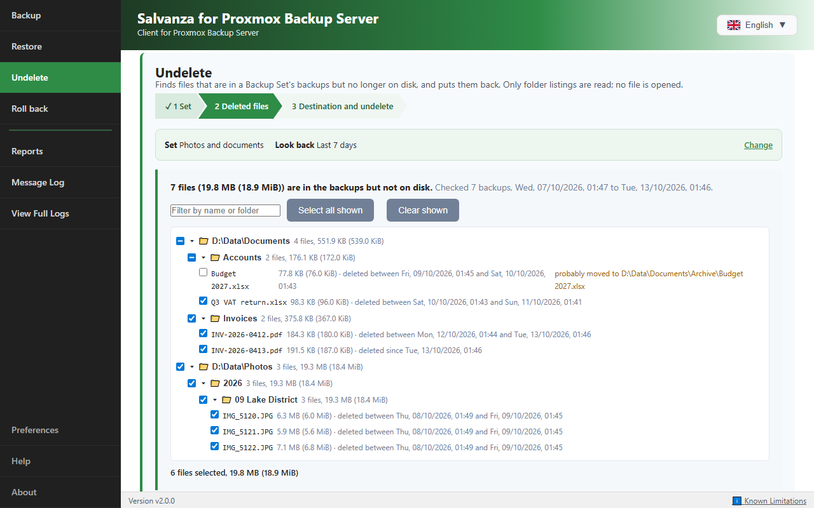
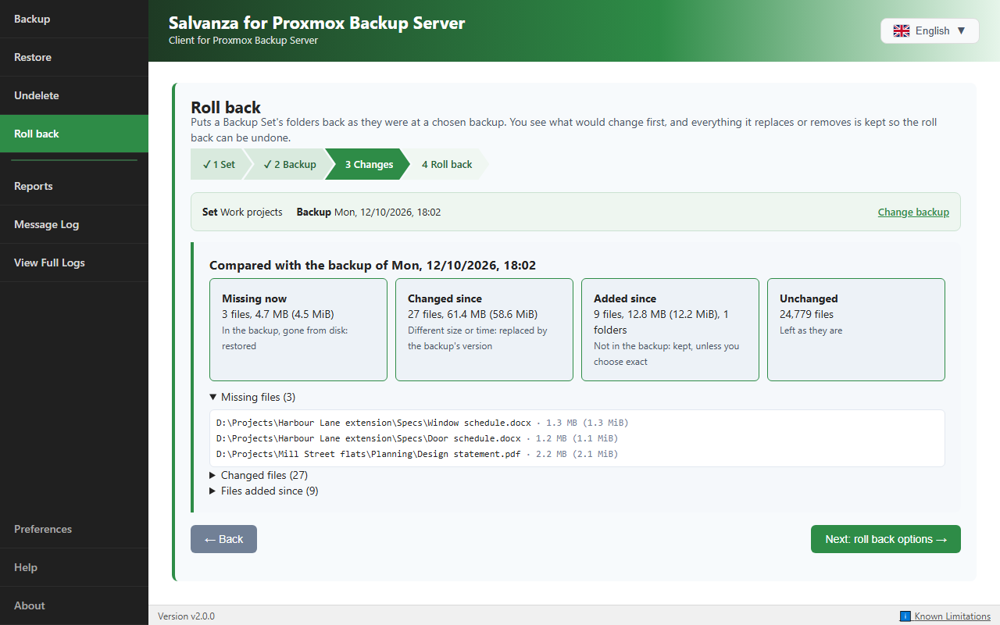
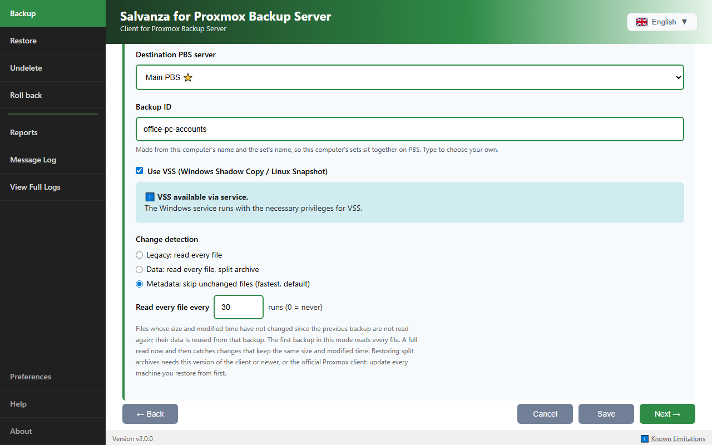

# Salvanza for Proxmox Backup Server: Windows and Linux client for Proxmox Backup Server

[🇬🇧 English](README.md) · [🇫🇷 Français](README.fr.md) · [🇮🇹 Italiano](README.it.md) · [🇩🇪 Deutsch](README.de.md) · [🇪🇸 Español](README.es.md) · [🇷🇺 Русский](README.ru.md) · [🇨🇳 中文](README.zh.md) · [🇯🇵 日本語](README.ja.md) · [🇬🇷 Ελληνικά](README.el.md) · [🇷🇴 Română](README.ro.md) · [🇸🇪 Svenska](README.sv.md) · [🇸🇦 العربية](README.ar.md) · [🇮🇷 فارسی](README.fa.md)

> ℹ️ The translated READMEs are made from this English README; where they differ, the English one is current.

> ⚠️ **Trademark & affiliation notice.** This is an **independent community project**, not an official Proxmox product: it is **not affiliated with, endorsed by, or sponsored by Proxmox Server Solutions GmbH**. **Proxmox®** is a registered trademark of Proxmox Server Solutions GmbH in the EU, the U.S. and other countries, and it is used here **only** to describe compatibility. Following Proxmox's own trademark guidance (registered marks must not be used in product or app names, for example "XY App for Proxmox Virtual Environment" rather than "Proxmox XY App"), **the non-branded client has been renamed**: the product formerly called *Proxmox Backup Client* is now **Salvanza for Proxmox Backup Server** (Salvanza for short), a name that does not contain the Proxmox mark. See the [Proxmox media kit](https://www.proxmox.com/en/about/company-details/media-kit) for the exact rules.

[](LICENSE)
[](https://github.com/salvanza/salvanza_client/releases)
[](docs/manual/README.md)

**Salvanza for Proxmox Backup Server (formerly Proxmox Backup Client) is an open-source (GPL-3.0) backup client for Proxmox Backup Server (PBS), for Windows and Linux.** It backs up folders as browsable file archives and whole machines as bootable disk images, on schedules or on demand. It restores anything from a single file to a whole machine: onto the same computer, onto a replacement, or into a Proxmox VE virtual machine.

Project site: **[salvanza.org](https://salvanza.org/)** · Source code, releases and issues: **[github.com/salvanza/salvanza_client](https://github.com/salvanza/salvanza_client)**

It is a **suite of tools**:

- **The Salvanza app**, `salvanza-gui` (originated by RDEM Systems as the Nimbus Backup GUI, reworked and extended by mjb-is): the app for Windows and Linux. Backup Sets with several schedules each, folder and whole-disk backups with consistent snapshots (VSS on Windows, elastio-snap/dattobd on Linux), restore of files from folder and machine backups, Undelete and Roll back, several PBS servers, client-side encryption, and a background service, `salvanza-svc`, so schedules run with nobody signed in.
- **`salvanza-cli`**, one command line tool with a subcommand for each job:
  - **`salvanza-cli backup-folder`**: folder (pxar) backups with deduplication and change detection.
  - **`salvanza-cli backup-disk`**: live whole-disk backups (fidx) of Windows and Linux machines. The image is bootable after a restore.
  - **`salvanza-cli attach-nbd`**: attaches a disk backup as an NBD block device (Linux).
- **A bare-metal restore ISO** (Salvanza-BMR) built on Clonezilla Live, with a guided restore from power-on to reboot.

> Keywords: salvanza · proxmox backup server client windows · PBS client · Windows VSS backup · immutable offsite backups · physical to virtual (P2V) · bare-metal restore · Proxmox Backup Server interface.

## 💡 Why use this client

The official `proxmox-backup-client` is a command-line tool for Linux. This client works with the same server and the same backup formats, and adds:

- **Windows.** There is no official client for Windows. Here there are command-line tools and an app, folder backups through VSS snapshots, and live whole-disk backups.
- **An app for Windows and Linux**: Backup Sets on schedules, run by a background service so nobody needs to be signed in, Restore with search, Undelete and Roll back, Reports and e-mail.
- **Whole machines**: bootable disk images, single files back from them, and a guided bare-metal restore ISO, onto the same computer, new hardware or a Proxmox VE virtual machine.
- **Windows file details kept**: NTFS permissions, attributes, alternate data streams, extended attributes and creation times are recorded with each folder backup, and this client's Restore puts them back.
- **No lock-in**: what this client backs up restores with the official client, and what the official client backs up restores with this one (see below).

## 🆕 New in 2.0

Version 2.0 merges a large body of work on the GUI, the background service and the backup engine into the project (see the [CHANGELOG](CHANGELOG.md)). Compared with 1.2:

- **The app connects to the background service with administrator rights.** With the service installed, the computer's PBS servers and Backup Sets belong to the service, and only the service reads its settings folder. The app asks for administrator rights once to connect (UAC on Windows, pkexec on Linux; on a standard account, an administrator's name and password). Only a small helper is elevated, and the app keeps the service's token in memory only. A user who cannot answer the prompt can choose **Use my own settings** and keep their own servers and Backup Sets, which run while the app is open; **Connect** later offers to copy them to the computer's. The app itself runs without administrator rights, and offers **Restart as administrator** where an operation needs it. See section 15 of the [GUI manual](docs/manual/GUI.md#connecting-to-the-background-service).
- **The app checks it is talking to the service.** Before it sends anything to the service's local API, the app checks who answers: the service's own process on Windows, a socket owned by root on Linux. A program that takes the port while the service is stopped gets nothing.
- **Backup Sets with several schedules each**, from every few minutes to once a year (the last day of the month, the 2nd Tuesday), each shown in plain words with its next 3 runs.
- **Incremental folder backups** with the official client's change detection (Data and Metadata modes): unchanged files are not read again.
- **Faster machine backups** that skip free space, the paging file and the hibernation file, and write unreadable sectors as zeros instead of failing.
- **Several backups at once** (**Maximum Concurrent Backups**, 1 to 8, default 3), also in the background service, each with its own snapshot, log, Pause and Stop.
- **Speed limits** for upload to PBS, download from PBS and disk read, each one budget shared by everything running at the same time.
- **Undelete and Roll back** for folder and machine Backup Sets, in the GUI and from the command line.
- **Files back from machine backups**: browse NTFS, FAT, exFAT, ext2/3/4 and XFS volumes inside a disk image and restore single files.
- **Encryption keys you can keep**: save a copy, print a paper key with a QR code, and import a key from a file, the camera, a photo or typed text.
- **Machine Backup Sets pin their disks by identity**, so a disk that gets a new number after a hardware change is still the one backed up, and a missing disk fails the run instead of backing up another disk.
- **Partitions can be left out of a machine backup**: tick the partitions to back up under each disk. A partition left out is not read or snapshotted and goes into the image as zeros, so a restore gives it back in its place and at its size, empty and unformatted. The disk picker marks the partitions a restored disk needs to start.
- **Linux machine backups with elastio-snap or dattobd.** A Linux machine set can turn snapshots off and read disks live, but only when its owner ticks that they accept the backup may be inconsistent.
- **Each user can choose their own colour theme** in the unbranded app. A branded app keeps its brand's colours.
- **Enable and disable a Backup Set** from its editor as well as its menu, and a warning on save when a set would not run as saved (disabled, no schedule on, a snapshot problem, a missing disk).
- **One command line tool, `salvanza-cli`**, with the subcommands `backup-folder`, `backup-disk` and `attach-nbd` in place of the three separate tools; their earlier names still work.
- **Linux packages** (`.deb`, `.rpm` and Arch), package `salvanza` and service `salvanza.service`, with the background service.
- **A guided bare-metal restore ISO**, which also restores into an empty virtual machine (P2V). A machine backed up as a Proxmox VE virtual machine can also be restored straight from PBS in Proxmox VE, like any VM that Proxmox VE backed up itself.
- **Branded builds**: the same binaries ship as Salvanza, Nimbus Backup and Etitech Backup installers, each with its own program names and settings folders.
- **18 interface languages.**

## 🔁 Upgrading from Proxmox Backup Client

Salvanza is the new name of Proxmox Backup Client, and the upgrade is automatic. Installing Salvanza (the MSI, or the Linux package) removes the earlier Proxmox Backup Client install, or another brand's, and its background service. The first time Salvanza starts, it moves the earlier settings over (PBS servers, keys, Backup Sets and history), from `C:\ProgramData\ProxmoxBackupClient`, `%APPDATA%\ProxmoxBackupClient`, `~/.proxmox-backup-guardian` or `/var/lib/proxmoxbackupclient`, and keeps a dated copy of the settings files in the new folder, under `pre-salvanza-<date>`. Your backups on PBS are not touched.

| Before | Now |
|---|---|
| `ProxmoxBackupClient.exe`, `ProxmoxBackupClientSVC.exe` | `salvanza-gui.exe`, `salvanza-svc.exe` (Windows service `salvanza-svc`) |
| `proxmoxbackup-directory`, `proxmoxbackup-machine`, `proxmoxbackup-nbd` | `salvanza-cli backup-folder`, `salvanza-cli backup-disk`, `salvanza-cli attach-nbd` (the earlier names still work) |
| `C:\Program Files\ProxmoxBackupClient`, `C:\ProgramData\ProxmoxBackupClient` | `C:\Program Files\Salvanza`, `C:\ProgramData\Salvanza` |
| Linux package and service `proxmoxbackupclient` | Package `salvanza`, service `salvanza.service`, settings in `/var/lib/salvanza`, your own in `~/.salvanza` |

## ⭐ What it does, with measured results

| | Result |
|---|---|
| **Incremental folder backups** | A 480.9 GB file share of 761,866 files: first run 4 h 17 min, each later run 10 to 15 minutes. Unchanged files are not even opened (Metadata change detection, as in the official client). |
| **Fast machine backups** | Free space, the paging file and the hibernation file are not read, and blank disk space is not hashed. A 1 TB laptop disk with 373 GB used took between 1 h 23 min and 1 h 44 min before, and takes 38 minutes now. |
| **Slow and metered links** | Only new data is sent, compressed, and the app shows what really crossed the network. A small Linux PC at a remote site on a 4G connection (4.8 Mbit/s up): its whole 128 GB disk image plus its home folder in 11 minutes for about 172 MiB transferred. |
| **Files back from machine backups** | A laptop's 127 GB C: drive with 430,000 files lists in 4 to 15 seconds. Nothing is mounted or downloaded first. |
| **Bare-metal restore** | Boot the ISO (USB stick, CD or network), enter the PBS details, pick the backup: a 32 GB Windows machine was back at its login screen 8 minutes after power-on. |
| **Undelete** | After 39 GB were deleted from a 761,000-file share, an Undelete search over the last 7 days of backups found exactly those files in about a minute, and put them back. |
| **Restore fidelity** | NTFS permissions, attributes, alternate data streams, extended attributes, creation and folder times on Windows; modes, owners, ACLs, extended attributes and symlinks on Linux. |

## 📖 User manuals

| Manual | Covers |
|---|---|
| **[GUI manual](docs/manual/GUI.md)** | Install, PBS servers, Backup Sets and schedules, incremental backups, progress, restore, Undelete, Roll back, Reports, logs, Preferences, the background service, troubleshooting |
| **[Command line manual](docs/manual/CLI.md)** | `salvanza-cli backup-folder`, `backup-disk`, `attach-nbd`: every flag, config files, exit codes, scheduling |
| **[Bare-metal restore manual](docs/manual/BMR.md)** | The restore ISO, step by step; `vm` backups onto Proxmox VE; physical to virtual; different hardware |
| [Restore scenarios](docs/RESTORE_GUIDE.md) | Which restore to use when |
| [Manuals index](docs/manual/README.md) | An overview of the manuals |

The same manuals are built into the app (**Help**, F1), so they work offline and match the installed version.

## 📦 Download

👉 **[Download the latest release](https://github.com/salvanza/salvanza_client/releases)**

| You have | Use |
|---|---|
| Windows | The **MSI installer**, `Salvanza-<version>-x64.msi`. It installs the app, the background service and `salvanza-cli` in `C:\Program Files\Salvanza`, puts that folder on the PATH, starts the service, and adds a Start menu entry. The branded installers (`NimbusBackup-<version>-x64.msi`, `EtitechBackup-<version>-x64.msi`) are the same build under another brand |
| Debian, Ubuntu, Mint | `sudo apt install ./salvanza_<version>_amd64.deb` |
| Fedora | `sudo dnf install ./salvanza-<version>-*.rpm` |
| Arch | The package built from [packaging/arch/PKGBUILD](packaging/arch/PKGBUILD) (`make pkgarch`) |
| Command line only | The per-platform `salvanza-cli` archives |
| A machine to restore | The bare-metal restore ISO ([bare-metal restore manual](docs/manual/BMR.md#3-get-the-iso-and-make-the-boot-media)), or build it yourself ([below](#-bare-metal-restore-iso)) |

When a release does not include a Linux package, build it with `make deb`, `make pkgfedora` or `make pkgarch` ([BUILD.md](BUILD.md), [packaging/debian/README.md](packaging/debian/README.md)).

The Linux packages install one menu entry, **Salvanza for Proxmox Backup Server**, which starts the app as you. A fresh install turns the background service (`salvanza.service`) on; an upgrade keeps the choice you made. The `salvanza` package replaces the earlier `proxmoxbackupclient` and `pbsgo` packages. The packages need polkit (pkexec), which the app uses to connect to the service.

> ⚠️ **Windows shows "virus detected" (e.g. `Trojan:Win32/Sabsik.FL.A!ml`) or a SmartScreen warning?**
> This is a **known false positive** for Go/Wails applications: it is *not* a virus. The `!ml` suffix indicates a machine-learning model detection that flags *unsigned and uncommon* executables. Verify the download as shown below.

### 🔎 Verifying any download

Every release provides SHA-256 checksums (`SHA256SUMS.txt`, also printed on the release page) and a **signed provenance attestation**: cryptographic proof that the file was produced by this repository's CI, from a precise commit.

```powershell
Get-FileHash .\Salvanza-<version>-x64.msi -Algorithm SHA256   # compare with SHA256SUMS.txt
gh attestation verify .\Salvanza-<version>-x64.msi --repo salvanza/salvanza_client
```

On Linux: `sha256sum -c SHA256SUMS.txt --ignore-missing`.

When a release's installers scan clean on VirusTotal, the release page links the reports.

> ℹ️ **Code signing:** Windows binaries are **not yet Authenticode-signed** (an OSS certificate via [SignPath Foundation](https://signpath.org) is pending). In the meantime, provenance is established through the attestation and checksums above.

## 🚀 Quick start (GUI)

1. Install it: the MSI on Windows, the `.deb`, `.rpm` or Arch package on Linux ([Download](#-download)).
2. Start **Salvanza for Proxmox Backup Server**. The installers set up the background service, so the app asks once for administrator rights to connect to it (UAC on Windows, your password through pkexec on Linux). If you cannot give them, choose **Use my own settings**.
3. Add your PBS server in **Preferences > Account Information** and **Test** it.
4. Create a Backup Set (or a one-off backup) and select the folders or disks to back up.
5. Run it. With the background service, its schedules run whether or not anyone is signed in.

The [GUI manual](docs/manual/GUI.md) walks through every step.

### 🪟 Unattended / silent install (MSI)

The MSI honours Windows Installer's standard silent switch, plus public properties for every default:

```powershell
# Silent install with the defaults (service: Automatic + started)
msiexec /i Salvanza-<version>-x64.msi /quiet

# Silent install that installs the service but does NOT enable/autostart it
# (created as Manual and left stopped)
msiexec /i Salvanza-<version>-x64.msi /quiet SERVICEAUTOSTART=0

# Silent install that also applies a settings file exported from another computer
msiexec /i Salvanza-<version>-x64.msi /quiet CONFIGFILE="C:\Deploy\settings.json"

# Custom directory + verbose install log
msiexec /i Salvanza-<version>-x64.msi /quiet INSTALLFOLDER="D:\Apps\Salvanza" /L*v "C:\Temp\install.log"

# Silent uninstall (KEEP_CONFIG=0 also purges %ProgramData%\Salvanza)
msiexec /x Salvanza-<version>-x64.msi /quiet KEEP_CONFIG=0
```

| Property | Default | Meaning |
| --- | --- | --- |
| `SERVICEAUTOSTART` | `1` | `0` = service installed as **Manual** and left **stopped**: installed, but never enabled or autostarted |
| `AUTOSTART` | `0` | `1` = start the app in the tray at each user's sign-in (the installer's **Start Salvanza for Proxmox Backup Server when a user signs in** tick box). Not given, an upgrade keeps the installed version's choice |
| `DESKTOPSHORTCUTS` | `1` | `0` = no desktop shortcut (the Start menu entry is always added) |
| `CONFIGFILE` | | Full path of a file saved with **Preferences > Export Settings**: its PBS servers and Backup Sets are merged in before the service starts. Backup IDs made from the exporting computer's name are made from each computer's own name. See [installer/DEPLOYMENT.md](installer/DEPLOYMENT.md) |
| `KEEP_CONFIG` | `1` | Uninstall only: `0` = also delete the `%ProgramData%\Salvanza` state directory (a branded build's own, such as `%ProgramData%\NimbusBackup`) |
| `INSTALLFOLDER` | `C:\Program Files\Salvanza` | Installation directory (also editable in the UI) |

Run elevated (admin); exit code `0` = success, `3010` = success + reboot required. The branded MSIs take exactly the same switches.

## ✨ Features

### GUI
The main features are listed under [New in 2.0](#-new-in-20). Also:
- 18 interface languages: French, English, Italian, German, Polish, Spanish, Bulgarian, Czech, Greek, Hungarian, Latvian, Lithuanian, Dutch, Portuguese, Romanian, Slovak, Turkish and Ukrainian
- **One-off backups** of folders or whole disks, and machine backups stored as `host` or as a Proxmox VE `vm` backup, with a **forensic copy** option that reads free space too
- **Restore** with file search (wildcards, regular expressions, full paths), selective restore, NTFS/POSIX ACLs, alternate data streams, Windows creation times and an optional verify pass
- **Pause, Resume and Stop** a running backup, also from the tray on Windows and for runs the background service makes
- Live progress card (forecast finish, files done, upload speed, data transferred, compression ratio), **Reports**, a **Message Log** and **View Full Logs**
- Email notifications, post-backup actions, Backup Set cloning, settings export and import
- Several PBS servers, with certificate fingerprint pinning (trust on first use), API token or user/password login
- Five colour themes and a custom colour, chosen by each user (the unbranded app; a branded app keeps its brand's colours)

### Command line: `salvanza-cli`
- `salvanza-cli backup-folder`: folder (pxar) backups with deduplication and `-change-detection-mode legacy|data|metadata`
- `salvanza-cli backup-disk`: live whole-disk backups of Windows (VSS) and Linux (elastio-snap/dattobd) machines (fidx, incremental, free space skipped unless `-readfreespace`, `-type vm` for a Proxmox VE backup, `-skippartition <disk>:<number>` to leave a partition out)
- `salvanza-cli attach-nbd`: NBD server for restoring disk backups (Linux)
- `salvanza-cli version` prints the version, `salvanza-cli help` lists the subcommands, and `salvanza-cli <command> -help` lists a subcommand's options
- The service program, `salvanza-svc` (`salvanza-svc.exe` on Windows; on Linux also the app, `salvanza-gui`): `-list-sets`, `-undelete` and `-rollback` for Backup Sets defined in the GUI

The three subcommands accept `-keyfile` and `-keyfile-passphrase` for encrypted snapshots. The tools' earlier names, `proxmoxbackup-directory`, `proxmoxbackup-machine` and `proxmoxbackup-nbd` (and `pbsdirectorybackup`, `pbsmachinebackup`, `pbsnbd`), still run the same subcommands with the same flags, so existing scripts keep working. Full reference: [command line manual](docs/manual/CLI.md).

### 📸 Screenshots

<table>
<tr>
<td width="33%">

[](docs/screenshots/gui-backup-sets.png)
**Backup Sets**: named jobs with schedule and type badges, Run Now on each

</td>
<td width="33%">

[](docs/screenshots/gui-backup-progress.png)
**Backup progress**: throughput, forecast finish, new and reused chunks

</td>
<td width="33%">

[](docs/screenshots/gui-restore.png)
**Restore**: pick a PBS server and backup ID, list snapshots or search them by file name

</td>
</tr>
<tr>
<td width="33%">

[](docs/screenshots/gui-schedule-tab.png)
**Schedules**: several per set, with the next 3 runs

</td>
<td width="33%">

[](docs/screenshots/backup-set-as-vm.png)
**Backup as a Proxmox VE VM**: the PBS backup ID is shown as you type

</td>
<td width="33%">

[](docs/screenshots/gui-reports.png)
**Reports**: full run history with a detail panel

</td>
</tr>
<tr>
<td width="33%">

[](docs/screenshots/gui-machine-partitions.png)
**Machine sets**: tick the partitions to back up under each disk

</td>
<td width="33%">

[](docs/screenshots/gui-themes.png)
**Themes**: six colour themes, chosen by each user

</td>
<td width="33%">

[](docs/screenshots/gui-languages.png)
**Languages**: 18, here French, German, Italian, Spanish, Polish and Ukrainian

</td>
</tr>
<tr>
<td width="33%">

[](docs/screenshots/gui-undelete.png)
**Undelete**: finds the files gone from disk since the latest backups and puts them back

</td>
<td width="33%">

[](docs/screenshots/gui-rollback.png)
**Roll back**: shows what would change before a set's folders go back to an earlier backup

</td>
<td width="33%">

[](docs/screenshots/gui-set-editor-nav.png)
**Backup Set editor**: Back and Next through the tabs; a new set skips unchanged files and reads every file every 30 runs

</td>
</tr>
</table>

### Smart system exclusions (folder backups)
Folder backups leave these out on their own:

**System folders:** `System Volume Information` (VSS storage, can reach 100+ GB) and `$RECYCLE.BIN` wherever they are; `Recovery` only at the root of a drive; `.pbs-rollback` (Roll back's safety folder).
**System files:** `pagefile.sys`, `hiberfil.sys`, `swapfile.sys` and `DumpStack.log.tmp`.

**Why this matters:** a drive may show 1.03 TB used while real files are ~141 GB. Without exclusions the backup would include VSS snapshots (wasted space and time); with them, the size matches the real data.

**Recommendation:** use a **folder** backup for file-level backups; use a **machine** backup in a separate Backup Set for bare-metal restore and P2V (a whole-disk image, in which free space and the paging and hibernation files go in as zeros).

### Security & quality
- The service's settings folder is open to SYSTEM and Administrators only (Windows) or root only (Linux); its local API listens on 127.0.0.1 and needs a token, replaced at every start and every 24 hours
- The app sends nothing to that API until it has checked that the service itself answers (the service's process on Windows, a root-owned socket on Linux)
- On Windows, PBS tokens and passwords in `config.json` are encrypted for the computer (DPAPI)
- Input validation, credential sanitization, path traversal prevention, retries with exponential backoff
- Unit tests in every module, plus opt-in live tests and end-to-end tests against a real PBS

## 🔐 Client-side encryption

Snapshots can be encrypted before they leave the machine, using a Proxmox Backup Server key file (the format `proxmox-backup-client key create` writes, so keys are interchangeable with the official client). Every chunk is encrypted with AES-256-GCM and the manifest is signed. The PBS server never sees the key.

**GUI:** open **Preferences > Account Information**, edit a server and use its **Encryption** tab. **Import...** a key you already have (a copy of the key file, or a paper key read with the camera, from a scan or photo, or typed in) or **Generate...** a new one. The tab shows the key fingerprint. **Save a copy...** and **Print a paper key...** (with a QR code) keep a copy away from the computer. Reports show whether each backup was encrypted. **Without the key file a snapshot cannot be restored: keep a copy somewhere safe, away from this machine.**

**Passphrase-protected keys (scrypt or PBKDF2):** **Ask me** keeps the passphrase in memory for one app session; **Remember on this computer** stores it like the PBS token, and is the choice for schedules and the background service.

**CLI:**
```shell
salvanza-cli backup-folder -baseurl ... -backupdir "C:\data" -datastore store -keyfile "C:\keys\pbs-key.json" -keyfile-passphrase "..."
```
`-keyfile-passphrase` (or `PBS_ENCRYPTION_PASSWORD`) is only needed for a protected key, and is prompted for when omitted. `salvanza-cli backup-disk` and `salvanza-cli attach-nbd` take the same flags. `attach-nbd` checks the key against the snapshot before touching the NBD device, so a wrong key fails at once.

**Bare-metal restore:** the restore ISO asks for the key (none, a key file on a USB stick, or a typed path) and for the passphrase of a protected key. The key is never written to the ISO.

Restoring an encrypted snapshot needs the same key file; there is no recovery if it is lost.

## Faster folder backups: change detection

In the default Legacy mode every folder backup reads every file, so a run takes as long as reading the whole folder even when nothing changed. Backup Sets and `salvanza-cli backup-folder` can use the change-detection modes of the official `proxmox-backup-client` instead:

| Mode | Reads | Stored as |
|---|---|---|
| **Legacy** (default) | every file | one `<name>.pxar.didx` per folder |
| **Data** | every file | a split archive: `<name>.mpxar.didx` (metadata) + `<name>.ppxar.didx` (file contents) |
| **Metadata** | only new and changed files | the same split archive; files whose size, modification time (to the nanosecond), mode and owner match the previous backup are taken from it without being read |

In **Metadata** mode the first run reads everything; later runs read only what changed. A file changed in a way that keeps its size and modification time is not noticed, which is why a set can also **read every file every N runs**. Give every Backup Set its own Backup ID: Metadata mode compares with the newest snapshot in the backup group. On the command line use `-change-detection-mode`.

**Before switching a set to Data or Metadata,** update every machine you restore from to 2.0: earlier versions show the folders of a split archive without their files. See [section 7 of the GUI manual](docs/manual/GUI.md#7-incremental-folder-backups-change-detection).

## 🔄 Physical machines into virtual machines (P2V)

A machine backup of a physical PC or server can become a Proxmox VE virtual machine, two ways:

1. **Restore it in Proxmox VE.** Set the Backup Set (or one-off backup) to **Backup as: Proxmox VE virtual machine**. The backup is stored as `vm/<number>`, so Proxmox VE lists it with its other VM backups and restores it as a VM (one SATA disk; add a network card before starting it).
2. **Restore it with the restore ISO into an empty VM** with the same firmware as the original machine, a SATA disk at least as large and an Intel E1000 network card. This works for `host` and `vm` backups alike, and the same backup still restores onto bare metal.

Tested routes include Windows 10 and Windows Server (UEFI/GPT), Linux desktops (UEFI/GPT and BIOS/MBR) and an encrypted Linux backup with its key on a USB stick. The [bare-metal restore manual](docs/manual/BMR.md#7-restoring-onto-different-hardware-p2v-and-replacement-machines) has the full table, the firmware choices, drivers and step-by-step instructions.

## 🤝 Compatible with the official Proxmox client, in both directions

Verified with `proxmox-backup-client` 3.4.9 and PBS 4.2:

- **Legacy, Data and Metadata snapshots made by this client restore byte-identically with the official client**, from both the GUI and the command line, made on Windows or Linux, and PBS 4.2's file browser opens them.
- **Legacy, Data and Metadata snapshots made by the official client restore byte-identically with this client**, fully or selectively.
- Same split archive format (pxar version 2), same change-detection modes, same encryption key file format, same `PBS_REPOSITORY` style environment variables.

Your backups are never tied to this client. Two extras ride alongside the standard archives, and the official client restores the files as normal without them:

- `.proxmox_backup_client_meta.json`, at the root of a folder snapshot, records the original path. The official client restores it as an ordinary file.
- `proxmox-client-acls.json.gz.blob`, stored with each folder snapshot, records what the archive has no place for on Windows (NTFS permissions, attributes, creation times, alternate data streams and extended attributes) and, on Linux, the extended attributes and POSIX ACLs. The official client and the PBS web page leave it out; this client's Restore puts them back.

On Linux the official client keeps POSIX ACLs, extended attributes and file capabilities inside the archive itself. This client does not write or read those entries yet, so on Linux ACLs do not carry between the two clients in either direction. Doing it the official way, as an option, is on the [roadmap](TODO.md).

## Full machine live backup

`salvanza-cli backup-disk` (and the GUI's machine backups) back up a complete Windows 10/11 or Windows Server system, or a Linux machine, without any downtime.

The command syntax is mostly the same as for folder backups, except that `-backupdir` is replaced by `-backupdev` (repeat it for several disks). For example:

`salvanza-cli backup-disk -authid yourapikey -backupdev \\.\PhysicalDrive0 -baseurl https://yourpbs:8007 -certfingerprint xx:xx:xx... -datastore zfs -secret L4m3r -backup-id testfull1`

The above command looks at Disk 0, detects all mounted partitions, takes a VSS snapshot of them, and then creates a bootable backup image of the whole disk as fidx. Free space and the paging and hibernation files go into the image as zeros without being read (on Linux, ext2/3/4 and XFS free space too); `-readfreespace` reads everything instead, for a forensic copy. A sector that cannot be read goes into the image as zeros, and the run says where. Add `-type vm` (with a numeric `-backup-id`) to store the backup as a Proxmox VE VM backup ([P2V](#-physical-machines-into-virtual-machines-p2v)).

The next backup is incremental. Hashing is parallelized, so speeds of 1 GB/s can be reached.

To leave a partition out, for example a games library or a data partition already covered by a folder backup, add `-skippartition <disk>:<number>` (repeat it for several), such as `-skippartition \\.\PhysicalDrive0:4` or `-skippartition /dev/sda:3`. The partition is not read or snapshotted and goes into the image as zeros: the partition table is kept, so a restore gives the partition back in its place and at its size, empty and unformatted. In the GUI, untick the partition under its disk in the Backup Set.

### Linux machine backup prerequisites (VSS equivalent)

Windows machine backup uses VSS. Linux has no VSS, so a machine backup of a running Linux host takes a point-in-time snapshot of each mounted partition with a kernel module: `elastio-snap` (the maintained fork, [`Axcient/elastio-snap`](https://github.com/Axcient/elastio-snap)) or `dattobd`.

Two things are required, or a Linux machine backup refuses to run:

1. **The kernel module must be installed and loaded.** Install it through DKMS, so it is rebuilt after each kernel update, and have it loaded at every start. The GUI manual's section [Linux snapshots: installing elastio-snap or dattobd](docs/manual/GUI.md#linux-snapshots-installing-elastio-snap-or-dattobd) has tested steps for Debian, Ubuntu, Mint and Fedora, plus Secure Boot and checks. On kernel 7 (Fedora 44 after its updates) neither module builds as published; the project's script `packaging/linux/elastio-snap/install-elastio-snap.sh` builds elastio-snap with a patch that fixes it. Neither module can snapshot **btrfs**, Fedora's default file system: partitions and folders on btrfs need snapshots off (below).

2. **The backup must run as root.** The module's control interface is root only, and the snapshot is refused for a normal user. The background service runs as root; without it, use **Restart as administrator** in the app, or run `salvanza-cli backup-disk` with `sudo`. A folder backup needs both only when it is snapshotted too (**Use VSS** ticked in a Backup Set; on the command line unless `-novss` is given). A backup that cannot take its snapshot says why: not root, no module loaded, or a file system the modules cannot snapshot.

In the GUI, a Linux machine Backup Set can untick **Use snapshots** and read its disks live, but only with the second box ticked ("Run without a snapshot: I accept the backup may be inconsistent"). Without it, every run stops and says why. Partitions that are not mounted are read directly.

### File restore from a disk backup

The GUI's Restore page opens a machine backup like a folder backup: each volume in the image (NTFS, FAT, exFAT, ext2/3/4 or XFS) is a folder you can browse and restore from. Nothing is mounted.

On Linux you can also attach a disk backup as a block device with `salvanza-cli attach-nbd`. First run `modprobe nbd max_part=0`: with `max_part != 0` the kernel can loop forever probing partitions.

`attach-nbd` connects any fixed disk backup, whether a VM or host backup (so it also works for Proxmox VE backups). For example:

`sudo salvanza-cli attach-nbd -authid 'apikey' -baseurl https://yourpbs:8007 -secret 'yoursecret' -certfingerprint 'aa:...:xx' -datastore test -namespace test1 -path "vm/107/2025-08-02T23:13:01Z/drive-virtio0.img.fidx"`

If you omit `-path`, a terminal UI lets you select the fidx file; `-list` prints every image instead.

> Do not use this on a machine running anything important: a corrupt file system can crash the OS, which is why Proxmox VE uses a QEMU instance for this.

Unmount everything on the nbd disk before stopping `salvanza-cli attach-nbd`, or the partition is likely to stay busy. If you get a `Device or resource busy` error, force a disconnect with `nbd-client -d /dev/nbd0`, or reboot.

### Restore to a physical machine or a VM

Use the [bare-metal restore ISO](#-bare-metal-restore-iso), onto bare metal or into an empty virtual machine. The [bare-metal restore manual](docs/manual/BMR.md) covers it step by step.

## Usage: Directory Backup

The full reference, with examples for Windows and Linux, exit codes and scheduling, is in the **[command line manual](docs/manual/CLI.md)**. A typical command:

```shell
salvanza-cli backup-folder -baseurl "https://yourpbshost:8007" -certfingerprint pbsfingerprint -authid "user@realm!apiid" -secret "apisecret" -backupdir "C:\path\to\backup" -datastore "datastorename"
```

```
salvanza-cli backup-folder
  -baseurl string            PBS URL, example: https://192.168.1.10:8007
  -certfingerprint string    Certificate fingerprint (asked for interactively when omitted)
  -authid string             API token ID (user@realm!token)
  -secret string             API token secret
  -pbsusername string        PBS user for ticket login (with -pbspassword; overrides -authid/-secret)
  -pbspassword string        Password for -pbsusername (asked for when omitted)
  -datastore string          Datastore name
  -namespace string          Namespace (optional)
  -backup-id string          Backup ID (default: the hostname)
  -backupdir string          Source directory, must not be a symlink; repeat for several
  -change-detection-mode     legacy (default), data or metadata
  -novss                     Do not snapshot the source (VSS on Windows, elastio-snap/dattobd on Linux)
  -keyfile string            PBS encryption key file
  -keyfile-passphrase string Passphrase for a protected key (asked for when omitted)
  -no-mtime                  Record 1970-01-01 as every file and folder time (see below)
  -backupstream string       Back up standard input as <name>.didx instead of a directory
  -pxarout string            Also write the archive to a local file (debugging)
  -mail-host, -mail-port, -mail-username, -mail-password, -mail-insecure,
  -mail-from, -mail-to, -mail-subject-template, -mail-body-template
                             Email report (optional)
  -config string             JSON config file; flags given on the command line override it
```

The `PBS_REPOSITORY`, `PBS_SERVER`, `PBS_PORT`, `PBS_DATASTORE`, `PBS_AUTH_ID`, `PBS_PASSWORD` and `PBS_FINGERPRINT` environment variables of the official client are read too.

For JSON configuration see [config.json.example](config.json.example); fill in only the fields you need.

### Several directories in one run

Repeat `-backupdir` to back up more than one directory with a single command:

```shell
salvanza-cli backup-folder -baseurl "https://yourpbshost:8007" -certfingerprint pbsfingerprint -authid "user@realm!apiid" -secret "apisecret" -datastore "datastorename" -backupdir "C:\Data" -backupdir "D:\Photos"
```

Each directory is backed up as its own backup group, with the backup ID `<backup-id>_<path>` (`-backup-id` defaults to the hostname). Retention, pruning and restore therefore treat every directory as an independent series. A directory that fails does not stop the others, and the exit code reports the failure. `-pxarout` cannot be combined with several directories, and two directories that would end up with the same backup ID are rejected before anything is uploaded.

In a JSON config file use `"backupdirs": ["C:\\Data", "D:\\Photos"]`. The single `"backupdir"` field keeps working and can be combined with `"backupdirs"`. Encryption works as for a single directory: the key is read once, and every directory's backup group is encrypted with it.

### Leaving times out of the archive

Every file's and folder's modification time is part of the archive, so a time that changes changes the archive bytes, and the chunks around that entry are uploaded again even though nothing in them changed. For most data that is the right trade. Some trees, though, keep touching their folders while the files stay the same: a store that files its data under hash-named folders (`aa/bb/<rest of the hash>`) can end up uploading a large part of the archive again every run for that reason alone.

`-no-mtime` (`"no-mtime": true` in a JSON config file) records 1970-01-01 as every file's and folder's time instead, so only real content changes cost new chunks. The real times are not kept anywhere: a restore dates every item 1970-01-01. With `-change-detection-mode metadata` every file is read, as in `data` mode. The option is off by default; use it for a source where the times do not matter.

### Mail templating

A relay that needs no login (often on port 25) works: leave the username and password out. The sender may include a name (`Backups <backup@example.com>`).

[Go's templating engine](https://pkg.go.dev/text/template) is used for mail subjects and bodies; see its documentation for the syntax. These variables are available:

- `.NewChunks`: number of new chunks created
- `.ReusedChunks`: number of chunks reused
- `.Datastore`: datastore name
- `.Error`: the error, if any (`.ErrorStr` gives it as text, empty when there is none)
- `.ReadErrors`: the files or folders that could not be read; `.ReadErrorCount` is how many
- `.Hostname`: hostname of the machine
- `.StartTime`: time the backup started
- `.EndTime`: time the backup ended
- `.Duration`: duration of the backup
- `.FromattedDuration`: formatted duration of the backup (the name is spelt this way in the code)
- `.Success`: true when the backup finished with no errors and nothing unreadable
- `.Partial`: true when a snapshot was saved but some files could not be read
- `.Status`: `Success`, `Partial` or `Failed`

## Stream Backup

This backs up a stream instead of a pxar archive. For example:

```
mysqldump yourdatabase | salvanza-cli backup-folder -backupstream yourdatabase.sql [other options]
```

This uses buzhash chunking for deduplication of the stream itself, for example a tar archive or an SQL dump.

## Known Issues

Windows Defender antimalware being active can slow a backup down to about 25% of the attainable speed.

On Windows `salvanza-cli backup-folder` and `backup-disk` take a process lock: a second backup started while one is running prints "Another backup job is running" and exits with code 2. On Linux there is no such lock, so do not schedule two command-line runs at the same time. (The GUI and the background service run several backups at once safely, see [Several backups at once](docs/manual/GUI.md#67-several-backups-at-once).)

## 📋 Prerequisites

- Windows 10/11 or Windows Server (64-bit); administrator rights to install, and to connect the app to the background service
- or Linux: the packages are for Debian, Ubuntu, Mint, Fedora and Arch; the GUI needs the WebKitGTK runtime and polkit; consistent machine backups need the elastio-snap or dattobd kernel module and root
- Network access to a Proxmox Backup Server
- For P2V: Proxmox VE with the PBS datastore added as storage, or any hypervisor that can boot the restore ISO

## 🔨 Building from source

**[BUILD.md](BUILD.md)** has the full instructions: the GUI and the background service, the command-line tools, the MSI and the Linux packages. In short, with Go 1.25 or later and the Wails CLI v2.13:

```bash
cd gui
wails build                                                       # the app, gui/build/bin/salvanza-gui.exe
go build -tags service -o build/bin/salvanza-svc.exe              # the background service
cd ../cli
GOWORK=off go build -o ../gui/build/bin/salvanza-cli.exe .        # the command line
```

```bash
make cli          # salvanza-cli, in dist/
make deb          # .deb
make pkgfedora    # .rpm (in Docker)
make pkgarch      # Arch package (on Arch)
make msi          # Windows MSIs on Linux (Docker + Wine + WiX), one per brand
make clonezilla   # the bare-metal restore ISO, dist/Salvanza-BMR-<version>.iso
```

The built frontend (`gui/frontend/dist`) is committed, so Node.js is only needed to change the frontend (`npm install` and `npm run build` in `gui/frontend`, or `wails dev` for hot reload). Tests: `make test`.

## 🔧 Advanced use & guides

### Multi-PBS (multiple PBS servers)

Configure several PBS servers and pick the target per Backup Set or one-off backup (e.g. `C:\Users` to a fast SSD PBS daily, `D:\` to a big-data PBS weekly, plus a DR server).

- **[User guide](MULTI_PBS_USER_GUIDE.md)**: adding and testing servers, the default server, choosing a server per backup, FAQ and troubleshooting.
- **[Implementation guide](MULTI_PBS_GUIDE.md)**: data model, automatic migration from a single-PBS config, backend methods.

Legacy single-PBS configuration is automatically migrated to a `default` server on first load.

### 💿 Bare-metal restore ISO

The restore ISO, Salvanza-BMR, is a stock Clonezilla Live ISO patched with the `pbsnbd` binary (the code of `salvanza-cli attach-nbd`, built on its own from `nbd/cmd/pbsnbd`) plus two menu entries. It boots from CD, from a USB stick (written with `dd`, or from a Ventoy stick), and on UEFI or BIOS machines:

- **`ocs-pbs-bare-metal-restore`**: the first, default boot menu entry, **PBS Bare Metal Restore**. It skips Clonezilla's language and keyboard prompts and goes straight from PBS credentials to a completed restore: DHCP first (a static-IP prompt only if that fails), an encryption key from a USB stick if the backup is encrypted, and target disk detection that never offers the stick it booted from. It restores Windows and Linux backups alike (the restore is at block level), onto bare metal or into an empty VM.
- **`ocs-pbs-nbd`**: a **pbs-nbd** entry in Clonezilla's own mode-selection menu. It asks for your PBS connection details and the snapshot, attaches it to `/dev/nbd0`, then hands off to Clonezilla's normal disk-restore wizard for you to drive by hand.

```bash
./patch-clonezilla.sh \
  -o clonezilla-live-patched.iso \
  clonezilla-live-3.3.3-37-amd64.iso \
  ./build/pbsnbd \
  ./clonezilla-patch/ocs-pbs-nbd ./clonezilla-patch/ocs-pbs-bare-metal-restore
```

`make clonezilla` downloads the stock ISO, builds `pbsnbd` and does the same, writing `dist/Salvanza-BMR-<version>.iso`. Full details (why a full ISO rebuild instead of an in-place swap, prerequisites, menu flow, verification) are in **[PATCH-CLONEZILLA.md](PATCH-CLONEZILLA.md)**; using it, in the **[bare-metal restore manual](docs/manual/BMR.md)**.

### Building the Windows GUI

**Native Windows**: see **[BUILD.md](BUILD.md)** for the toolchain (Go and MinGW from Chocolatey, Wails) and the commands for the app, the service and the MSI.

**Docker (when building on Linux).** `./build_gui_windows_docker.sh` builds the Windows app, with proper WebView2 support, in a disposable `golang` container. It does not build the background service or the MSI.

### Changelog and internal docs

- **[CHANGELOG.md](CHANGELOG.md)**: per-version change history.
- **[TODO.md](TODO.md)**: open roadmap and ideas.
- **[RELEASE_NOTES.md](RELEASE_NOTES.md)**: stable product state and available builds.
- **[installer/DEPLOYMENT.md](installer/DEPLOYMENT.md)**: deploying the MSI to many computers.
- **[MSI_UNINSTALL_TEST.md](MSI_UNINSTALL_TEST.md)**: MSI uninstall dialog (keep/delete configuration) and its test plan.
- **[AGENTS.md](AGENTS.md)**: repository layout and conventions, for contributors and coding agents.

## 🌐 Tech Support in Italy

Being said that the project and **ALL** its contributions will remain forever public and licensed under GPLv3 license, main sponsor of this project and also of the latest machine backup features, E.T.I. Srl ( https://etitech.net ) can provide, to who needs it, support for Proxmox deployments in general and specifically Windows backup tools.

There will never be a "community" & "enterprise" different edition, solely tech support will be an independent service.
Any customization that you are going to ask, even if development may be paid, will be released as GPLv3 like the whole project is.

## 🖥️ GUI attribution

The **Salvanza app** (formerly the Proxmox Backup Client GUI) was originated by **[RDEM Systems](https://www.rdem-systems.com/)** as the **[Nimbus Backup GUI](https://nimbus.rdem-systems.com)**: they designed and built the original app, and provide commercial support around Nimbus Backup, its branded version. **[mjb-is](https://github.com/mjb-is)** then reworked and extended it, drawing on the workflow and feel of other backup systems, and that work has been merged back into this repository. The entire codebase, including the GUI and all its features, remains open-source under the GPLv3 license.

## ⚠️ Warning

This software is provided "as is". Although we aim for reliability, we decline any responsibility for loss of or damage to data. Always test your backups and verify restoration before relying on them in production. No backup is proven until you have restored from it, so test your own restores, including a bare-metal one.

The software is still alpha quality and we take no responsibility for any kind of damage or data loss, even of source files.

Bug reports are welcome: open an [issue](https://github.com/salvanza/salvanza_client/issues) with what you did, what happened and the log (the Message Log, or **View Full Logs**).

## 📄 License

GPLv3: see the [LICENSE](LICENSE) file.

## 🏷️ Branding

Every contributor who has contributed **at least 5 commits** that add functionality or fixes, has the right to have their branding data added for commercial use.

The only conditions are that the company that the branding points to is **not** running any of the following:

- Malware campaigns
- Businesses promoting war (this applies to any country, including western ones)
- Scams
- Data theft
- Child trafficking
- Violence
- Discrimination
- Drugs
- Any activity generally recognized as illegal

If any complaint shows up at any of the contributors, we will try to get in touch; if no valid explanation is given, we will **immediately terminate** that benefit.

The **GPLv3 license remains active**, and you will still be free to fork the project and build your own executables.

## 🤝 Contribute

Contributions are welcome, especially:

1. Translations of the READMEs and the user manuals for version 2.0
2. Async / multicore upload of chunks (multicore compression is already implemented for machine backup)
3. Proxmox side patch to add another kind of entry to pxar format with Windows security descriptors in it
4. Support for Windows symlinks and junctions (they are skipped today)
5. Testing on more hardware, Linux distributions and kernels, especially bare-metal restores
6. Anything interesting you can come up with :)

## About the Salvanza contributors

The Salvanza contributors (formerly the Proxmox Backup Client GO contributors) develop and maintain this project. The software relies on the NTP/NTS infrastructure and the [11 public NTS servers](https://github.com/jauderho/nts-servers) listed in the community reference.

---

**© 2024-2026 Salvanza contributors and RDEM Systems.**
